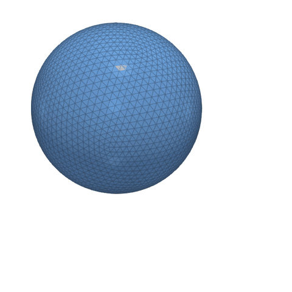
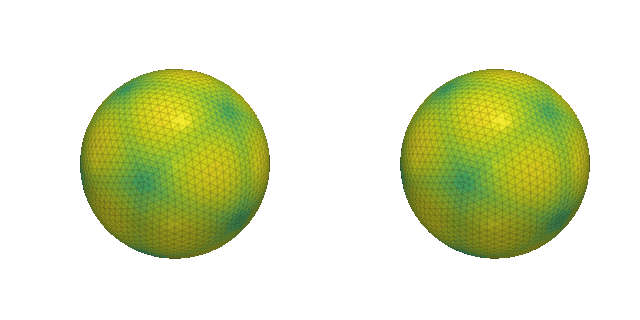
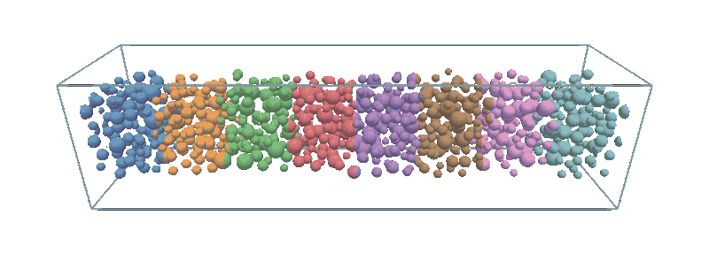
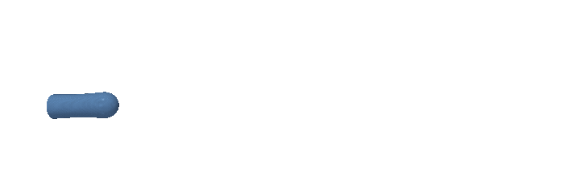
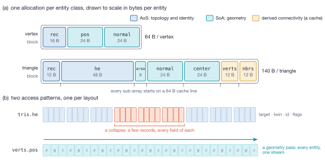

# MFTL — MultiFlow Triangulation Library

[](https://github.com/Chris-Gorges/MFTL2/actions/workflows/release.yml)
[](https://github.com/Chris-Gorges/MFTL2/actions/workflows/debug.yml)
[](https://github.com/Chris-Gorges/MFTL2/actions/workflows/warnings.yml)
[](https://github.com/Chris-Gorges/MFTL2/actions/workflows/format.yml)
[](https://github.com/Chris-Gorges/MFTL2/actions/workflows/consumers.yml)
[](https://chris-gorges.github.io/MFTL2/)
[](https://github.com/Chris-Gorges/MFTL2/actions/workflows/codeql.yml)
[](https://codecov.io/gh/Chris-Gorges/MFTL2)
[](LICENSE)


A C11/MPI library for the distributed-memory manipulation of closed and open triangulated surface meshes, for
front-tracking and immersed-boundary CFD simulations.

**[Manual](https://chris-gorges.github.io/MFTL2/)** — guides, the theory of every module, the API reference and the
Doxygen manual with call graphs, rebuilt from `main` on every push.

<table>
  <tr>
    <td width="40%"></td>
    <td width="60%"></td>
  </tr>
  <tr>
    <td valign="top"><b>Distributed remeshing.</b> LeVeque's deformation test, face-on: a sphere is stretched into a thin
      spiral sheet and returns, remeshed every step on 4 MPI ranks (colour: owning rank, the 2&times;2 decomposition).
      After the full period the volume is off by 0.08 %, the worst triangle quality is 0.83, no triangle is inverted.</td>
    <td valign="top"><b>Curvature-adaptive sizing.</b> The same run with uniform (left) and curvature-adaptive sizing
      (right), coloured by triangle area (dark: small). Refining where the sheet bends keeps the volume error at 0.08 %
      instead of 1.42 %, with up to twice the triangles.</td>
  </tr>
  <tr>
    <td colspan="2">
      </td>
  </tr>
  <tr>
    <td colspan="2" valign="top"><b>Many bodies</b> (left). 800 droplets of random size carried through a periodic duct by a
      swirling flow, remeshed every step and redistributed across 8 ranks as they move (colour: owning rank): 1.0 &rarr; 1.7 M
      triangles, volume +0.3 % over one pass, about 0.36 s per step on a laptop. <b>Topology change</b> (right). A jet
      grows through a nozzle; its necks pinch off and every drop becomes a closed body of its own (blue: the jet), on 4
      ranks. Both flows are prescribed velocity fields, not flow solutions.</td>
  </tr>
</table>

> **Status:** under active development (2.0.0-alpha). Everything listed below is implemented and tested; the API can
> still change between releases.

## Highlights

- **Distributed remeshing that reproduces the serial answer.** Isotropic or curvature-adaptive remeshing (split,
  collapse, flip, tangential smoothing, Phong projection) runs serially or distributed, by one of two strategies
  chosen per call from the body sizes: bodies smaller than a rank's box are moved to one rank and remeshed there,
  **bit-identical to the serial remesh** at every tested rank count; larger bodies are remeshed in place while the cut
  planes move over a shift/freeze schedule.
- **Breakup and coalescence that do not depend on the process count.** Events are detected from opposing triangles,
  the affected bodies are reconstructed by marching cubes on a union signed-distance field, and the surface agrees
  with the single-rank reconstruction to 1e-12 at 1 to 27 ranks.
- **Exact contact detection.** An LBVH over Morton codes with an explicit-stack dual traversal, Shewchuk's adaptive
  orientation predicate and an exact Guigue–Devillers triangle test, behind a broad phase derived from body extents
  rather than all pairs, and a spatial halo that finds contacts across ranks and periodic seams.
- **Coupling to a flow solver.** Interpolation from, and spreading onto (its exact transpose), a solver's lattice or
  point cloud with Peskin-type kernels corrected to linear exactness. Coverage is proved by counting indices, never
  assumed; a missing sample is reported, not renormalised away.
- **Communication that scales with what a rank holds.** Per-body reductions and prefix sums go to each body's
  holders over a 26-neighbour graph communicator, certified after the exchange, with an exact global fallback.
- **Tests that check the answer.** 150 CTest entries at 1, 2, 3, 4, 8 and 27 ranks. Distributed results are compared
  with the same call on one rank, contact queries as multisets against an exhaustive sweep, coupling rows against
  brute-force references written without the library's machinery; several suites were mutation-checked.

## Performance

The per-timestep loop of a front-tracking solver — move the owned vertices, synchronise the ghosts, recompute the
geometry, redistribute, vertex normals — for droplets of 1280 triangles each in a periodic box, measured on an HPC
cluster with 36 cores per node ([`scaling/`](scaling/README.md)):

| | Problem | 36 → 288 ranks (1 → 8 nodes) |
|---|---|---|
| Weak scaling | 1 000 droplets (1.28 M triangles) per rank, up to 288 000 droplets and 369 M triangles | 90 % efficiency; 162 ms per step at 288 ranks |
| Strong scaling | 110 592 droplets, 142 M triangles | 6.6× faster (82 % efficiency); 393 → 60 ms per step |

Remeshing and topology changes are not part of these numbers; the remeshing sweeps in `scaling/` measure them.

## The idea

A surface mesh is two different things that want opposite memory layouts, so MFTL stores each in the layout it
wants — and stores them in the **same allocation**, so they can never disagree about how many entities exist.



**Topology and identity are AoS** — a remesher edits one entity at a time and touches most of its record when it
does. **Geometry is SoA** — it is read and written by kernels that touch one component of every entity, every
timestep, which is the access pattern AoS is worst at. The same split is what makes the geometry arrays usable by an
accelerator as they are: positions and compact triangle indices are plain contiguous arrays with no repacking.

Three invariants fall out, and every module is allowed to assume them:

- **Half-edge `3t+k` belongs to triangle `t`**, and `next(3t+k) == 3t+(k+1)%3`. So `he_idx`, `next_idx` and
  `triangle_idx` are not stored — they are arithmetic — and the half-edge array needs no capacity of its own.
- **Ownership is an array prefix**: `[0, n_local)` is owned, `[n_local, n)` are ghosts. No `is_ghost` field.
- **Positions live in the SoA and only there.** The space-filling-curve ordering is applied to the *pool*
  (`MFTLObjectReorderMorton`), not stored as a permutation, so there is exactly one index space.

Lookups are arrays, not hash maps: global IDs are dense per entity class, and "the other side of this edge" is
already an index.

## Quick start

```c
#include "mftl_core.h"

MPI_Init(&argc, &argv);
MFTLRegisterMpiTypes();                       // the wire datatypes every exchange uses

int    cuts[3] = {1, 1, 1};                // one rank; the product must equal the rank count
double lo[3]   = {-2, -2, -2}, hi[3] = {2, 2, 2};
bool   per[3]  = {false, false, false};

MFTL_Ensemble *ens = MFTLEnsembleCreate(MPI_COMM_WORLD, cuts, lo, hi, per, 10);

MFTL_Object *obj = MFTLObjectCreate(1);
MFTLEnsembleAddObject(ens, obj);              // links it to the domain; ensemble now owns it

double centre[3] = {0, 0, 0};
MFTLGenerateSphere(obj, centre, 1.0, 5);      // collective
MFTLObjectReorderMorton(obj);                 // local: spatial renumbering
MFTLEnsembleUpdate(ens);                      // collective: geometry + quality, one pass
MFTLEnsembleUpdateVertexNormals(ens, MFTL_NORMAL_WEIGHT_AREA);  // collective: normals + one ghost exchange

printf("mean-ratio quality: %f\n", obj->quality.avg_aspect_ratio);

MFTLWriteVtu(ens, "surface", MFTL_NULL);      // collective: raw-binary .vtu per rank + .pvtu

MFTLEnsembleDestroy(&ens);                    // cascades to every object
MFTLFreeMpiTypes();
MPI_Finalize();
```

A redistribution (`MFTLRedistribute`) re-partitions the bodies and may destroy a rank's copy of one, so an
`MFTL_Object*` does not survive it: the handle that does is the body's global id
(`MFTLEnsembleFindLocalObject`). [`tests/consumer/main.c`](tests/consumer/main.c) is a complete distributed program.

## Configuring a run

Every runtime option — domain and decomposition, remeshing, topology changes, contact, output — lives in one struct,
`MFTL_Settings`, filled from one settings file per simulation (a subset of TOML) and `section.key=value` overrides
on the command line. Each section embeds the parameter block its module already takes, so a call passes
`&cfg.remesh.params` or `&cfg.output.vtk`; no module reads the settings behind its caller's back.

```toml
# run.toml
[remesh]
every             = 1
target_length     = 0.0        # 0: hold the mesh's starting resolution
parallel_strategy = "auto"

[topology]
every = 5
```

```c
MFTL_Settings cfg;
MFTLSettingsDefaults(&cfg);
MFTLSettingsLoad(&cfg, "run.toml", MPI_COMM_WORLD);       // rank 0 reads, every rank parses the same text
MFTLSettingsLoadArgs(&cfg, argc, argv, MPI_COMM_WORLD);   // remesh.every=2 on the command line
MFTL_Ensemble *ens = MFTLSettingsCreateEnsemble(&cfg, MPI_COMM_WORLD);
/* ... create the bodies ... */
MFTLSettingsResolve(&cfg, ens);                           // lengths left at 0, measured from the mesh
MFTLRemeshEnsemble(ens, &cfg.remesh.params, &stats);
```

A misspelled key, a wrong type or a value out of range is an error naming the file, the line and the key that was
probably meant. `mftl_settings template` prints every key with its documentation; `mftl_settings check run.toml
--np 64` validates a file before a job is queued. Every key, default and admissible value comes from the one table
that declares them (`src/settings/settings_keys.c`).

## Hot loops

A hot loop streams compact triangle indices, gathers current positions and forms minimum-image edges in registers:

```c
MFTL_FOREACH_TRIANGLE_GEOMETRY(obj, obj->tris.n_local,
    const double nx = e1y * e2z - e1z * e2y;
    const double ny = e1z * e2x - e1x * e2z;
    const double nz = e1x * e2y - e1y * e2x;
    total_area += 0.5 * sqrt(nx*nx + ny*ny + nz*nz);
);
```

The macro unswitches periodicity outside the triangle loop, so the body receives seam-consistent edge vectors
without managing derived position state.

## Build and test

Requires CMake ≥ 3.13, an MPI-3 implementation (used with Open MPI, MPICH and MVAPICH2) and a C11 compiler. CI builds
with GCC and Clang on Linux; development is on macOS.

```bash
cmake -S . -B build -DCMAKE_BUILD_TYPE=Release
cmake --build build -j
ctest --test-dir build --output-on-failure -j 8 -LE np27
```

`python3 build_all.py` does the same in a fresh `build/` (`--debug` adds AddressSanitizer and
UndefinedBehaviorSanitizer, `--valgrind` a Debug build without them, `--lib-only` skips the examples), and
`python3 run_local_tests.py` builds and runs the whole suite.

Every test carries labels, so a subset is one flag away: `serial`, `mpi`, `np<N>` for the rank count, `example`
for the physical runs of the example programs, `oversub` and `np27` for runs with more ranks than a laptop has
cores, and `long`. MPI tests declare their rank count to CTest, so `ctest -j N` schedules ranks rather than tests.
The full Release suite takes about 45 s with `-j 8` on an Apple M4 laptop.

Some of the examples, each of which checks its own answer before it reports anything:

```bash
# a solver-shaped run configured entirely by a settings file, plus command-line overrides
mpirun -n 4 ./build/settings_driven_run examples/settings/settings_driven_run.toml remesh.every=2 --steps 50

# the whole timestep, distributed: advection, ghost sync, geometry, redistribution
mpirun -n 4 ./build/parallel_advection_redistribute_list 2 2 1 1 1 1 --spheres 256 --refine 3 --verify

# distributed remeshing over the LeVeque test: does it track the serial answer
mpirun -n 4 ./build/leveque_remeshing_parallel

# open surfaces with breakup and coalescence
mpirun -n 4 ./build/liquid_jet_open_surface 2 2 1 --sectors 24 --length 24 --eps 0.1 --weber 2 --require-breakup
mpirun -n 4 ./build/rayleigh_taylor_open_surface --roll 1.7 --growth 1.4 --require-topology

# interface advected by a solver's velocity field through the coupler
mpirun -n 2 ./build/leveque_coupled_cartesian -n 16,32 -steps 75 -verify
```

`scaling/` holds the strong- and weak-scaling drivers and the Slurm scripts used on an HPC cluster.

## Using MFTL in your project

As an installed CMake package:

```bash
cmake --install build --prefix $HOME/opt/mftl
```

```cmake
find_package(MFTL 2.0 REQUIRED)               # configure with -DCMAKE_PREFIX_PATH=$HOME/opt/mftl
target_link_libraries(solver PRIVATE MFTL::MFTL)
```

or from a source checkout, which builds only the library:

```cmake
add_subdirectory(external/MFTL2)
target_link_libraries(solver PRIVATE MFTL::MFTL)
```

MPI comes with the target as a usage requirement. The headers are valid C++ with C linkage, so a C++ solver
includes them directly (the `MFTL_FOREACH_*` loop macros are C-only). Both routes, from C and from C++, are built
and run in CI by [`tests/consumer`](tests/consumer).

## Output

```c
MFTL_VtkOptions o = MFTLVtkDefaults();   // raw binary, one .vtu per rank + .pvtu, owned entities only
o.layout = MFTL_IO_SINGLE_FILE;          // ... or ONE .vtu, written collectively with MPI-IO
MFTLWriteVtu(ens, "surface", &o);
```

Triangles that straddle a periodic face are unwrapped at write time, so they render at their true size without the
mesh in memory being touched. Only owned entities are written, so the merged dataset contains every triangle exactly
once and an integral computed over it in ParaView is right. Raw binary is 23–32× faster to write than ASCII and
about half the size.

## Documentation

Every public function is documented in its header (`include/`), and each module has a theory chapter next to its code:

| Module | Chapter |
|---|---|
| Mesh container: pools, layout, derived arrays | [`src/object`](src/object/README.md) |
| Half-edge connectivity | [`src/topology`](src/topology/README.md) |
| Periodic-aware geometry, closest point, signed distance, least squares | [`src/geometry`](src/geometry/README.md) |
| Ensemble handle and per-body collectives | [`src/ensemble`](src/ensemble/README.md) |
| Mesh construction: icosphere, marching cubes | [`src/mesh_creation`](src/mesh_creation/README.md) |
| Redistribution, ghost synchronisation, spatial halo | [`src/communication`](src/communication/README.md) |
| Isotropic and curvature-adaptive remeshing, serial and distributed | [`src/remeshing`](src/remeshing/README.md) |
| Breakup and coalescence | [`src/topology_change`](src/topology_change/README.md) |
| Front corrections: undulation removal, volume correction | [`src/correction`](src/correction/README.md) |
| LBVH and contact detection | [`src/bvh`](src/bvh/README.md) |
| Coupling to a flow solver | [`src/coupling`](src/coupling/README.md) |
| Run configuration | [`src/settings`](src/settings/README.md) |
| Mesh output | [`src/io`](src/io/README.md) |
| Sorting and duplicate removal | [`src/arrayfunctions`](src/arrayfunctions/README.md) |

The **[online manual](https://chris-gorges.github.io/MFTL2/)** renders all of it — guides, these chapters with their
figures, the API reference and the Doxygen manual with call and include graphs. The `Docs` workflow builds it from
this repository and [MFTL2_Documentation](https://github.com/Chris-Gorges/MFTL2_Documentation) with `--strict`, so an
undocumented parameter or a dead link fails the build, and publishes it from `main`. Source comments that cite
`docs/analysis.md §N` refer to the project's measurement record, which is not public yet.

## Status and roadmap

Present: everything in the module table above. Absent: open-surface generators other than a level set
(`MFTLBuildMeshFromLevelSet`), a mesh reader of any format, topological ghost-layer growth, and continuous-time
(swept) contact or topology detection.

Next: GPU offload of the per-timestep geometry kernels, for which the SoA layout is designed; measurement of the
distributed remesher at hundreds of ranks; a local (rather than global) volume correction.

## Contributing

See [CONTRIBUTING.md](CONTRIBUTING.md).

## Citing

If you use MFTL in your work, please cite it — GitHub's "Cite this repository" button reads
[CITATION.cff](CITATION.cff).

## License

Copyright 2025–2026 Christian Gorges and Berend van Wachem. Licensed under the [Apache License 2.0](LICENSE);
see [NOTICE](NOTICE) for third-party attributions.
