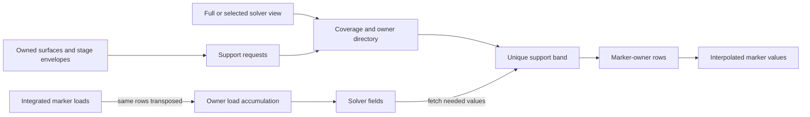

# 06 — Solver-independent coupling between fluid DOFs and surface ensembles

Status: C1 and C2 IMPLEMENTED (2026-10-07, branch `christian`; what is and is not built, and what was
measured, is in `src/coupling/README.md`); C3 and C4 planned. Revision 4, critical architecture review, 2026-10-06.
Depends on: nothing for the raw-array C1 API. `04-attached-fields.md` supplies optional field storage;
`05-curvature-and-surface-tension.md` supplies integrated surface forces.
Used by: `07` (point queries, indicator, surface sizing), `08` (IBM, bindings), `09` (surface sources).

This is an implementation plan, not a claim that the coupler or its performance measurements already exist.
Revision 4 replaces the earlier normative design; the review findings below record why.

| Milestone | Independently testable delivery |
|---|---|
| C1 | Uniform/rectilinear collocated and staggered blocks; full and selected inputs with coverage validation; Peskin and kernel table; vertex, centroid and user markers; strict adjoint transfer; private sparse MPI schedules; direct reads plus forward/reverse supplemental exchange; checked stage binds and versioned field fetches |
| C2 | Unstructured samples, general anisotropic metrics, composite AMR constraints, adaptive surface quadrature, incremental selection/grid updates, local stages within prepared motion windows and adaptive sizing |
| C3 | Directional reconstruction with declared reproduction order; imported solver-native rows; distinct gradient operators; deterministic point-query merge for 07 |
| C4 | Optional framework adapters outside `libMFTL`; Fortran forms with 08 E4; integrated solver demonstrations |

The input/coverage, identity, boundary, lifecycle and transpose contracts below belong to C1 even when a
particular descriptor or numerical operator first ships in C2/C3.

## 0. Review findings and decisions

The earlier plan had the right core: a single interpolation operator and its transpose, structured fast paths,
marker-owner assembly, sparse discovery, cached band values and split-phase calls. It was not yet sufficient
for arbitrary supplied subsets, general discretizations, or a claim of optimal MPI scaling.

| Earlier assertion or omission | Revision 4 decision |
|---|---|
| An arbitrary point cloud is enough for any solver | Point samples support regularized transfer. Modal FE/DG coefficients, flux integrals, constraints and consistent mass matrices need explicit interpretation or native operator rows (§1, §2.1, §2.10) |
| Passing all DOFs versus a selected band was implicit | Make selection independent of the underlying mesh; require complete support and expose request/fulfil/validate (§2.6, §4.5–4.8) |
| A solvable moment matrix implies a usable stencil | Completeness and numerical quality are separate checks; a missing cell can leave a perfectly conditioned but wrong row (§2.2, §2.6) |
| Two solver ghost layers limit all kernels and marker types | Two layers suffice for one important uniform-grid case. Support is independent of solver ghosts; fetch missing values and return their transpose contributions (§2.5) |
| `ℓ ≤ h` guarantees nothing is lost; quadrature can be dropped | Retain a configurable sampling check, add quadrature and convergence tests; this inequality proves neither accuracy nor impermeability (§2.9) |
| Only 26 destinations and one-hop top-ups are needed | Enumerate every intersected rank box. Strong scaling, wide kernels and anisotropy can require more hops (§2.8, §4.5) |
| STATIC builds every schedule once | Only an unchanged full ownership directory is static; selections, support bands and field layouts can still change (§2.6–2.8) |
| LOCAL has zero communication; `Iallreduce` latency is hidden | LOCAL can have zero **value payload**, while checked binds still reduce and solver halos still communicate. Overlap must be measured (§2.8, §7) |
| Regular-row moment matrix is the identity | Its zeroth/first moments reproduce constants/coordinates; its second-moment block is generally not the identity (§2.2) |
| Singular rows silently become constant or empty | Fail by default, or grow support within a declared limit; lower order requires explicit consent and diagnostics (§2.2) |
| Directional constant reconstruction equals MAC rows and conserves torque | Use block operators and test their reproduction modes; linear/rigid-motion reproduction is needed for torque (§2.10) |
| Frozen-field RK4 is an accurate coupled fourth-order scheme | It is RK4 for the frozen autonomous field only. Time-dependent coupling needs matching stage fields/forces (§4.11) |
| Open MPI 5 reports the wrong MPI version | It intentionally reports complete MPI-3.1 support with selected MPI-4 features; probe specific capabilities (§2.8) |
| Dense offset arrays over rank boxes cost only O(band) | Use occupied sorted bricks/bins; dense indexing is optional only with an explicit memory bound (§4.7) |

No numerical or transport backend is declared universally optimal. Correctness contracts are fixed;
backend defaults are selected by the gates in §6–§7.

## 1. Purpose and solver contract

Interpolation supplies marker velocities or other sampled fields. Spreading returns integrated marker loads
or sources to the solver. MFTL assembles one operator per binding and applies its exact algebraic transpose.
The solver retains its own fluid equations, time integration, boundary enforcement and mesh storage.

**The solver does not send its entire mesh to every surface rank.** It registers descriptors or array views
on the ranks that own them. Only the support band needed by surface ranks is communicated. Both of these
registration styles are first-class:

- **FULL:** expose every active owned DOF, usually through compact structured patch descriptors or borrowed
  point arrays. The coupler requests and transfers only the required band.
- **SELECTED:** expose only active owned DOFs in a conservative interface band, with explicit coverage
  metadata. The same operator and transfer routines operate on this view. Changing the selection does not
  imply that the fluid mesh changed.

Prefer FULL compact descriptors for a static structured mesh: registering its bounds is cheap and avoids
application-side selection work. SELECTED is useful when a full unstructured registry/search index is large
or the solver already maintains interface-local cells. Compare total export/index/rebuild costs, since
repeatedly constructing a selected cloud can cost more than retaining a full local index. Neither mode
requires communicating far-field values. The generic kernel backend needs sample metadata rather than full
cell connectivity; cell bounds/constraints/native basis information are additional capabilities when needed.

The solver must supply, per location:

- The meaning of a value: point sample, component velocity, normal velocity, or native coefficient.
- Positions/structured coordinates; positive sampling measures for kernel quadrature; and, where density
  output is requested, the appropriate positive dual volumes or lumped mass weights.
- A resolution field and a bounded support metric (§2.3); the smallest cell edge alone is insufficient for
  a highly anisotropic stencil.
- Unique DOF identity, ownership and active status; array indexing; periodicity and boundary classification.
- For SELECTED input, regions in which **all active DOFs of that location** have been supplied, plus the
  grid and selection versions to which that assertion applies.
- For native FE/DG, constrained AMR or physical-boundary ghosts, the relevant linear maps and their
  transposes, represented as descriptors/rows or applied explicitly by the solver at the API boundary.

| Solver/discretization | Representation and limits |
|---|---|
| Cartesian FD/FV, MAC, lattice Boltzmann | Uniform blocks and location offsets; factored tensor rows where certified |
| Stretched Cartesian meshes | Rectilinear blocks, physical measures and corrected rows; support from coordinate tables |
| Spectral slabs or pencils | Structured rectangular blocks; partition overlap decides the communication route. Pencils are boxes, and do not imply one fixed route |
| Block/octree AMR | Active leaf cells/DOFs, coverage regions and coarse/fine constraints; no double-counted covered DOFs |
| Unstructured FV or nodal FE | Point samples with measures and support metric; kernel transfer is a smoothing approximation |
| Face-normal velocities or fluxes | Directional block reconstruction; integrated fluxes include face-area scaling in the operator |
| DG/high-order/modal FE | Sample/reconstruction map with transpose, or imported native rows. Treating modal coefficients as point values is invalid |
| Moving meshes/particles | Geometry versions and motion envelopes, separately from ownership and selection changes |

No framework dependency enters `libMFTL`. Bulk request/response and optional imported rows avoid per-DOF
solver callbacks. A bridge lattice remains possible through an adapter, but the entire chain must preserve
adjointness: composing interpolations requires composing their transposes in reverse order.

The initial implementation uses the same MPI process group as the ensemble, allowing different rank order
and ranks with no surface or no fluid DOFs. One ensemble contains many bodies and all share each exchange.
Independent ensembles can use separate couplers with private contexts; sharing their grid directory is an
optional optimization. Disjoint solver/surface communicators need an explicit union-communicator design (§8).

## 2. Numerical and distributed invariants

### 2.1 The complete operator, units and conservation

Let `J` map solver unknowns `u` to marker velocities `U`. For ordinary scalar/component point samples,
`J = W`. Let `F` be **integrated marker forces**, including surface quadrature exactly once:

```
U = J u
b = Jᵀ F                         integrated Eulerian load
f = D_E⁻¹ b                      density, only for a declared diagonal positive D_E
uᵀ b = Uᵀ F = uᵀ D_E f           discrete power identity
```

For a surface force density `g`, `F = Q_S g`, where `Q_S` contains the marker area weights. Integrated input
must not be multiplied by area again. Scalar mass/heat exchange uses the same weighted-duality convention.
A physical force is not an acceleration: the solver applies density/inertia and its timestep operator.
A consistent FE mass matrix `M_E` requires the solver to solve `M_E f = b`; division by supplied point
volumes does not implement that solve. Sampling measure and inertial mass are distinct metadata.

For unconstrained scalar/component samples:

- `Σ_j W_ij = 1` implies total integrated force conservation.
- `Σ_j W_ij (X_j − x_i) = 0` implies torque conservation, with coordinates in one consistent image frame.
- Each MAC component satisfies these tests on its own location. Use vector work/rigid-motion tests for
  directional or native coefficients; blindly summing coefficient loads is not a physical force.

If stored samples are reconstructed as `u_samples = P u_free + u_bc`, the actual interpolation is
`U = W P u_free + W u_bc`. Spread `b_free = Pᵀ Wᵀ F`. Prescribed boundary values contribute boundary work
`Fᵀ W u_bc`; retain the associated wall reaction. Physical ghosts with mirrored/Dirichlet values cannot be
reverse-added as if they were independent owned fluid cells. The same rule covers hanging nodes, AMR ghost
prolongation and sampling an FE polynomial at quadrature points.

The same binding, constraints, periodic images and weights must be used in both directions. Reassembling a
second approximately equal matrix for spreading is insufficient. The power identity is a spatial transfer
property, not a proof of stability, energy conservation of the time integrator, incompressibility or absence
of parasitic currents.

### 2.2 Kernels, moments and strict row quality

Peskin-4 is the default on uniform Cartesian sample locations. Other tensor or radial kernels declare their
support, smoothness and reproduction properties. Moment correction applies to irregular stencils and to
regular stencils whose base kernel does not meet the requested reproduction order.

For positive base measures `ψ_ij`, dimensionless coordinates `d_ij = H_i⁻¹(X_j − x_i)` and
`p(d) = [1, d_x, d_y, d_z]ᵀ`:

```
M_i = Σ_j ψ_ij p(d_ij) p(d_ij)ᵀ
M_i c_i = e_0
W_ij = ψ_ij p(d_ij)ᵀ c_i
```

Use a scaled solve, not an explicitly formed inverse. On a complete uniform lattice a kernel that already
has zeroth/first moments needs no correction: `M_i e_0 = e_0`. **This does not say `M_i = I`.** A correction
claim is checked against the requested physical moments, including at stretched axes and AMR interfaces.

Separate four results for every row: support completeness, numerical rank/condition, achieved moment
residuals and weight amplification (`Σ|W|`, negative mass, maximum weight). A count of neighbours or a
successful Cholesky pivot does not establish all four. Use scaled QR/rank-revealing solves for difficult
rows; Cholesky is an optimized path only with a conditioning check and residual verification. Thresholds
are dimensionless, with documented defaults and conditioning-aware error bounds.

| Policy | Required behavior |
|---|---|
| LINEAR, default | Reproduce constants and linear fields; negative weights are possible |
| CONSTANT | Normalize positive base weights; preserves constants and positivity, with reduced accuracy/torque guarantees |
| NONE | Preserve the declared base kernel; report which moments it actually has |
| Failure, default ERROR | Return a collective quality/coverage error with offending marker/location, no output modification |
| Optional GROW | Retry within a declared maximum support envelope; request missing coverage before solving |
| Optional ALLOW_LOWER_ORDER | Explicit application choice; expose achieved order per row and counters |

Never silently create an empty or constant row when LINEAR was requested. Positivity and linear precision
cannot both be guaranteed outside the convex hull of available sample positions. Walls and narrow gaps
therefore need an explicit physical boundary policy or an acknowledged loss of one property.

### 2.3 Support geometry and row representation

- Uniform blocks use index arithmetic and factored tensor rows: base index plus per-axis weights. Record
  actual padded storage in benchmarks instead of fixing an ABI-sized byte count in advance.
- A general row uses CSR/block-CSR indexed into the local/remote band. Mixed blocks can still use a factored
  row when coordinates, measures and full tensor support are demonstrably regular across their boundary.
- Define physical base weights, for a tensor example,
  `ψ_ij = q_j / det(H_i) · Π_k φ((H_i⁻¹(x_i − X_j))_k)`, with sampling measure `q_j`.
  A radial kernel replaces the product by its radial function. Kernel shape, metric and measure must have
  consistent normalization; the complete uniform case reduces to the standard product of 1-D weights.
- On rectilinear blocks, physical-space kernels with local metric are the baseline. Index-space kernels
  are an optional separately tested policy; multiplying by physical volumes generally changes their
  partition of unity, so it cannot be asserted from index-space partition of unity alone.
- Keep **resolution for surface sizing** separate from **support width**. An isotropic radius of twice the
  shortest edge can miss entire directions on elongated cells. Supply per-axis widths or an SPD metric,
  plus conservative regional bounds for discovery; use bounded support growth when rank is inadequate.
- Scale selection cannot depend solely on whatever points happened to arrive. Use complete coordinate
  metadata, a solver-supplied bounded resolution/metric field, or a complete pilot neighbourhood followed
  by a second support request. Any smoothing of this field needs its own coverage envelope.
- A containing-block spacing jumps at refinement boundaries. Do not claim automatic smoothness in marker
  position there. Choose/document smoothing or accept jumps and test trajectories across them.
- Bin/LBVH choice depends on local scale ratio. Sorted multilevel bins or an LBVH avoid querying coarse-sized
  bins full of tiny cells. Fixed bins are a fast path for bounded scale variation.

### 2.4 Where rows live and how DOFs reach them

Rows normally live with owned markers on MFTL's canonical partition. This brings the complete stencil to one
rank, makes corrected reconstruction local and reuses each fetched DOF among many nearby markers. It is a
baseline to benchmark, not a proof that sending markers to fluid owners is always worse.

Each binding/location partitions row entries into disjoint routes:

1. **SELF:** an owned DOF on this process, read directly and accumulated once.
2. **SOLVER_HALO:** a certified current ghost sample; spreading uses the solver's declared transpose halo map.
3. **REMOTE:** fetch from the unique owner and return contributions through the reverse schedule.

A hybrid is normal. One unsupported location or one distant DOF must not force every field to abandon direct
reads. Diagnostic regime names are summaries:

| Regime | Certified meaning |
|---|---|
| LOCAL | Every required sample is accessible directly, including usable solver ghosts; zero coupler value payload for this binding |
| NEIGHBOUR | Additional exchanges involve only actual neighbours in MFTL's graph |
| GENERAL | Additional partners discovered by geometry; no fixed bound on degree |

Use the same ownership resolution for every route and deduplicate overlap. Multiple replicas/periodic aliases
may supply reads, but each algebraic DOF receives each transposed contribution exactly once. Supplemental
forward **and reverse** exchange ships in C1. A solver without reverse ghost accumulation can use direct ghost
reads while the coupler sends their loads to the true owners.

### 2.5 Two ghost layers are an optimization, not an API restriction

On a uniform lattice Peskin-4 has half-support `2h`. For markers inside an aligned ownership box, two solver
ghost layers suffice for cell-centred and ordinary staggered locations, with nonzero weights selected using
the location offset. Test both box faces and one-ulp perturbations. This statement assumes complete corner
halos, correct face ownership, and valid physical/periodic boundary treatment; an allocated array is not a
certificate of valid values.

A displaced stage marker, quadrature marker, wider kernel, stretched grid or growing support may need more.
The coupler fetches the difference between required support and available certified samples. The solver may
provide zero, one, two or more ghost layers; none is mandatory. Wider support does not require modifying the
solver's own halo. All returned loads use the complete transpose, including supplemental entries.

A one-cell motion allowance is a useful default **when a bound on every stage displacement establishes it**.
`CFL < 1` alone does not prove that bound for arbitrary RK coefficients, interpolated overshoot, variable
resolution, moving fluid points or topology changes. Check actual support containment or obtain a valid
motion envelope; an exceeded allowance triggers a request/rebuild before transfer. No index clamping may
silently discard a nonzero kernel weight.

### 2.6 Full mesh and selected band: a coverage contract

The numerical requirement is the same for FULL and SELECTED input. For every bound marker `i`, location `l`
and stage in a prepared window, every active DOF whose kernel is nonzero must be available exactly once,
after applying the chosen physical-boundary and AMR policies. Coverage includes any neighbourhood used to
choose the metric, grow the support, reconstruct samples or evaluate a sizing query.

Let `S_il(t)` be that physical support. The provider must cover the union of `S_il(t)` over the requested
markers, locations and times. Requests use conservative boxes/tiles enclosing this union, not merely a list
of cells currently cut by the surface. For an old interface band a sufficient *physical distance* allowance
has the form

```
R_export ≥ R_kernel,max + D_marker,max + D_fluid,max + R_growth + E_interface
```

where the motion bounds apply through the next export (including all stages/subcycles), growth is additional
allowed support, and `E_interface` bounds error in the seed interface. Select cell/patch bounding boxes that
intersect this region, or add the centre-to-cell extent if selection tests cell centres. Include metric-query
support and all requested locations; add quadrature/element reach only when the seed represents vertices
rather than the entire triangles. Use Minkowski sums/anisotropic extents in the actual implementation.
Do not double-count allowances already included in `R_kernel,max`.

**Using the previous indicator is reasonable for prediction, with these conditions:**

- Dilate the detected interface band by the above bounds, over enough cell/rank layers for the local mesh.
  A fractional-cell indicator alone can miss small bodies or a surface aligned exactly with cell faces;
  combine phase-neighbour transitions, valid signed distance and current surface bounds.
- At startup, after topology change, prescribed motion or an invalidated motion/error bound, seed from current
  MFTL triangle/marker envelopes. The coupler can produce requests before any fluid values are registered.
- Check coverage against current geometry at every checked bind and before committing a prepared window.
  A missed interface must yield NEED_COVERAGE, never a renormalized incomplete row.
- Keep hysteresis: export a larger outer region and refresh when required support leaves its inner safe
  region. Indicator updates alone need not force a new grid ownership plan.

**Coverage metadata is essential.** For each location and grid version a provider states: these regions
contain the complete active sample set; these regions are outside the physical domain or governed by an
explicit boundary map; these other regions are unknown/unprovided. Unknown is never interpreted as a wall.
For structured patches validate expected index ranges and masks. For unstructured meshes the authoritative
solver must certify completeness using its cell/DOF registry and conservative spatial regions; MFTL cannot
infer that a withheld point exists from the received cloud. Debug validation compares with an independently
enumerated full input or expected region counts/IDs. Moment tests remain separate.

If coverage is missing, return NEED_COVERAGE on all participating ranks, plus local missing regions. The
application exports additional descriptors/samples and retries. FULL can fulfil internally from its registry;
SELECTED uses this explicit bulk protocol with no callback. `required`, `exported` and `currently used` masks
are distinct. A mask of yesterday's fetched cells cannot discover a new interface outside that mask.

### 2.7 Independent versions and reusable motion windows

Track changes by effect, not just STATIC versus TRANSIENT:

| Version/change | Invalidate |
|---|---|
| Grid topology/active set | Affected IDs, coverage, search data, rows and schedules |
| Geometry/metric/measure | Affected coordinates, support bounds and rows; schedules only if reachable DOFs change |
| Ownership | Owner directory and affected routes/schedules |
| Selection/export | Coverage and affected band entries; unchanged ownership directory survives |
| Field layout | Pack/scatter addressing and dependent views; persistent staging addresses remain separate |
| Field values, stage time, halo fill | Fetched values only |
| Surface geometry | Rows and sampling checks |
| Surface topology, pool order, ownership | Marker lookup/order, rows and relevant windows |

Versions may differ between ranks. `UpdateGrid` is collective, but a rank with no local change passes an empty
update; a change on one rank must not require fabricating changes on every rank. Exchange versions only for
relevant providers and combine the need to rebuild at a defined synchronization point.

STATIC/TRANSIENT can remain hints for caching/transport policy. They do not change correctness or freeze an
active-band graph forever. Preserve stable IDs for retained DOFs across subset changes; provide explicit
old/new ownership for migrations. A full rebuild remains a supported fallback.

A Verlet-style window stores a union of reachable supports plus skin. It remains valid only while every
actual support is contained, all dependent versions match, and promised boundary/metric policies hold.
An eroded spatial bitmap is a fast certificate when erosion uses a conservative maximum support; variable
supports require exact containment or a conservative metric bound. Include incoming markers by sending their
motion envelopes to **all** possible destination boxes, not just one neighbour hop. Topology/remesh-created
markers must be checked again.

A band is typically proportional to surface area times support thickness, but can occupy the full domain
for many close interfaces, large kernels or very coarse meshes. Publish memory/replication statistics and
honour a workspace budget instead of promising it is never volumetric.

### 2.8 MPI architecture and scaling

All coupling MPI lives in `src/coupling/coupling_comm.c`, enforced by the existing confinement-test pattern.
Use private communicator contexts; never probe the solver's messages. `MPI_Comm_compare` and translation
of actual peer ranks support SIMILAR communicators. Cache rank translations by peer, and handle empty ranks,
self loops and aliased periodic neighbour offsets explicitly.

**Discovery is geometric and sparse.** Enumerate intersected Cartesian rank-coordinate ranges arithmetically,
then look up ranks. Never loop over all P boxes or assume only 26 offsets suffice. The existing graph is
usable only after testing that every required destination is a graph neighbour. Strong scaling can make one
kernel span multiple rank boxes even on a perfectly aligned grid. This applies to occupancy, requests,
replies, marker migration windows and supplemental layers. Periodic image shifts are metadata separate from
rank identity; one rank can own several relevant images.

For unknown incoming peers use NBX [R3]: issue nonblocking synchronous sends, keep probing/receiving and
testing sends, start `Ibarrier` only after local outgoing sends complete, and continue servicing receives
until termination. Complete received payloads before leaving the discovery phase. Zero-send ranks still
participate. Request/reply dependencies use separate completed phases; no reply may be generated after a
phase's termination test under an untracked protocol. Isolate phase tags and serialized instance operations.
NBX has a global termination cost and does not make discovery free of synchronization.

| Transport/functionality | Decision |
|---|---|
| Packed nonblocking point-to-point | Portable baseline; local request setup; arbitrary changing peer lists |
| Persistent point-to-point | Reuse fixed staging buffers/counts across windows; benchmark against ordinary `Isend/Irecv` |
| Neighbour collectives | Optional backend for stable certified graphs; use MPI's actual source/destination ordering |
| Persistent neighbour collectives | Enable by compile/link capability probe and runtime test; measure setup amortization |
| Graph creation | At stable graph epochs, never per field/stage. Changed graphs can use point-to-point without communicator churn |
| Split-phase Begin/End | Compute SELF/ready rows while remote values travel; expose progress/testing through the comm module |
| RMA accumulation | Not the baseline: reduction order is uncontrolled; reconsider only for a measured need |
| Large counts | Wide local indexing; `_c` when available, otherwise deterministic chunking below count/displacement limits |

Persistent requests bind buffer addresses/counts. Complete all operations before buffer growth, request
recreation, grid update or destruction; use stable coupler staging buffers even when solver field pointers
change. A signature includes ordered location/component maps, layout generation, direction and payload
type. Serialize operations per coupler in C1; multiple overlapping fields use explicit distinct requests.
Check `MPI_TAG_UB`; do not consume unbounded tags or communicator contexts.

Open MPI 5's MPI-3.1 version declaration is consistent with its partial MPI-4 support [R4]. Feature probes
check declarations and linking; CI exercises enabled paths. Nonblocking initiation permits overlap but does
not guarantee progress during arbitrary computation [R5]. Measure exposed wait time, optional periodic
`MPI_Test`, and MPI implementation/progress settings. No hidden requirement for `MPI_THREAD_MULTIPLE`.

**Synchronization policy:**

- Checked `Bind`/`BindStage` makes one collective status decision after local coverage and row-quality checks;
  rebuild/retry phases are explicit additional costs. Validate failures discovered while assembling rows
  before publishing a binding; a reduction started before those checks cannot include their outcome.
- A prepared window can avoid repeated discovery and stage value fetches. Advanced local stage binding
  (§4.8) can also reuse the solver's existing collective error decision; it must not silently enter a
  collective repair from one rank. The safe default keeps a checked bind per stage.
- Fixed-schedule interpolation/spreading needs no separate global reduction per field. Every participant
  follows the agreed call order, including ranks with no rows. This assumes a collectively validated
  readiness token for the entire batch (§4.9). Checked wrappers perform a preflight agreement per batch;
  prepared integrations can combine it with the solver's existing status decision. No rank may return a
  recoverable stale/view error while peers have already entered the value exchange. Configuration/signatures
  are also checked when creating a schedule. Debug checks can diagnose differing arguments, but cannot
  promise to detect a rank that never calls the API at all.
- LOCAL means zero additional value bytes when certified, not zero MPI in the complete timestep. Include
  the solver's forward/reverse halo cost and global decisions in performance comparisons.

Sort discovery records and band keys deterministically; accumulate reverse contributions in fixed source
rank and DOF order independent of arrival. Fixed process count, decomposition, compiler/math mode and route
should reproduce bitwise. Different routes/decompositions are compared to numerical tolerance; summation
order and solver-owned halo reductions can differ.

Do not add O(P) coupler arrays or global DOF gathers. The existing `MFTL_Domain.rank_map` already costs O(P)
per rank (`src/ensemble/ensemble.c`); report this inherited limitation separately rather than claiming total
library memory has no O(P) term. Dense graphs, concentrated surfaces and mismatched partitions can still
produce large partner degree or load imbalance. Measure max/mean work and compare marker-owner assembly
with moving marker requests to fluid owners if replication or imbalance dominates.

### 2.9 Surface resolution, quadrature and impermeability

`ℓ ≤ ratio·h`, default `ratio = 1`, remains a conservative **sampling policy for vertex/centroid lumping**.
It does not prove force accuracy, absence of leakage, translation invariance or volume conservation. Those
also depend on quadrature, kernel, fluid discretization, geometry and forcing/time integration [R1, R2, R6].
Allow an application-selected stricter ratio and separate REPORT/ERROR policies. A coarse structural mesh
with adequate element quadrature is a legitimate alternative to forced remeshing.

- Check owned triangles using minimum-image corners. Shared edges occur in two triangles; either report
  triangle-edge incidences or use a canonical owner/key when reporting a unique-edge count.
- On varying resolution, use a conservative minimum over the element/edge region relevant to coupling.
  A midpoint or Shepard average can miss a fine patch crossed by an edge. Provider resolution bounds
  cover these query regions even before a successful interpolation bind.
  An anisotropic sizing policy may instead bound `sqrt(eᵀ G_resolution e)` along the whole edge/element,
  using a supplied resolution metric; the scalar minimum is the conservative fallback. This avoids forcing
  tangential refinement solely because the fluid has a very small spacing in the surface-normal direction.
- Report worst edge/resolution ratio, quadrature spacing, aspect/area quality and offending body/entity.
  Interpolation-only queries can proceed under a different sampling policy from force spreading.
- Add adaptive triangle quadrature, chosen from physical element extent and local fluid metric. Structural
  vertices and integration points then have different jobs. Only owned elements produce quadrature loads;
  store deterministic `(body, element, quadrature-index)` identities and area weights.
- Keep element-to-quadrature maps and transpose reductions explicit. Interpolating at quadrature points,
  projecting to surface unknowns and spreading surface loads must be one composite adjoint pair with the
  chosen surface mass matrix. Do not average quadrature velocities onto vertices ad hoc.
- USER markers include stable identity, body association and caller-provided integrated weights; they also
  carry a declared sampling policy. Lack of triangle connectivity is not a claim of adequate resolution.

For example, with surface basis evaluation `B`, quadrature matrix `Q`, and a symmetric surface mass matrix
`M_S`, a projected velocity operator is `J_S = M_S⁻¹ Bᵀ Q W`. Its load operator for integrated surface
generalized forces `F_S` is exactly `J_Sᵀ F_S = Wᵀ Q B M_S⁻ᵀ F_S`. If instead the caller supplies surface
force coefficients `g_S` with `F_S = M_S g_S`, this becomes `Wᵀ Q B g_S`. A consistent mass solve and a
lumped approximation are different declared policies; each must use its own transpose. This makes the
quadrature path compatible with the integrated nodal forces from 05 without inventing an extra area factor.

The existing remesher's split threshold is `(4/3)L`. For a desired maximum edge `θ·ratio·h`, supply
`L = (3/4)θ·ratio·h`, with `θ < 1` as a motion/stretching margin. Until 07's variable sizing field lands,
a global minimum over the **surface's relevant regions** is a conservative fallback. Check/retry before
spreading; do not rely on a failing Bind to have produced new velocity values for advection.

### 2.10 Directional samples and native discretizations (C3)

For normal-velocity samples `q_j = n_jᵀ u(X_j)`, build a vector reconstruction from positive base weights.
For constant reproduction, `T = Σ ψ_j n_j n_jᵀ` and
`A_j = T⁻¹ ψ_j n_j`, so `U = Σ A_j q_j` and `b_j = A_jᵀ F`.
Use the transpose of the actual stored block even if a future reconstruction is nonsymmetric.

For linear reproduction, fit a 3-D affine vector field (12 coefficients), with the sample rows evaluating
`n_jᵀ(a + B d_j)`. Extract `a` at the marker and store its linear map from samples; spreading uses its exact
transpose. Require adequate geometric **and directional** rank. CONSTANT is an explicit lower-order mode;
LINEAR is the force/torque-capable target. Rigid translations and rotations give direct work-based tests of
force and torque. A generic fit over the union of MAC faces need not give the same weights as independent
scalar MAC kernels; exact equality is required only for an explicitly recognized component-wise fast path.

Face fluxes include their area/sign conversion in the sample map. General FE/DG adapters can instead import
rows keyed by independent global DOFs and marker IDs; declared reproduction modes and the adjoint tests
still apply. Native point-location/basis evaluation is solver work, outside the hot transfer loop. Native
rows may have nonlocal support; coverage and owner routing apply to their explicit column sets too.

### 2.11 Gradient operators and boundaries (C3)

Distinguish a **local polynomial gradient reconstruction** from the **derivative of interpolation**.
The slope coefficients of the weighted affine fit reproduce affine gradients, but generally are not
`∂W/∂x`. Differentiating corrected interpolation also differentiates `ψ`, `M⁻¹`, the basis and any varying
metric. Give the two operations different API names; validate the derivative by finite differences away
from support/metric discontinuities. Derivative transfer has its own transpose when used variationally.

Generic kernel interpolation of a discretely divergence-free velocity is not necessarily continuously
divergence-free [R6]. Divergence-preserving and pressure-gradient-compatible transfers are specialized
operator backends, not consequences of moment correction. Sharp-interface/cut-cell stresses, one-sided
traces and exact cell fractions need material labels, cell geometry and solver stencils. A smooth kernel
averages across a jump unless explicitly configured otherwise; never advertise it as an exact interface
stress or indicator reconstruction. Physical-wall correction needs the boundary work accounting in §2.1.

### 2.12 Identity, lifetime and surface mutation

Never retain an `MFTL_Object*`, pool address or slot across redistribution/remeshing. Keep stable ensemble
and grid handles, and resolve `(body, entity)` IDs when binding. Owned markers alone interpolate/spread;
ghost surface copies contribute to geometry construction only as defined by the marker rule.

Introduce a surface generation contract covering geometry writes, topology, ownership and pool reordering.
A single ensemble generation is adequate initially if every public mutator advances it and callers writing
raw positions explicitly mark them changed. Geometry checksums in Debug detect unannounced writes.
A redistribution epoch alone misses direct coordinate edits and Morton reordering. Temporary remeshing
partitions also need an explicit busy/canonical-state guard; changing an epoch only after the pass is too late.

A binding records marker order and surface/grid generations. A fetch records its band generation, ordered
field signature, field value/stage/halo token and layout. `InterpolateFetched` refuses incompatible tokens.
Borrowed descriptors and views stay valid through End and any fetch window; mutation is forbidden while
requests are active. Rebanding invalidates a fetch; the caller explicitly fetches again. Do not retain
arbitrary field pointers and silently refetch from them during a later bind.

## 3. Architecture decision

Separate three reusable objects conceptually, even if C1 stores them inside one opaque coupler:

1. **Grid/provider directory:** independent DOF identity, owner/geometry summaries and provider coverage.
   Shared by fields and reusable while topology/ownership stay fixed.
2. **Support window and transport schedule:** selected DOFs, their images and storage routes, fixed pack lists,
   stable staging buffers and forward/reverse schedules.
3. **Binding:** marker positions/weights, requested reproduction properties and stored interpolation rows.
   Geometry changes rebuild rows without necessarily rebuilding the window or fetching unchanged values.



The diagram describes a logical data path; SELF/valid halo entries can be read in place. Structured fast
paths remain arithmetic/factored; irregular paths use corrected sparse rows. The data-selection policy is
outside the operator. Kernels, constraints and route selection cannot silently alter the covered active set.

## 4. Design and public contracts

### 4.1 Vocabulary and descriptors

| Term | Meaning |
|---|---|
| Location | One physically defined sample/unknown family; named consistently across ranks, including empty ranks |
| Block | Owned structured index ranges plus coordinate/measure/layout metadata and optional valid-DOF masks |
| Point set | Owned samples with stable keys, coordinates, measures, support metadata and optional directions |
| Coverage region | A solver assertion of complete active samples within a region for one location/version |
| Ownership summary | Conservative spatial extent of the DOFs a provider can supply, including currently unexported DOFs |
| Window | Certified envelope of possible supports and the band data/schedules that service it |
| Binding | Ordered owned markers, operator rows and achieved numerical properties at one geometry/stage |
| Fetch | Versioned values for a particular window and field set |
| Supplemental exchange | Required remote entries absent from usable solver storage; works in both directions |

Composite mesh active sets need explicit masks/level or independent-DOF constraints. A global `Σ volume`
check cannot prove absence of gaps/overlap, fails for selected domains and is not even the right identity for
all face/FE locations. Check ownership keys, active masks and constraints; use volume sums only as optional
location-specific diagnostics. Keep co-located DG coefficients distinct. Deduplicate only algebraically
identical DOFs/replicas, not arbitrary equal coordinates.

DOF keys are 64-bit globally stable within `(grid, location)` or an equivalent collision-free structured
key `(patch, logical index, location)` with a documented patch lifetime. Require stable keys for incremental
updates; an epoch-local `(owner, local-index)` key is allowed only with complete invalidation on reorder.
Use wide local counts/offsets with overflow checks; do not make `int` array indices a hidden scalability cap.

Point arrays may be borrowed; coordinate tables may be copied. The descriptor states which, the valid
lifetime and memory space. C1 is host memory. Arbitrary nonnegative component/index strides and sparse
selection maps must work; force targets may use different base pointers from velocity inputs. Empty arrays
are legal. Invalid/duplicate ownership, nonfinite coordinates, nonpositive measures, singular metrics and
invalid normals produce a diagnostic before values are transferred.

### 4.2 API outline (`include/mftl_coupling.h`)

These are contract-level signatures; descriptor definitions below are requirements for the header, not an
ABI frozen before implementation. All calls document local versus collective scope. Status-returning
collective operations agree their status before any rank takes a different communication path.

```c
typedef struct MFTL_SolverGrid MFTL_SolverGrid;
typedef struct MFTL_Coupler MFTL_Coupler;
typedef struct MFTL_SupportRequest MFTL_SupportRequest;
typedef struct MFTL_CouplingWindow MFTL_CouplingWindow;
typedef struct MFTL_CouplingBinding MFTL_CouplingBinding;
typedef struct MFTL_CouplingFetch MFTL_CouplingFetch;
typedef struct MFTL_TransferReady MFTL_TransferReady;

typedef enum {
  MFTL_COUPLING_OK,
  MFTL_COUPLING_NEED_COVERAGE,
  MFTL_COUPLING_BAD_STENCIL,
  MFTL_COUPLING_BAD_SAMPLING,
  MFTL_COUPLING_STALE,
  MFTL_COUPLING_INVALID
} MFTL_CouplingStatus;

typedef enum { MFTL_GRID_FULL, MFTL_GRID_SELECTED } MFTL_GridExposure;
typedef enum { MFTL_SPREAD_INTEGRATED, MFTL_SPREAD_DENSITY } MFTL_SpreadForm;
typedef enum {
  MFTL_MARKERS_VERTICES, MFTL_MARKERS_CENTROIDS,
  MFTL_MARKERS_USER, MFTL_MARKERS_QUADRATURE
} MFTL_MarkerKind;

/* Local registration, same location definitions on all participating ranks. */
MFTL_SolverGrid *MFTLSolverGridCreate(MPI_Comm solver_comm);
int MFTLSolverGridAddLocation(MFTL_SolverGrid *, const MFTL_LocationDesc *);
int MFTLSolverGridAddUniformBlock(MFTL_SolverGrid *, const MFTL_UniformBlockDesc *);
int MFTLSolverGridAddRectilinearBlock(MFTL_SolverGrid *, const MFTL_RectilinearBlockDesc *);
int MFTLSolverGridAddPoints(MFTL_SolverGrid *, const MFTL_PointSetDesc *);
int MFTLSolverGridSetCoverage(MFTL_SolverGrid *, const MFTL_CoverageDesc *);
int MFTLSolverGridSetProviderRegions(MFTL_SolverGrid *, const MFTL_ProviderRegions *);
int MFTLSolverGridApplyDelta(MFTL_SolverGrid *, const MFTL_GridDelta *);
void MFTLSolverGridReset(MFTL_SolverGrid *); /* full replacement fallback */
void MFTLSolverGridDestroy(MFTL_SolverGrid **);

/* Collective on the shared process group. Create accepts an empty initial export;
   directory/request setup need not wait for fluid values or a first indicator. */
MFTL_Coupler *MFTLCouplerCreate(MFTL_Ensemble *, MFTL_SolverGrid *, const MFTL_CouplerParams *);
int MFTLCouplerUpdateGrid(MFTL_Coupler *, const MFTL_UpdateKinds *);
int MFTLCouplerRequestSupport(MFTL_Coupler *, const MFTL_MarkerSpec *,
                            const MFTL_WindowSpec *, MFTL_SupportRequest **);
/* Local views: spatial requests delivered to potential providers, and missing coverage. */
int MFTLCouplerGetRequests(const MFTL_SupportRequest *, MFTL_RequestView *);
int MFTLCouplerPrepareWindow(MFTL_Coupler *, const MFTL_SupportRequest *,
                           MFTL_CouplingWindow **);
int MFTLCouplerBind(MFTL_Coupler *, const MFTL_MarkerSpec *,
                   MFTL_CouplingWindow *, MFTL_CouplingBinding **);
int MFTLCouplerBindStage(MFTL_Coupler *, const MFTL_CouplingBinding *,
                        const MFTL_StageGeometry *, MFTL_CouplingBinding **);
/* C3: rows keyed by independent DOFs; collective validation uses the same identity,
   support/coverage and declared reproduction contracts as assembled rows. */
int MFTLCouplerImportRows(MFTL_Coupler *, const MFTL_MarkerSpec *,
                         MFTL_CouplingWindow *, const MFTL_NativeRows *,
                         MFTL_CouplingBinding **);

/* Batched transfer preflight: validates views, signatures and generations collectively.
   A prepared integration may supply a readiness token from an equivalent solver-wide
   agreement; checked wrappers perform this step automatically. */
int MFTLCouplerPrepareTransfer(MFTL_Coupler *, const MFTL_TransferSpec *,
                             MFTL_TransferReady **);

/* All ranks use the same ordered field/component signature. One active transfer per
   coupler initially. Binding/fetch handles are immutable until released. */
int MFTLCouplerFetchBegin(MFTL_Coupler *, const MFTL_CouplingWindow *,
                         const MFTL_TransferReady *, size_t nfields, const MFTL_SolverField *);
int MFTLCouplerFetchEnd(MFTL_Coupler *, MFTL_CouplingFetch **);
int MFTLCouplerInterpolateFetched(const MFTL_CouplingBinding *,
                                const MFTL_CouplingFetch *, MFTL_MarkerField *); /* local */
int MFTLCouplerSpreadBegin(MFTL_Coupler *, const MFTL_CouplingBinding *,
                          const MFTL_TransferReady *, const MFTL_MarkerField *, size_t nfields,
                          const MFTL_SolverField *);
int MFTLCouplerSpreadEnd(MFTL_Coupler *);
/* Blocking Fetch, Interpolate, Spread wrappers compose the same operations. */

int MFTLCouplerSurfaceSpacing(MFTL_Coupler *, const MFTL_MarkerSpec *, MFTL_SpacingResult *);
int MFTLCouplerBandMask(const MFTL_Coupler *, int location, uint64_t block,
                      MFTL_BandMaskKind, MFTL_MaskView *); /* required/exported/used */
int MFTLCouplerGetStats(const MFTL_Coupler *, MFTL_CouplerStats *); /* local */
int MFTLCouplerReduceStats(MFTL_Coupler *, MFTL_CouplerStats *);   /* explicit collective */
void MFTLCouplerDestroy(MFTL_Coupler **); /* collective, no active transfers */
/* Public Release calls for request/window/binding/fetch/readiness handles; no MPI in local releases. */
```

Required descriptor fields:

- `LocationDesc`: name, sample interpretation, physical component map, independent/constrained status,
  boundary policy, measure semantics, requested reproduction and gradient mode.
- Structured descriptors: stable patch key, owned/array bounds, origin/spacing/offset or rectilinear tables,
  measures, valid mask, levels/constraint references, ghost ownership and halo-map capability. Staggered
  face ownership is explicit; adjacent patches cannot both own their shared face.
- `PointSetDesc`: count, stable keys, owned positions, sampling measures, optional density weights,
  resolution/support metric, optional directions, active/material masks and local array index map.
- `CoverageDesc`: FULL/SELECTED, complete regions per location, physical-domain exclusions/boundaries,
  topology/selection/geometry versions and certification metadata. An empty covered region is distinct
  from missing coverage.
- `ProviderRegions`: conservative complete ownership extents for routing future requests, or explicit
  application-managed request routing (§4.5); independent of the currently exported subset.
- `GridDelta`: added/removed/updated keys, ownership moves, coverage and per-kind versions. C1 may apply a
  full replacement internally; C2 retains unaffected search data/schedules.
- `SolverField`: ordered location/component mappings, input/output array views and layout token, value
  version and stage time, halo-validity token, output INTEGRATED/DENSITY form. It specifies whether valid
  ghosts may be read and whether the solver or coupler completes the transpose halo operation.
- `MarkerSpec`/`MarkerField`: marker kind, surface generation, ordered location list (no 32-location mask
  limit), owned `(body, entity, quadrature)` keys and scatter map, values/components and INTEGRATED versus
  DENSITY input. Optional attached-field identifiers use the same ordering.
- `WindowSpec`: time interval, motion/metric/support-growth bounds, initial query envelopes and byte budget.
  `StageGeometry` supplies positions and any changed area/quadrature weights, not just an unversioned `x`.
- `TransferSpec`/`TransferReady`: operation direction, binding/window, ordered field views, output/load
  views, relevant generation/value/halo tokens and the agreed preflight status. Ready is invalidated by any
  change to these dependencies; it may cover a declared immutable batch, not arbitrary future calls.
- `CouplerParams`: kernel/table entry, support metric policy and maximum growth, reproduction/fallback and
  condition tolerances, surface sampling policy, skin, brick/search policy, transport hint, deterministic
  accumulation mode and memory budget. STATIC/TRANSIENT is a performance hint only.

Errors include offending stable IDs and a reason (unprovided region, physical truncation, bad rank,
amplification, stale token, inadequate sampling). No public spread/interpolation output changes on a
preflight/validation failure. Completed valid spreading is additive; document initialization and halo
completion obligations. MPI/process failure recovery is outside this transactional numerical contract.

### 4.3 Kernels (`coupling_kernels.c`)

Keep a single table for built-ins: Peskin-4, Roma-3, cosine-4, hat-2, cubic B-spline and radial Wendland C2.
The table declares support, moment order, sign and smoothness; tests verify applicable properties with
independent formulas and boundary cases. A cosine kernel cannot bypass a requested linear correction merely
because the grid is uniform. Wider kernels can be registered without changing solver ghosts; additional
built-in kernels may land later.

For tensor kernels evaluate all axis weights together, sharing algebraic work. Hoist built-in dispatch out
of marker loops. User kernels may use one stencil callback per axis/marker; no indirect call per DOF. Include
nonzero support enumeration and, where offered, derivatives in the kernel contract. Sampling 1024 shifts is
a useful test, not a proof of an arbitrary callback's declared support or smoothness; require declared
finite support and test endpoints/random shifts/known identities. Do not infer missing support by sampling.

Checks of support bounds, weights and dimensions are scale-relative. Kernel checksums/signatures are agreed
at creation; no per-step kernel validation. A kernel request is rejected for an invalid contract or exhausted
configured memory/support budget, never just because the solver has two ghost layers.

### 4.4 Marker construction and sampling checks (`coupling_markers.c`)

Gather owned vertices, owned triangle centroids or owned-element quadrature using current minimum-image
geometry, then wrap only for routing. Keep an unwrapped local frame for moments/torque. Vertex weights are
dual areas `Σ A_T/3` from the vertex-complete halo; centroid weights are triangle areas; quadrature weights
include the physical area/Jacobian. Surface forces from 05 are already integrated.

Marker order is deterministic and supplied back as a map to body/entity/field storage. Concatenate all local
bodies into one transfer. Identity/order may change after redistribution, so old binding and output views
become stale. Sampling checks query complete resolution metadata over triangle regions (§2.9). They may be
cached until surface geometry, metric or requested sampling policy changes.

Stage bindings can spread if the requested quadrature weights, geometry and sampling checks are current.
A stage that is explicitly interpolation-only can skip force sampling checks. There is no blanket prohibition
on stage spreading or on markers lying outside the owning rank box: support routing handles both.

### 4.5 Initial directory and support requests

1. Verify process-group/rank mapping, location definitions, physical coordinates, periodic origin/length and
   units. Use scale-relative comparisons plus canonical shared domain metadata; reject real mismatches.
2. Build a provider directory from full compact patch extents or conservative occupied spatial regions.
   Publish summaries to intersected MFTL boxes with sparse discovery. SELECTED providers advertise their
   ability to supply **unexported** regions too, so newly moving interfaces can find an owner. Loose whole-rank
   bounding boxes are allowed as a fallback but their false-positive degree/bytes are measured; use compact
   tiles/hierarchical summaries for fragmented partitions.
3. Alternatively the application may route returned spatial requests through its existing distributed mesh
   directory and provide the owning samples explicitly. This avoids requiring a second full spatial index.
   The protocol still returns NEED_COVERAGE and checks certification. No global allgather is required by the
   API, and absence from the current exported list cannot stand in for an ownership directory.
4. Derive requests from current surface geometry plus window/support bounds. A first request can be made
   from conservative user-declared maximum widths; refine it after receiving complete metric metadata.
   Intersect rank-coordinate ranges arithmetically, including all relevant periodic images.
5. Send requests only to candidate providers. FULL services them from registered metadata. SELECTED returns
   provider-local requested regions to the application, which adds samples/coverage and calls UpdateGrid.
6. Check that the union of responses/coverage certificates covers every requested region, including provider
   overlap, active masks and physical boundary treatment. Resolve unique owners and confirm ordered DOF keys.

Directory construction costs at least a pass over a generic unstructured full input and storage for its
search/occupancy index unless the solver supplies one. Structured patches remain compact descriptors. Do not
claim that an arbitrary full cloud requires only surface-sized metadata. The **exchanged values and cached
remote coordinates** remain restricted to requested support; local borrowed full arrays are solver storage.

### 4.6 Updates and invalidation

On a collective UpdateGrid, accept zero deltas on unchanged ranks. Validate new descriptors before replacing
the live directory. Retain unaffected stable IDs, routes, search tiles and cached field signatures. A selection
slide on an unchanged grid updates only exported coverage and affected band entries. Moving coordinates
update rows and spatial bounds even when the owner/key stays unchanged.

Ownership changes update directory entries and migrate request obligations. Complete active transfers first;
remove stale subscriptions/keys before assigning new ones. AMR active-mask changes invalidate rows that
reference covered coarse or retired fine DOFs. Keep coarse/fine constraint maps with the same version.

If partner lists change, rebuild affected point-to-point schedules without creating a communicator. A graph
backend rebuilds collectively at an explicit graph epoch or switches to point-to-point. Request creation
alone is local, but peers still need a completed handshake establishing matching counts/order; it is not
free communication. Rebuild counters distinguish directory, selection, band, row and transport changes.

### 4.7 Band storage and schedules

1. Union owned-marker supports and incoming motion envelopes. Clip only at declared physical boundaries.
   Resolve all active DOFs in the union, retaining periodic image keys until row construction.
2. Structured providers enumerate requested index subranges/masks; both sides agree ordering and keys.
   Irregular masks still need metadata even when uniform complete blocks do not need coordinate payloads.
   Point providers return coordinates, measures, metric/direction and keys for requested samples only.
3. Store occupied bricks/bins as sorted Morton/range keys with flat SoA data and compact lookup structures.
   Avoid a dense offset array over an otherwise empty rank volume. Small bounded dense tables are a measured
   option. Reuse the repository's sorted-array/radix conventions, not an unbounded hash-map dependency.
4. Deduplicate each `(location, independent DOF)` value within a receiving rank and reuse it among bodies/rows.
   Different periodic images reuse the value with different coordinates. Construct owner pack/scatter lists
   once; inverse schedules send sums of all local marker contributions to that owner.
5. Certify SELF/HALO/REMOTE entry routes. The remote complement can cross multiple rank boxes. Do not fetch or
   reverse-add an entry twice when solver ghosts and supplemental storage overlap.
6. Create forward/reverse schedules with stable coupler buffers and exact field signatures. Keep only a
   bounded cache of signatures. Freeze counts during a window; rebuild before capacity/address changes.
   Incoming and outgoing peer sets/counts can differ. Store their orders separately; the reverse exchange
   transposes these schedules. A symmetric-union graph with zero counts is allowed, but reusing forward
   counts/displacements without constructing the transpose is not.
7. Store a conservative valid core/support-containment certificate and generation. Track bytes for metadata,
   rows, send/receive buffers, cached fields and periodic/partition replication separately.

Periodic kernels use a stated policy: either constrain support below half the period (clear validation
error if violated), or enumerate and sum every image intersecting support. In the latter case several image
weights contribute to one algebraic DOF. A nearest-image-only implementation cannot silently accept a wider
support. Thin process grids must not double-count self/neighbour aliases. Torque/linear-field tests across
seams use a local unwrapped frame; a global Cartesian linear function is not periodic.

### 4.8 Prepare and bind state machine

```
UNPREPARED -> REQUESTED -> COVERED -> WINDOW_READY -> BOUND
                    ^        |            |          |
                    |        +-- missing coverage ---+
                    +----------- update/repair -------+
BOUND + compatible fetch -> interpolation
BOUND + validated loads  -> spread begin -> spread end
```

Checked Bind (and checked BindStage) performs:

1. Check operation state, generations, marker IDs, support/coverage and relevant sampling policy locally.
2. Build temporary rows for covered markers; validate rank, conditioning, moments and amplification.
3. Agree status and recovery flags collectively. Any error leaves the previous binding/output untouched and
   unavailable for use with changed geometry. Return the agreed status plus local diagnostic/request records.
4. Fulfil from FULL or return NEED_COVERAGE for SELECTED. Grow support only under the chosen bounded policy.
   Repeated failure at the maximum support returns BAD_STENCIL; no unbounded repair loop.
5. Publish a new immutable binding only after validation succeeds everywhere. Reuse the schedule if keys and
   routes did not change. A changed band invalidates previous fetches, requiring an explicit new Fetch.

Start any preflight reduction only when its contents are known; overlap with independent valid work if
available. Report additional reductions required by repair/quality validation instead of promising all of
Bind is hidden behind one `Iallreduce`.

C2 may add `BindStageLocal` within a prepared immutable window. It has no MPI/rebuild and returns a local
status if motion/quality assumptions fail. The advanced caller must combine those statuses in its existing
collective stage/step decision **before any dependent communicating call or committing outputs**. This
contract can remove extra per-stage reductions for frozen-field advection. It does not infer agreement from
a successful local call. Standalone users retain the checked API. Local retry can never create a new graph
or fetch values behind other ranks' backs.

### 4.9 Fetch, interpolate and spread

- PrepareTransfer checks local view/state/signature errors and agrees readiness before posting the batch.
  The blocking checked wrappers call it automatically. Advanced Begin/End users provide an equivalent
  collectively established token and obey its immutable dependencies. If a local-only interpolation or
  stage bind subsequently fails, agree that failure before the next transfer or output commit. This exposes
  the synchronization cost and prevents a recoverable local error from stranding matching receives.
  Fuse this verdict with Bind when field views are supplied together, or with an existing solver status
  decision; do not add separate reductions for each field in the same immutable batch.
- FetchBegin packs only subscribed values and starts the forward schedule. Compute independent SELF/ready
  rows while messages progress. FetchEnd completes/unpacks and returns a token for the band and field state.
- SELF or halo values can remain borrowed in place only under an immutable-value promise through the fetch
  lifetime. Otherwise Fetch snapshots the required local values too. A changed pointer, value version, stage
  time or halo validity invalidates the token even if the remote buffers have not changed.
- InterpolateFetched checks compatibility then applies rows without MPI/allocation. The blocking Interpolate
  composes Fetch and apply. Fields with the same schedule can be batched; a changed time-dependent field needs
  new values even if positions and rows are unchanged.
- SpreadBegin validates the binding/field mapping before modifying targets, accumulates integrated `Jᵀ F`
  into private scratch, and starts the reverse exchange. Aggregate duplicate DOF contributions locally.
- SpreadEnd reduces in deterministic source order and adds to owned targets. Apply density scaling after
  accumulation on the owner. For a solver-owned transpose halo route, use dedicated zeroed coupling ghost
  scratch and require exactly one reverse accumulation; do not add unrelated pre-existing ghost loads.
- Physical-boundary/AMR maps return their transpose contributions/reactions (§2.1). A halo fill without its
  matching transpose is insufficient for conservative spreading.
- Stage spreading uses these same paths; there is no missing reverse supplemental operation.
- Multi-direct forcing can reuse rows and schedules while geometry stays fixed, but refreshes velocity values
  after each solver update. Unchanged valid windows require no allocations/count negotiation.

Begin/End buffer access rules and collective call order are documented on each public function. Preflight
errors produce no partial target update. Do not update/destroy descriptors while communication is active.

### 4.10 Point-query reverse combine (C3, for 07)

SUM is the load combine. Nearest-surface queries use a separately typed candidate record: distance/sign,
body ID, triangle/feature ID, image and validity. Define a total tie order, including signed zero, equal
distances and invalid/NaN rejection; merge all payload fields together. A scalar `MFTLSdfMerge` alone does
not give a deterministic body/closest-point payload. Associative selection makes the merge deterministic
for an identical candidate set; bitwise equality across decompositions also requires identical candidate
geometry/evaluation, which must be tested rather than inferred from associativity.

Request the query's geometric band about **whole owned triangle bounds**, not just vertex interpolation
support. Reuse routing/storage machinery but keep independent coverage and query-width tokens. A subset
outside the query band remains unknown. Signed distance is not a conservative cell volume fraction; 07's
far-field sign/inside test remains a separate operation with its own coverage.

### 4.11 Solver loops and temporal accuracy

**Static grid, front tracking:**

1. At current geometry, compute surface forces/areas. Request/refresh coverage, query surface spacing and
   remesh if required; repeat geometry/force evaluation after any remesh.
2. Prepare a window covering the intended motion/stages. Bind at the force geometry and spread integrated
   loads. Complete all reverse/constraint accumulation before the solver consumes them.
3. Advance the fluid with its chosen scheme. Fill valid ghosts if used; publish the velocity version/time.
4. Fetch needed values and advect the surface with stage bindings at stage positions.
5. Commit positions, mark geometry changed, update ghosts/geometry, redistribute and optionally remesh or
   apply topology changes. Reacquire all marker/field views afterward.

For advection through a **frozen** field, classical RK4 uses new weights at
`X`, `X + dt*k1/2`, `X + dt*k2/2`, `X + dt*k3`, with one Fetch if the whole window is covered. Reusing the
original weights at every stage reduces this to Euler. Nevertheless, frozen `u^(n+1)` is only an autonomous
advection approximation: it does not make a time-dependent or partitioned fluid/surface method fourth order.
A time-dependent scheme must supply `u(t_stage)` through matching fluid stages or an explicitly validated
temporal reconstruction, and spread forces at the corresponding geometry. Fetch each distinct field state.
Remeshing, splitting, kernel regularity and support/metric switches can limit observed order.

If a motion window is exceeded, perform a collective coverage refresh/rebind/refetch before committing the
step, or reject/retry the step at smaller dt. Subcycling uses an envelope over the full export interval.
New surfaces after topology changes force a coverage check regardless of the old indicator.

**AMR/repartition/selection update:** transfer fluid state using the solver's own methods, submit deltas and
coverage versions, UpdateGrid, query spacing even if old force rows are invalid, remesh or raise quadrature,
then prepare/bind/fetch again. A selection-only slide follows the same protocol with no fabricated regrid.

**Direct-forcing IBM:** expose the operator pair for iterative or implicit solves. With `S = D_E⁻¹ Jᵀ` and
a solver velocity response `A` to a force density, solve/iterate
`J A S F = U_body − J u*`. For a simple explicit constant-density update, `A = dt/ρ I`.
The heuristic `F ≈ ρ Q_S h (U_body − U*)/dt` is a possible preconditioner with chosen effective thickness,
not an exact forcing law. It needs a slip residual, tolerance, iteration cap and convergence test; a later
pressure projection can reintroduce slip. Added-mass stability, variable density, projection and rigid-body
inertia require the solver's coupled algorithm. Loads on an immersed body may also require fictitious
interior-fluid momentum correction; `−ΣF` is the reaction of this transfer, not universally the final drag.

**Balanced force:** 05's force/normal spreads and 07's indicator still need the solver's pressure gradient
and compatible density placement. Validate equilibrium pressure jump and spurious velocities with an actual
solver. An adjoint spread alone is not a well-balanced surface-tension discretization.

### 4.12 Honest cost model

Let `N_p` be locally registered samples, `B_p` support samples including replicas, `R_p` row entries, `d_p`
actual peer degree and `P` process count. Costs depend on the representation and partition geometry:

| Operation | Work/storage/communication to measure |
|---|---|
| Full structured directory | Patch summaries × actual intersected regions; compact coordinates, no point expansion |
| Full unstructured directory | At least O(N_p) scan/index unless the solver supplies searchable metadata; sorting may add log factors |
| Selected update | Changed samples/regions and affected peers; worst case equals full rebuild |
| Window/reband | Requested metadata + O(B_p) data, peer handshakes/discovery, sorting and any global termination |
| Bind | Marker/support search + O(R_p) assembly/quality work + sampling checks; checked API includes status reduction |
| Value fetch/reverse | O(remote B_p × components) payload; O(d_p) messages apart from count-limit chunking; packing/apply work and readiness agreement for checked batches |
| Frozen-field RK4 | One fetch per valid window/field + four row applications and necessary stage binds/status decisions |
| Coupler memory | Directory/search index + O(B_p + R_p + d_p) + field/staging caches; count all replication |

Dense partner graphs can have `d_p = O(P)`. A spatial band can be volumetric. A small payload can still be
latency-bound. No fixed number of neighbour rounds, guaranteed overlap, or surface-only total memory is
promised independently of the mesh and partition.

## 5. Files to modify during implementation

| File | Responsibility |
|---|---|
| `include/mftl_coupling.h`, `include/mftl_core.h` | Public contracts, opaque handles, status/descriptor types and umbrella |
| `src/coupling/solver_grid.c` | Registration, stable identity, active masks, versions, coverage and update deltas |
| `src/coupling/coupling_directory.c` | Spatial provider summaries, exact support routing inputs, periodic images and local searches |
| `src/coupling/coupling_kernels.c` | Kernel table and finite support contracts |
| `src/coupling/coupling_markers.c` | Marker/field maps, quadrature and sampling/sizing checks |
| `src/coupling/coupling_rows.c` | Factored/CSR/block rows, constraints, moment/conditioning checks, gradient modes |
| `src/coupling/coupler.c` | Coverage handshake, window/binding/fetch state machine, public driver and diagnostics |
| `src/coupling/coupling_comm.c` | Every module MPI call, private contexts, NBX, schedules, forward/reverse transfer and status decisions |
| `src/coupling/coupling_internal.h` | Private types shared by these files |
| `src/coupling/README.md` | Numerical contracts, coverage examples, solver loops and measured transport choices |
| `include/mftl_types.h`, public mutation/reorder/redistribution/remesh/topology paths | Surface generation and canonical-state contract; audit every raw geometry/pool mutation |
| `include/mftl_settings.h`, `src/settings/settings_keys.c` | Embed the parameter block and declare each setting once; dimensionless tolerances and explicit support/memory limits |
| `CMakeLists.txt` | MPI feature compile/link probes with portable fallbacks |
| `tests/test_coupling*.c`, `tests/CMakeLists.txt` | Numerical, protocol and route tests; `test_coupling_mpi_is_confined` |
| `examples/coupled_front_tracking.c` | FULL/SELECTED, static/AMR and frozen/time-dependent velocity drivers with independent verification |
| `contrib/<framework>/` | Optional adapters, including explicit reconstruction/mass/halo transpose semantics |
| `docs/analysis.md` | Append actual measurements, machine/MPI details and decisions; no fabricated benchmarks |
| `CLAUDE.md` | Module/lifetime/MPI rules after implementation; describe sampling policy without claiming an impermeability theorem |
| External `MFTL2_Documentation` repository | Computed operator/coverage/communication figures and manual integration when the API lands |

## 6. Verification and acceptance tests

Tests require meaningful serial references and non-vacuous distributed routes, not merely np agreement.
Use the repository's `agreed()` pattern for MPI assertions so a local failure cannot strand peers.
Tolerances scale with units, conditioning and accumulated work. Absolute comparison to zero must be
normalized by a relevant norm/measure; cancellation is not a reason to divide by a near-zero net force.

### 6.1 Numerical operators

- Compare the sorted `(marker key, location, DOF key, image, weight/block)` multiset against independent
  brute-force enumeration/assembly on small grids. The reference may share declared kernel formulas but
  not discovery, active-mask logic, search or optimized row construction. Also compare against independent
  closed-form built-in kernel values. Include zero endpoint weights consistently.
- Uniform cell-centred and MAC grids, stretched/anisotropic grids, jittered clouds, severely uneven clouds,
  composite AMR, directional samples, native FE/DG rows and constrained boundary maps.
- Test constants, affine vector fields, rigid rotations, force/torque and weighted work identity, including
  DENSITY/INTEGRATED forms, surface area conversion and a non-diagonal mass adapter. Use random loads and
  fields; normalize adjoint error by sums/norms of terms, not the small cancelled work itself.
- A regular Peskin row must have the expected first moments without asserting that its full moment matrix
  is the identity. A regular cosine row under LINEAR must undergo correction when needed.
- Nearly planar/collinear clouds, rank-deficient directional normals, large weight amplification, empty
  support and a marker outside the sample convex hull. Default failure is explicit; GROW and lower-order
  fallback obey their declared limits and report achieved quality. Constant/positive mode stays nonnegative.
- Boundary tests distinguish missing samples from a wall, verify affine prescribed-value work and reactions,
  and compare composed AMR prolongation/restriction with an explicitly formed `J` and `Jᵀ`.
- Compare polynomial gradients with manufactured affine fields; compare derivatives of interpolation with
  finite differences of corrected rows. Include varying metrics and state where derivatives do not exist.
- Smooth manufactured spatial fields under independent fluid/surface/quadrature refinement. Record L2/L∞
  errors and observed rates away from and across jumps; moments alone are insufficient. No universal order
  is claimed for arbitrary irregular clouds or discontinuous fields.
- Translation/orientation sweeps through a cell, a refinement jump, a wall and a periodic seam. Measure
  interpolation error, spread oscillation and squared-weight variation. Test geometry and forces at scales
  `2^-20`, `1`, `2^20`; require exact power-of-two scaling where arithmetic permits, otherwise a documented
  dimensionless rounding bound. Include translations with large coordinate offsets to expose cancellation.

### 6.2 Full versus selected input — mandatory equivalence gate

For identical fluid and surface states compare FULL with independently extracted SELECTED inputs:

1. Structured and point inputs, cell and staggered/normal locations, physical walls and periodic seams.
2. Export widths at the exact support bound, below it, and with several conservative motion skins.
3. Static grid with a moving selected band; update **selection only**. Slide past provider/rank boundaries,
   include a marker that arrives on a previously empty surface rank, and change just one provider's export.
4. Grow the metric/support, refine/coarsen at the interface, move fluid points and change ownership separately.
5. Generate the selected band from the old indicator, deliberately including a subcell body, an aligned
   interface, a fast-moving surface and a newly created topology component. Current surface requests must
   recover every missed seed or return NEED_COVERAGE before any output is committed.
6. Delete one interior support DOF while leaving enough points for a well-conditioned linear fit. Completeness
   validation must still fail. Also test a false provider certificate against the full-input debug oracle;
   document that an arbitrary false assertion cannot be detected from a point cloud alone.
7. Export overlapping replicas and periodic aliases; enforce unique ownership and exact-once reverse loads.

For every *complete* selection require the same mathematical row set, marker values and owner loads as FULL,
with rounding tolerance when execution routes differ. Removing far-away cells must not change rows or value
traffic. Incomplete coverage must never be interpreted as a wall or repaired solely by renormalization.
Track exported versus used DOF counts and ensure far-away values are never fetched in FULL mode either.

### 6.3 MPI and state transitions

| Axis | Cases |
|---|---|
| Process grid | np 1, 2, 4, 8, 27 plus np ≥ 32/64 when available; thin periodic axes; explicit multi-hop support |
| Fluid decomposition | Aligned blocks; zero/one/two/many ghosts; slabs/pencils; permuted patches; disconnected/random ownership; reversed rank order |
| Surface distribution | Several bodies per rank, concentrated interfaces, empty surface ranks, empty fluid ranks and ranks with neither |
| Updates | Static directory, selection-only changes, geometry-only changes, AMR, repartition, remesh, direct coordinate edits, Morton reorder |
| Routes | SELF, certified halo, supplemental neighbours, supplemental non-neighbours, mixtures within one field |
| Transport | Nonblocking point-to-point, persistent point-to-point, neighbour fallback and persistent neighbours when available |

Explicitly test a support wider than a rank box in each relevant phase, including a kernel with half-support
above two cells while the solver still has only two ghosts. Exercise more than 26 **remote** peers at np ≥ 32;
that is impossible at np = 27 (only 26 other ranks), so the old non-vacuity assertion was unsatisfiable.

- All forward and reverse schedules match the brute-force global row set, including stage spreading outside
  the marker-owner box and a solver with no reverse halo routine. Check no duplicate halo/top-up loads.
- NBX zero-send/all-empty/asymmetric peers, delayed arrivals, large rendezvous messages, multiple instances,
  repeated updates and distinct request/reply phases. Force low count limits to test deterministic chunking.
- Compare ordinary/persistent backends; stress staging-buffer growth and field-pointer changes only when
  inactive. Check stale generations/tokens, layout changes and prohibited update/destroy during Begin/End.
- A reband invalidates Fetch explicitly. Field values changed without changed coordinates need a new fetch;
  changed coordinates with fixed values need new rows. Same-neighbour selection deltas preserve the directory.
- Stage bounds exceeded, lower-order fallback refused, remesh-created markers and topology-created bodies
  all produce agreed retry/error decisions before a communicating operation can diverge across ranks.
- For prepared local stages, inject failure on one rank and verify the documented caller agreement/retry
  protocol; there must be no local hidden reband/collective.
- Counters prove SELF bypass, actual halo/supplement use, no unsolicited full-field transfer, schedule reuse,
  no per-stage communicator creation, and no new O(P) coupler arrays. Record actual peak allocation by kind.
- Fixed-layout deterministic repeats give identical results. Across routes/np compare to a numerical bound;
  deterministic SDF candidates include body/feature tie cases and identical candidate-set checks.

### 6.4 Physics and temporal tests

- A spatially uniform **time-dependent** velocity with known integral isolates temporal error. Test the
  supplied stage/reconstruction order; explicitly show that freezing the field does not inherit that order.
- A smooth stationary nonlinear velocity checks RK stage positions/weights and the one-fetch path. Test
  that reference RK4 and implementation RK4 agree; do not require an error ratio that spatial interpolation
  error could mask. Add a smooth time-dependent deformation with independent spatial/time refinement.
- Advection of a closed surface: shape, volume and phase errors before any optional volume correction, over
  grid, surface and quadrature refinements. A divergence-free grid field alone must not pass by assumption.
- A forced closed interface/body: force/torque/work balance, slip/leakage and direct-forcing residual history;
  repeat near a physical wall and AMR jump. Check residual after pressure projection, not just before it.
- A stationary droplet with an actual solver/adapter: pressure jump, parasitic velocities and grid convergence.
  A fake analytic-velocity driver cannot establish balanced-force behavior.
- Scalar exchange to/from surfaces: equal and opposite integrated mass/heat transfer, area factors exactly
  once, positivity only for the declared positive transfer mode.

C1/C2 operator gates must pass before their milestones land. Solver-dependent tests are required when an
adapter advertises the corresponding IBM, high-order or balanced-force capability; claims remain scoped
until those integrations exist. Compare fake-driver results with an independent reference for **each grid**;
different grid discretizations need not produce identical interpolation errors.

## 7. Performance and integration gates

Record reproducible measurements in `docs/analysis.md`: build options, precision, MPI implementation,
placement, hardware, problem size and repetitions. Laptop tests establish correctness/local costs; multi-node
strong/weak scaling is required before asserting large-scale scalability. Label unavailable results pending.

Measure separately:

- Registration/directory build, selected export construction, request/response, row assembly/quality checks,
  packing, network wait, interpolation, transpose accumulation, and solver forward/reverse halo time.
- Full versus selected registration at identical surface states: total memory and index cost, exported and
  used samples, bytes/messages and setup amortization. Include selection generated by the previous indicator.
- Fixed directory/moving surface, selection-only slides, AMR and moving-particle updates; fraction of unchanged
  data retained; directory/band/row/request/communicator rebuild counts.
- Structured factored versus CSR rows, corrected/directional rows, and quadrature versus remeshing at equal
  error/slip targets. Report cost per marker and per nonzero, with achieved numerical accuracy.
- Ordinary/persistent point-to-point and neighbour collectives on the same patterns, including setup cost,
  empty ranks, irregular sizes and sufficiently long/short reuse windows. Select defaults from these results.
- Checked per-stage reduction versus prepared-window integration with a solver's existing status reduction.
  Record exposed wait and MPI progress behavior; do not deduct theoretical overlap from measured wall time.
- Skin/support/brick size sweeps, anisotropy, refinement ratios, multi-hop support, partition mismatch and
  clustered bodies. Publish peak/mean row count, peer degree, replicated bytes and work imbalance.
- Frozen-field RK4 with one fetch versus stage-dependent fetches at equal temporal accuracy; include all
  status decisions and halo work in the timestep total.
- Strong scaling at fixed physical mesh, including when rank boxes become smaller than kernel support;
  weak scaling with surface area per active rank and fraction of idle ranks stated explicitly.
- A marker-to-fluid-owner prototype if marker-owner band replication or imbalance dominates. Keep rows at
  marker owners as the initial implementation; make any later execution-placement decision from equal-work,
  equal-accuracy comparisons.

Steady windows allocate nothing and avoid repeated count negotiation. Enforce a configurable memory budget
and expose pressure before allocation failure; do not promise impossible surface-only storage for dense
interfaces. Monitor persistent-request cache growth and the inherited domain rank-map cost.

Audit surface-generation changes with the existing geometry/remesh/redistribution digest tests. Existing
outputs should remain unchanged by tracking-only modifications. Measure redistribution overhead in an
interleaved before/after run. Build the library and relevant tests per milestone; build both manuals when
implementation documentation is integrated. The revision of this plan itself does not require solver runs.

## 8. Scope and deferred work

The following remain optional extensions with explicit capability boundaries:

- Additional built-in wide kernels; the core support/transport design already permits them.
- Solver-native point location and FE/DG basis evaluation in adapters. C3 supplies the row import/transpose
  contract; point samples alone do not advertise native high-order accuracy.
- Specialized divergence/gradient-preserving or sharp-interface operators, exact cell fractions and one-sided
  stress reconstruction. They require fluid geometry/operators beyond generic kernel coupling.
- Disjoint process groups or MFTL on a strict process subset: union communicator, role masks and lifetime
  rules must be designed/tested. Same-group empty ranks are supported initially; separate executables and
  independent time loops remain a coupling-framework concern.
- Sharing directory/transport storage among multiple independent ensembles; one ensemble's many bodies
  already batch through a single exchange.
- Dynamic redistribution of coupling work independent of surface ownership. Collect imbalance/replication
  metrics now and retain stable marker keys so this remains possible.
- Node aggregation, GPU/device buffers, partitioned communication and shared-memory windows after an actual
  consumer/profile justifies them. Do not require GPU staging assumptions in the host API.
- Bitwise reproducibility across process counts via stronger accumulation algorithms. Current guarantee is
  deterministic fixed execution layout and numerical equivalence otherwise.

Coverage negotiation, bounded support growth, anisotropy, reverse supplemental spreading, stage validity,
constraint transposes, selected-input lifecycles and appropriate surface quadrature are core design
requirements; they are not deferred merely to preserve a two-ghost-layer special case.

## 9. Consequences for neighbouring plans

These contracts supersede conflicting assumptions when 05/07/08/09 are implemented:

- **05:** forces are integrated once; balanced-force recipes use compatible solver pressure-gradient and
  indicator discretizations. Neither moment reproduction nor the power identity alone proves equilibrium.
- **07 D1:** use the request/coverage protocol with a triangle query band and selected-input validity mask.
  Outside the provided band, distance/indicator is unknown unless its separate far-field procedure supplies
  it. Body/feature payload follows the deterministic merge. Query support is independent of solver ghosts.
- **07 D3:** SurfaceSpacing works before a successful force bind and returns conservative resolution over
  relevant element regions, enabling remeshing after refinement or selection refresh. Variable sizing and
  quadrature use the same resolution contract, with distinct accuracy objectives.
- **08 E1:** add QUADRATURE and stable marker/body maps. Direct forcing uses explicit inertia, slip tolerance
  and post-projection validation; distinguish spread reaction from hydrodynamic load conventions.
- **08 E4:** wrap descriptor/version/status and coverage-refresh semantics, plus stage/fetch lifetimes; keep
  simple single-block convenience forms. User C kernel callbacks need not be exposed to Fortran initially.
- **09:** scalar sources and sinks use integrated loads with the correct surface/fluid mass conventions;
  quadrature projection and gradients must use the composite operator/transpose contracts. Clamping a
  negative concentration independently after transfer breaks conservation and is not a coupler guarantee.

## 10. Primary references supporting the design

These establish numerical/MPI principles, not performance results for this unimplemented module.

- [R1 — Peskin (2002), *The immersed boundary method*][R1]: regularized delta coupling and discrete
  conservation structure.
- [R2 — Griffith & Luo (2017), *Hybrid finite difference/finite element immersed boundary method*][R2]:
  quadrature-based coupling permits independent structural and fluid resolution; structural mesh spacing
  alone is not the coupling accuracy criterion.
- [R3 — Hoefler, Siebert & Lumsdaine (2010), *Scalable Communication Protocols for Dynamic Sparse Data Exchange*][R3]:
  NBX sparse exchange and its termination protocol.
- [R4 — Open MPI 5 documentation, MPI functionality and conformance][R4]: MPI-3.1 conformance with selected
  MPI-4 functionality, including persistent collectives.
- [R5 — MPI 4.1, Nonblocking Collective Operations][R5] and
  [persistent communication requests][R7]: collective ordering, progress/completion and request lifetime.
- [R6 — Bao et al. (2017), *An Immersed Boundary method with divergence-free velocity interpolation and force spreading*][R6]:
  conventional IB interpolation need not preserve divergence/volume; specialized operators address this.

[R1]: https://www.cambridge.org/core/journals/acta-numerica/article/immersed-boundary-method/95ECDAC5D1824285563270D6DD70DA9A
[R2]: https://arxiv.org/abs/1612.05916
[R3]: https://htor.inf.ethz.ch/publications/img/hoefler-dsde-protocols.pdf
[R4]: https://docs.open-mpi.org/en/v5.0.x/release-notes/mpi.html
[R5]: https://www.mpi-forum.org/docs/mpi-4.1/mpi41-report/node145.htm
[R6]: https://www.sciencedirect.com/science/article/pii/S0021999117304953
[R7]: https://www.mpi-forum.org/docs/mpi-4.1/mpi41-report/node83.htm
