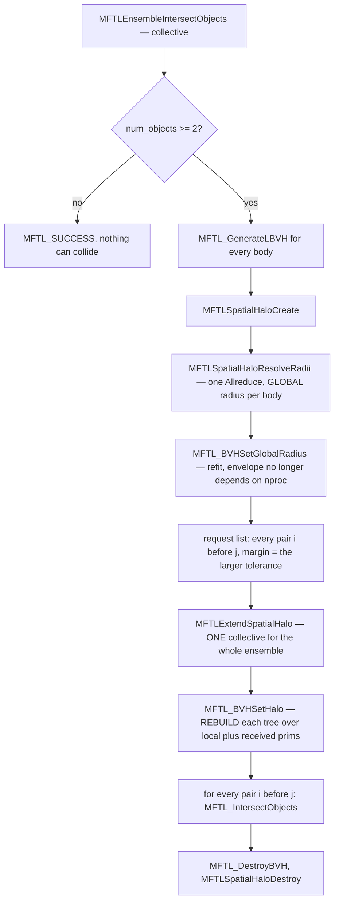
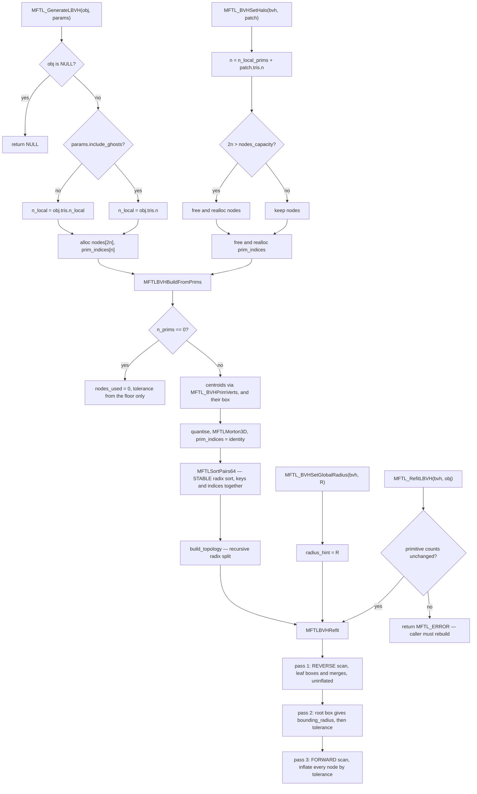
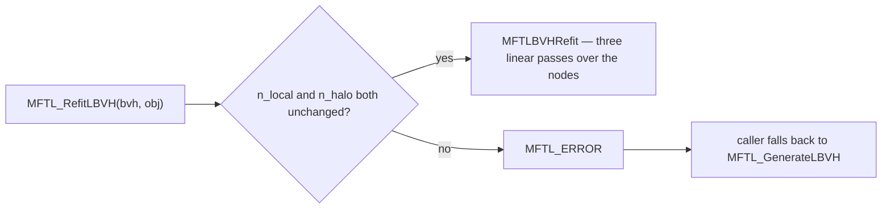
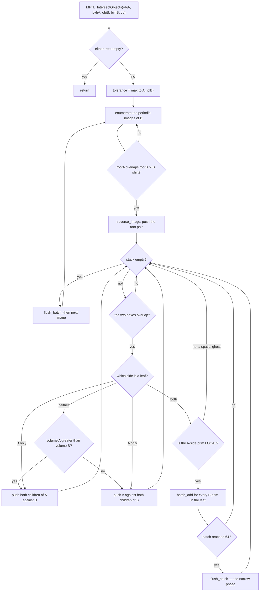
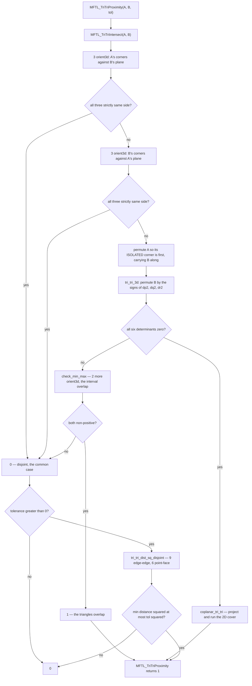
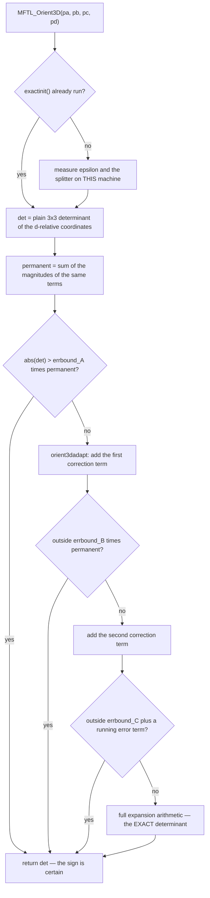

`src/bvh/` — LBVH and contact detection {#mftl_mod_bvh}
======================================

**Public header:** `include/mftl_bvh.h` · **Layer:** 3 ·
**Module group:** @ref mftl_bvh

| File | Job |
|---|---|
| `bvh_build.c` | primitive accessors, Morton codes, radix split, bottom-up AABB fit, refit-only fast path |
| `bvh_traverse.c` | dual-tree traversal over an explicit stack, batched leaf phase, the ensemble pipeline |
| `bvh_predicates.c` | Shewchuk-adaptive `orient3d`, Guigue–Devillers overlap, exact triangle–triangle distance |
| `bvh_internal.h` | float rounding helpers, AABB overlap, and the two module-private build entry points |

@warning `bvh_predicates.c` **must** be compiled with `-ffp-contract=off`
         (set in `CMakeLists.txt`). This is correctness, not tuning — see
         @ref bvh_fma below.

[TOC]

---

## 0. The whole pipeline, in one picture {#bvh_overview}

Contact detection is **two phases over three data structures**. The broad phase
(a tree of boxes) answers *"which triangle pairs are worth an exact test"*; the
narrow phase (a decision tree over exact predicates) answers *"are they actually
touching"*. The third structure is the **spatial halo**, which is what makes the
first two work when the mesh is spread over ranks.

`MFTLEnsembleIntersectObjects` is the whole thing end to end, and its order is
not free — every arrow below is a dependency, not a preference:



Three orderings in that graph are load-bearing:

- **The radii come before the request list.** The margin is a *fraction of the
  body*, and a body's size is only knowable collectively. Using this rank's share
  instead would make the separation at which contact is detected a function of
  the process count — see `MFTL_BVH::radius_hint`.
- **One halo exchange, not one per pair.** Two collectives serve the whole
  ensemble and neither grows with the number of bodies. The arrangement this
  replaces ran a full neighbour `alltoall` **per object pair**, so 500 droplets
  meant 124 750 rounds of collectives per timestep before a single triangle
  moved.
- **`MFTL_BVHSetHalo` rebuilds; it does not append.** The Morton order, the tree
  and the fit are all functions of the *full* primitive set, so leaves cannot be
  bolted onto a tree built over the local half — the sorted order the leaves
  address would no longer be sorted. See @ref bvh_setphalo.

@note **Every pair goes into the request list, unconditionally.**
      `MFTLExtendSpatialHalo` is collective and derives its sequence of
      collectives from that list, so the list may depend only on the object list
      — which every rank holds in the same order — and never on what this rank
      happens to hold geometrically. That is also why `MFTL_GenerateLBVH` returns
      an **empty hierarchy** for an empty partition rather than `MFTL_NULL`: a
      `NULL` here would make the list rank-dependent and hang the ranks that
      still had work.

### The same pipeline as a call tree {#bvh_ensembletree}

The diagram above is the control flow; this is the call hierarchy, with what each
step costs and whether it communicates. `◆` marks a decision, the same convention
`src/remeshing/README.md` uses.

```
MFTLEnsembleIntersectObjects(ens, params, callback, user_data)   COLLECTIVE
│
├─◆ ens->num_objects < 2 ?
│    └─ yes ─▶ return MFTL_SUCCESS — one body cannot collide with another
│
├─ 1 ── ONE TREE PER BODY ────────────────────────────────────────────────────
│   └─ for each body:  MFTL_GenerateLBVH(obj, params)                   local
│        └─ MFTLBVHBuildFromPrims                                       local
│             ├─ centroids ▸ MFTL_BVHPrimVerts   gathered current corners O(n)
│             ├─ MFTLMorton3D ▸ MFTLSortPairs64  stable radix sort      O(n)
│             ├─ build_topology                  recursive radix split  O(n)
│             └─ MFTLBVHRefit                    three linear passes    O(nodes)
│      ◆ an EMPTY partition yields an EMPTY hierarchy, never NULL — a NULL
│        would make the request list below rank-dependent, and hang the
│        ranks that still had work
│
├─ 2 ── THE BODY SCALES, BEFORE ANYTHING USES A MARGIN ───────────────────────
│   ├─ MFTLSpatialHaloCreate(ens)                                       local
│   ├─ MFTLSpatialHaloResolveRadii(ens, halo)       1 Allreduce    COLLECTIVE
│   └─ for each body: MFTL_BVHSetGlobalRadius(bvh, halo->global_radius[i])
│        └─ MFTLBVHRefit        only the boxes move; tree and order are kept
│
├─ 3 ── ONE HALO EXCHANGE FOR THE WHOLE ENSEMBLE ─────────────────────────────
│   ├─ request list: every pair i < j, margin = MAX(tol_i, tol_j)
│   │    ◆ the list must be IDENTICAL on every rank, so it may depend only
│   │      on the object list — never on what this rank holds geometrically
│   │    ◆ the margin matches what the traversal will test the pair against;
│   │      fetching less loses contacts at the rank boundary and nowhere else
│   └─ MFTLExtendSpatialHalo(ens, reqs, n_req, halo)               COLLECTIVE
│
├─ 4 ── ATTACH THE PATCHES, WHICH REBUILDS ───────────────────────────────────
│   └─ for each body: MFTL_BVHSetHalo(bvh, MFTLSpatialHaloPatch(halo, i))
│        └─ MFTLBVHBuildFromPrims over local AND received prims         local
│           ◆ a rebuild, not an append — see §1, "Attaching the halo"
│
├─ 5 ── THE QUERY ───────────────────────────────────────────────────────────
│   └─ for i, for j > i:  MFTL_IntersectObjects(objA, bvhA, objB, bvhB)  local
│        ├─ tolerance = MAX(tol_A, tol_B)
│        ├─◆ for each periodic image of B: root-AABB test        <= 27 images
│        └─ traverse_image  ─▶  batch_add  ─▶  flush_batch
│             ├─◆ boxes overlap ?              6 float compares
│             ├─◆ leaf/leaf, or split the larger box ?
│             ├─◆ is the A-side prim LOCAL ?   one compare, hoisted
│             └─ MFTL_TriTriProximity          31 or 176 ns/pair, measured
│
└─ 6 ── TEARDOWN ─────────────────────────────────────────────────────────────
    ├─ MFTL_DestroyBVH per body                                        local
    └─ MFTLSpatialHaloDestroy(&halo)                                   local
```

### Every decision the module makes, and where {#bvh_decisions}

The rest of this page is the reasoning behind this table. It is the short answer
to *"what is actually being decided, and at which line"*:

| # | Decision | Site | Rule | If it goes the wrong way |
|---|---|---|---|---|
| 1 | which triangles become primitives | `MFTL_GenerateLBVH` | `include_ghosts ? tris.n : tris.n_local` | a distributed contact is reported twice |
| 2 | where a primitive's corners come from | `MFTL_BVHPrimVerts` | current positions with minimum-image edges | a straddling triangle gets a domain-spanning AABB |
| 3 | how a centroid is turned into a key | `MFTLBVHBuildFromPrims` | one shared scale, 21 bits per axis, **not** wrapped | neighbours across the seam land at opposite ends of the key range |
| 4 | where an internal node splits | `build_topology` | highest differing bit of the 95-bit key | equal keys fail to split: infinite descent or an unbounded leaf |
| 5 | leaf or internal | `build_topology` | `prim_count <= leaf_size` | deeper tree, more pair pops |
| 6 | what the envelope is | `MFTLBVHRefit` pass 2 | `max(floor, factor * R)`, `R` global if known | detection depends on the length scale, or on `nproc` |
| 7 | refit or rebuild | `MFTL_RefitLBVH` | primitive counts unchanged | boxes describing renumbered triangles: *wrong* contacts, not missing ones |
| 8 | which periodic images to try | `MFTL_IntersectObjects` | `{-L, 0, +L}` per periodic axis, root test each | a contact across the seam is invisible |
| 9 | which node to split | `traverse_image` | the one with the larger box volume | more visited pairs for the same leaf tests |
| 10 | who reports a pair | `traverse_image` | the owner of the **A-side** primitive | contacts missed, or every cross-rank force doubled |
| 11 | when to run the narrow phase | `batch_add` | batch of 64 full, or traversal drained | (this is the SIMD seam; correctness is unaffected) |
| 12 | overlap or gap | `MFTL_TriTriProximity` | predicate first, then 15 distance sub-tests | a pierced face has positive distance to every edge and vertex |
| 13 | plain or exact determinant | `MFTL_Orient3D` | `abs(det) > errbound * permanent` | a wrong **sign** reports a clean miss for two triangles that cross |

---

## 1. Linear BVH construction {#bvh_build}

### The build call graph {#bvh_buildgraph}

Two public entry points reach the same private core. `MFTL_GenerateLBVH` sizes
the arrays and `MFTL_BVHSetHalo` re-sizes them; everything after that is
`MFTLBVHBuildFromPrims`, which depends only on the primitive soup and not on
where the primitives came from:



Note that `MFTL_BVHSetGlobalRadius` and `MFTL_RefitLBVH` both re-enter at
`MFTLBVHRefit` and **not** at the topology build: neither the Morton order nor
the tree shape depends on the tolerance or on vertex motion, only the boxes do.

### Step 1 — a primitive is a triangle of *some* object {#bvh_prims}

The BVH stores no geometry of its own. It holds a permutation and a tree of
boxes over a **primitive soup**:

$$
p \in [0,\, n_{\text{local}}) \;\mapsto\; \text{triangle } p \text{ of } \texttt{obj},
\qquad
p \in [n_{\text{local}},\, n) \;\mapsto\; \text{triangle } (p - n_{\text{local}}) \text{ of } \texttt{halo}
$$

and `prim_source()` resolves that in three lines. Because a halo patch is an
ordinary `MFTL_Object`, both kinds of primitive are reached through the same
`MFTLGetTriangleCorners` call and the local/remote distinction survives as
**one index comparison**. The alternative — a private array of nine doubles per
received triangle — is a second geometry representation with its own growth path
and its own periodic-consistency argument, for data the object machinery already
knows how to hold.

`MFTL_BVHPrimVerts` is the single accessor. It gathers corner 0 and forms two
minimum-image edges from the current positions:

$$
\mathbf{p}_0,\qquad
\mathbf{p}_1 = \mathbf{p}_0 + \mathbf{e}_1,\qquad
\mathbf{p}_2 = \mathbf{p}_0 + \mathbf{e}_2
$$

The three corners are therefore always mutually unwrapped. That is decision 2
of the table, and it is half of @ref bvh_periodic.

### Step 2 — centroids, quantisation, and the Morton key {#bvh_morton}

The sort key is built from the centroid of the **seam-consistent** corners:

$$
\mathbf{c}_i = \tfrac{1}{3}\left(\mathbf{p}_0 + \mathbf{p}_1 + \mathbf{p}_2\right)
$$

which for a triangle straddling a periodic face is the true centroid just
*outside* the box, rather than a point in the middle of the domain.

@warning The centroid is deliberately **not** wrapped back into the domain
         afterwards, and this is where the BVH differs from
         `MFTLGetTriangleProperties`. A wrapped centroid is the right answer for
         *"where is this triangle"* — it is a position, and redistribution routes
         by it. It is the **wrong** answer for a spatial **sort key**, because
         wrapping puts two triangles that are neighbours across the seam at
         opposite ends of the key range.

Let $[\ell_k, h_k]$ be the bounding box of the centroids. One **shared** scale is
taken over all three axes,

$$
s = \max_k\, (h_k - \ell_k),
$$

so the Morton cells stay **cubic**. Scaling per axis stretches the curve and
makes locality worse on a flat object — the same choice, for the same reason, as
`reorder_vertices` in `src/object/derived.c`. The quantised coordinate is

$$
q_{ik} = \left\lfloor \frac{c_{ik} - \ell_k}{s}\,\bigl(2^{21}-1\bigr) \right\rfloor
\;\in\; [0,\, 2^{21}-1]
$$

and the 63-bit key interleaves the three, one bit per axis per round:

$$
Z_i \;=\; \sum_{b=0}^{20} \Bigl( q^x_{i,b}\,2^{3b} \;+\; q^y_{i,b}\,2^{3b+1} \;+\; q^z_{i,b}\,2^{3b+2} \Bigr)
$$

This is `MFTLMorton3D` from `mftl_object.h` — the same key the pool renumbering
uses, not a separate 30-bit implementation. Two reasons to share it: a $1024^3$
grid puts many triangles of any resolved interface into one cell (see below), and
a module carrying its own copy of a spatial key will eventually disagree with the
one the pools are ordered by.

The array is then sorted with `MFTLSortPairs64`, a **stable** LSD radix sort
moving keys and primitive indices together. Stability is what makes the tree a
deterministic function of the input, which is what lets
`test_refit_only_matches_full_rebuild` compare two trees node by node.

### Step 3 — the radix split, and why the key is 95 bits {#bvh_radix}

This is Karras' construction. An internal node covers a contiguous range
$[f, l]$ of the **sorted** key array, and it splits where the highest differing
bit changes. Define the common-prefix length of two slots as

$$
\delta(i,j) \;=\;
\begin{cases}
\operatorname{clz}_{64}\!\left(Z_i \oplus Z_j\right), & Z_i \neq Z_j \\[4pt]
64 + \operatorname{clz}_{32}\!\left(i \oplus j\right), & Z_i = Z_j
\end{cases}
$$

The two-level form is `prefix_len`, and it exists because $63 + 32$ does not fit
a machine word: equal codes fall through to the index difference, offset by 64 so
that the ordering stays consistent.

**Why the index takes part in the key at all.** A radix split needs every
primitive to have a **unique** key. Two primitives sharing a code have a common
prefix of the full key length, the search for the highest differing bit finds
nothing, and the node **fails to split** — an infinite descent in the recursive
form, and an unbounded leaf in the guarded form.

Duplicates are not exotic. Two triangles smaller than one Morton cell share a
code, which for a resolved interface mesh is most of the mesh at low bit counts:
the customary 10 bits per axis put a $1024^3$ grid over the object, and any mesh
finer than that *in any region* collides. Extending the key with the primitive's
**index** makes it unique by construction without another sort — the array is
already sorted, so indices are ascending, and comparing $(Z_i, i)$
lexicographically is exactly what a 95-bit radix tree over unique keys does.

It also bounds the recursion depth at **95** rather than at the primitive count,
which is why the *build* keeps its recursion while the traversal does not.

**The split search.** With $\delta_c = \delta(f, l)$ the range's common prefix,
the split point is

$$
\gamma \;=\; \max\bigl\{\, m \in [f, l) \;:\; \delta(f, m) > \delta_c \,\bigr\}
$$

giving children $[f, \gamma]$ and $[\gamma+1, l]$. The binary search in
`build_topology` is correct because, for **sorted** keys, $\delta(f, \cdot)$ is
monotonically non-increasing over the range — so the set above is a *prefix* of
the range and its last element can be found by halving. The loop uses ceiling
halving (`step = (step + 1) >> 1`) so that a range of any length is covered
without an off-by-one.

**The split is a real plane.** Let $\delta_c$ be the common prefix length, so the
first differing bit sits at position $\pi = 63 - \delta_c$ counted from the LSB.
By the interleave above, that bit belongs to axis

$$
k = \pi \bmod 3
\qquad\text{at level}\qquad
\lambda = \left\lfloor \pi/3 \right\rfloor,
$$

so the two children are separated by the axis-aligned plane
$q_k = m\,2^{\lambda}$ — a **dyadic cut of the Morton grid**, not a median that
happens to fall wherever the primitive count does. That is the property a
top-down median split does not have, and it is why the tree can be built from the
sorted key array alone with no partitioning pass.

**The node budget is a bound, not a heuristic.** Worst case is one primitive per
leaf, i.e. $n$ leaves and $n-1$ internal nodes, so $2n - 1 \le 2n$ nodes. The
capacity is allocated at $2n$ and asserted against, never grown.

### Step 4 — the fit is three linear passes {#bvh_refit}

`MFTLBVHRefit`, shared by every path that changes geometry:

1. **Reverse scan** over `[nodes_used-1 … 0]`, fitting each leaf to its
   primitives and each internal node to its two children.
2. The root box now bounds every primitive, so `bounding_radius` and `tolerance`
   come straight off it.
3. **Forward scan** inflating every node by the tolerance.

**Why a reverse scan is a valid order.** `build_topology` allocates a child pair
by post-incrementing `nodes_used`, so

$$
\text{left}(i) > i \quad\text{and}\quad \text{right}(i) = \text{left}(i) + 1 > i
\qquad \text{for every internal node } i,
$$

i.e. **array order is a reverse topological order of the tree**. Walking
backwards therefore visits both children before the parent that merges them, with
no stack and no recursion. *That property is the whole reason a refit-only fast
path is worth having* — asserted in Debug inside the loop itself.

Pass 1 computes, for a leaf over slots $[f, f+c)$ and for an internal node,

$$
B_{\text{leaf}} = \Bigl[\min_{s,\,v} \mathbf{p}^{(s)}_v,\; \max_{s,\,v} \mathbf{p}^{(s)}_v\Bigr],
\qquad
B_i = B_{\text{left}(i)} \oplus B_{\text{right}(i)}
$$

where $\oplus$ is the componentwise min/max merge.

**Why the inflation is a separate pass.** The tolerance depends on the bounding
radius, which is only known once pass 1 has finished — so inflating the leaves
inside pass 1 would need a radius from a pass that has not run. The alternative,
a preliminary sweep over the *primitives* to find the box first, costs nine
doubles per primitive.

Pass 3 avoids both because **a uniform inflation commutes with the merge**. Write
$G_\tau(B) = [\,B^{\min} - \tau,\; B^{\max} + \tau\,]$. Since adding a constant
commutes with min and max,

$$
G_\tau\bigl(B_1 \oplus B_2\bigr) \;=\; G_\tau(B_1) \oplus G_\tau(B_2),
$$

so growing every leaf by $\tau$ and re-merging gives *exactly* the same tree as
merging first and growing every node by $\tau$. The correction is therefore
applied once per **node**, over an array still in cache from pass 1, instead of
once per primitive over the mesh.

Shared by `MFTL_GenerateLBVH` (as its last build step) and `MFTL_RefitLBVH` (as
the entire operation), so the two cannot disagree about what a fitted tree looks
like — asserted by `test_refit_only_matches_full_rebuild`.

### Refit or rebuild? {#bvh_refitguard}

`MFTL_RefitLBVH` refuses when the primitive count changed:



The leaves address primitives **by index**, and the Morton order was decided from
the geometry at build time, so a changed primitive count means the indices no
longer name the same triangles. Refusing is the only safe answer: a partial refit
would leave a tree whose boxes describe triangles that have been renumbered,
which produces **wrong** contacts rather than missing ones.

@note The refusal is deliberately **not** an assertion. *"Refit if you can,
      otherwise rebuild"* is a supported way to drive this — the header documents
      `MFTL_ERROR` as the signal to call `MFTL_GenerateLBVH` — so a caller
      probing with a refit after a remesh is using the API correctly, and
      aborting in Debug would make the documented control flow unusable in the
      build the library is developed in. The object is left untouched, so the
      fallback is free.

### Attaching the halo rebuilds the tree {#bvh_setphalo}

`MFTL_BVHSetHalo` grows the arrays and then calls `MFTLBVHBuildFromPrims` again,
over local **and** received primitives together. It cannot do less. The Morton
order is a function of the full primitive set, so appending remote leaves to a
tree built over the local half would leave the leaves addressing a range of an
array that is no longer sorted — every box would still be *fitted*, and the
descent would still terminate, so the failure is a silently incomplete answer
rather than a crash.

### Node layout: 32 bytes exactly {#bvh_node}

Six `float` for the AABB plus one `uint64_t` payload. The payload's **low bit**
is the leaf flag, and it is the only thing distinguishing the two layouts:

| | bit 0 | bits 1…31 | bits 32…63 |
|---|---|---|---|
| leaf | 1 | primitive count | first slot in `prim_indices` |
| internal | 0 | left child index | — (the right child is left + 1) |

Storing only the left child is what keeps a node 32 bytes rather than 40.

**The boxes are `float`, and the conversion must round outward.** A broad phase
does not need `double` precision, but a naive cast rounds to *nearest* and can
shrink the box by one ulp on either side — and one ulp is enough: a triangle
whose vertex sits exactly on the max face of its own leaf gets excluded from it,
and the traversal then reports a clean miss for a pair that touches. So

$$
\underline{f}(v) = \begin{cases}
\text{fl}(v)\,(1 - \epsilon_s) - \eta, & v \ge 0\\
\text{fl}(v)\,(1 + \epsilon_s) - \eta, & v < 0
\end{cases}
\qquad
\overline{f}(v) = \begin{cases}
\text{fl}(v)\,(1 + \epsilon_s) + \eta, & v \ge 0\\
\text{fl}(v)\,(1 - \epsilon_s) + \eta, & v < 0
\end{cases}
$$

with $\epsilon_s = 2.4\times10^{-7} \approx 2\cdot 2^{-23}$ and
$\eta = 10^{-30}$, guaranteeing $\underline{f}(v) \le v \le \overline{f}(v)$. The
float box is then a conservative **superset**, which is the only direction a
broad phase may ever be wrong in. The multiplicative term carries the magnitude
and the additive $\eta$ keeps the rounding outward **through zero and into the
denormals**, where a relative scale does nothing. Two instructions, against a
`nextafterf` libm call.

---

## 2. Periodicity is two problems {#bvh_periodic}

They look related and need entirely different fixes.

### Within an object

A triangle straddling a seam has wrapped vertices, so a centroid built from the
raw coordinates lands in the **middle of the domain**, and its AABB spans the
box — a false positive against everything.

Fixed by gathering every primitive through `MFTL_BVHPrimVerts` and applying
minimum-image edges — the one accessor both primitive kinds go through, so no
consumer branches on local-versus-remote. Guarded by
`test_periodic_morton_of_a_straddling_object`.

A straddling object's **root** box legitimately spans the domain and is **not** a
bug — the same accepted cost, for the same reason, as `MFTLObjectReorderMorton`.

### Between objects

Two bodies on opposite faces are neighbours, and no amount of per-triangle
unwrapping can see it: each body is internally consistent and they are genuinely
a domain length apart in stored coordinates.

Fixed by traversing the pair once per periodic **image** of B. The offset set is
built per axis,

$$
\mathcal{S} = \prod_{k=0}^{2} S_k,
\qquad
S_k = \begin{cases}
\{-L_k,\, 0,\, +L_k\}, & \text{axis } k \text{ periodic and } L_k > 0\\
\{0\}, & \text{otherwise}
\end{cases}
$$

so $|\mathcal{S}| \in \{1, 3, 9, 27\}$ and a **non-periodic domain collapses the
product to the identity image**, paying one root test it was going to pay anyway.
Each image is admitted or rejected by a single root-AABB test before any descent;
a periodic domain typically admits one and rejects the other 26 in 26 compares.
The bodies would have to span half the domain for two images to survive. Guarded
by `test_contact_across_a_periodic_face`.

**The shift is added to B, never subtracted from A.** A is the outer loop of the
traversal and its node is already in registers, and a zero shift costs three adds
the compiler hoists out of the leaf case entirely.

---

## 3. The contact envelope {#bvh_envelope}

$$
\tau = \max\bigl(\texttt{proximity\_floor},\; \texttt{proximity\_factor}\cdot R\bigr)
$$

replacing a hardcoded $10^{-4}$ (AABB inflation) and $10^{-6}$ (proximity), both
**absolute** and therefore correct at exactly one length scale: $10^{-4}$ is a
tenth of a 1 mm droplet's radius, and $10^{-6}$ is $10^{-6}$ of a 1 m body's. In
a run carrying both — the case this library exists for — there is no single
absolute number that works.

One $\tau$ does **both** jobs: it inflates the leaves *and* is the gap the narrow
phase tests against. That is what makes the broad phase unable to cull a pair the
narrow phase would have accepted.

$R$ is **half the longest side** of the root box,

$$
R = \tfrac{1}{2}\max_k\left(\text{root}^{\max}_k - \text{root}^{\min}_k\right),
$$

not half its diagonal. Both bound the object, but only this one equals $R$ for a
sphere of radius $R$ — and `proximity_factor` is documented as a fraction of the
body, so a caller writing $10^{-3}$ for a 1 mm droplet is entitled to get 1 µm.
Half the diagonal hands them 1.73 µm, a $\sqrt{3}$ inflation that is invisible
(it just makes contact trigger earlier) and therefore exactly the kind of silent
factor that must not sit inside a physical threshold.

$R$ is measured over **one rank's partition**, so the distributed pipeline
overwrites it with the body's **global** radius from one `MPI_Allreduce`
(`MFTL_BVHSetGlobalRadius`, which re-runs only the fit) — otherwise splitting a
droplet over eight ranks would change the separation at which contact is
detected. Guarded by `test_tolerance_is_independent_of_the_partition` and
`test_detection_at_two_disparate_length_scales`.

### The pair envelope, and why the maximum is the safe direction

A pair is judged at $\tau_{AB} = \max(\tau_A, \tau_B)$. The completeness argument
is a one-line inequality. Each tree's leaves are already inflated by *its own*
tolerance, so the broad phase admits every pair whose true gap satisfies

$$
g \;\le\; \tau_A + \tau_B,
$$

while the narrow phase declares contact at $g \le \tau_{AB}$. Since
$\max(\tau_A, \tau_B) \le \tau_A + \tau_B$, **the narrow-phase threshold is inside
what the broad phase can deliver**, and no contact can be culled before it is
tested. Taking the *minimum* would break nothing structurally and would let the
smaller body's envelope silently govern a contact with a body a thousand times
its size — which is the two-length-scale failure the fixed $10^{-6}$ produced.

@note The maximum has a price, and it is characterised rather than asserted away.
      A µm droplet against a metre body is judged at the metre body's scale, so
      the envelope of a pair can exceed the smaller body's own **diameter**. The
      escape exists and is documented on the field: set `proximity_factor` to 0
      and state the physical gap as `proximity_floor`. Pinned by
      `test_two_length_scales_share_the_larger_envelope`. Whether a per-pair rule
      that is neither the max nor the min is wanted is a physics question, not a
      code one, and has not been asked.

---

## 4. The query: dual-tree traversal {#bvh_traverse}

### The traversal, with every decision point {#bvh_traversegraph}



### Why the recursion went

The natural way to write a dual-tree descent is a four-argument recursive call.
An explicit stack buys three things, and only the third is really about speed:

1. **The hot state stays in registers.** Both objects, both node arrays, the
   callback and the image shift are loop-invariant, and a recursive call has to
   re-establish all of them per node pair.
2. **The "what next" data becomes contiguous.** A pair stack is two ints per
   entry in one array; a call stack is a frame per entry, interleaved with spill
   slots and a return address.
3. **Leaf pairs can be batched.** A leaf–leaf hit does not run the narrow phase
   where it is found; it appends to a fixed-size array of
   $(\text{prim}_A, \text{prim}_B)$, flushed when full.

There is also a robustness argument. A dual traversal is **not tail-recursive in
either branch**, so its depth is the sum of two tree depths and a pathological
pair could exhaust the machine stack with no diagnostic. An explicit stack turns
that into a `malloc` failure. The initial depth is 256 — a descent pushes at most
one extra pair, and each tree's depth is bounded by the 95-bit key — and it grows
by doubling anyway, because *"non-pathological"* is not something a library
should require of its caller.

### The descent rule {#bvh_descent}

When both nodes are internal, split the one whose box has the larger volume,

$$
V(n) = \prod_{k=0}^{2}\left(n^{\max}_k - n^{\min}_k\right).
$$

Splitting the *smaller* one makes the pair of boxes converge more slowly, so the
traversal visits more pairs for the same set of leaf tests. When exactly one side
is a leaf there is no choice — the other side is the only one that can be
descended.

### A distributed contact is reported by the A-side owner, and only that rank {#bvh_ownership}

- The BVH is built over **owned** triangles only. Including the redistribution
  halo makes two ranks report the same contact, exactly as writing ghosts into a
  `.vtu` double-counts the surface.
- Only object **B**'s triangles travel through the spatial halo, which halves
  what a symmetric exchange would send.
- The traversal **skips any leaf pair whose A side is remote** — one compare,
  `pa >= n_local_a`, against a value already in a register and hoisted out of the
  inner loop.
- `MFTLEnsembleIntersectObjects` iterates $j > i$, so "A" and "B" are well
  defined and every unordered pair is visited exactly once. Body $j$ is B for
  every pair $(i,j)$ with $i<j$, which is why attaching every body's patch is
  correct.

Get it wrong in one direction and cross-rank contacts are missed; wrong in the
other and every cross-rank contact force is applied twice.
`test_distributed_contacts_match_the_serial_answer` compares the gathered **set**
against the answer computed on one rank while it still held the whole mesh, which
is the only check that rules out both at once. A serial run satisfies all of it
trivially — everything is owned and there are no remote primitives.

### The batch is the SIMD seam {#bvh_batch}

`flush_batch` receives a contiguous run of up to 64 independent
$(\text{prim}_A, \text{prim}_B)$ tests. Everything above it produces that run;
everything below it is scalar double precision. A vector narrow phase replaces
the body of that one loop and nothing else in the module moves.

The **periodic shift is applied inside `flush_batch`**, not in
`MFTL_BVHPrimVerts`, because the shift belongs to the *pair being traversed* and
not to the primitive — the same primitive is tested against several images of the
same object when the bodies are large.

---

## 5. The narrow phase {#bvh_narrow}

### The decision tree {#bvh_narrowgraph}



@note **The predicate must run before the distance test, and cannot be replaced
      by it.** Intersecting triangles are at distance zero, and the fifteen
      sub-tests would *not* find that: an edge piercing the interior of the other
      face has a strictly positive distance to every edge and to every vertex of
      it. The overlap predicate is the only thing that sees that configuration.

### The orientation predicate {#bvh_orient}

Everything in the overlap test is expressed through one determinant:

$$
\operatorname{orient3d}(\mathbf{a},\mathbf{b},\mathbf{c},\mathbf{d}) =
\det \begin{pmatrix}
a_x - d_x & a_y - d_y & a_z - d_z \\
b_x - d_x & b_y - d_y & b_z - d_z \\
c_x - d_x & c_y - d_y & c_z - d_z
\end{pmatrix}
= (\mathbf{a}-\mathbf{d}) \cdot \bigl[(\mathbf{b}-\mathbf{d}) \times (\mathbf{c}-\mathbf{d})\bigr]
$$

which is six times the signed volume of the tetrahedron
$\mathbf{a}\mathbf{b}\mathbf{c}\mathbf{d}$. Its **sign** says which side of the
oriented plane through $\mathbf{b},\mathbf{c},\mathbf{d}$ the point $\mathbf{a}$
lies on, and zero means exactly coplanar. It is used here as a *scaled signed
distance*, never divided by anything, which is what keeps the whole test free of
constructed intersection points.

@warning **The argument order is load-bearing.** The **query point comes first**
         and the plane's three vertices follow, because that is the convention
         the decision tree was derived under. Writing it the other way round —
         plane first, point last, which reads more naturally — is a *cyclic*
         permutation of four arguments, and a 4-cycle is an **odd** permutation,
         so it negates every one of the six values. The early-out survives that
         (it compares products, which are sign-invariant) and so does any
         picture; the sign flip is invisible until the dispatch branches on an
         individual sign and takes the mirror branch of the tree. The observable
         symptom is a clean *"no intersection"* for a triangle pair that visibly
         crosses. Guarded by `test_tri_tri_intersect_basic_cases`.

### Guigue–Devillers, and what the two final determinants mean {#bvh_gd}

Write $d_{p_1}, d_{q_1}, d_{r_1}$ for A's corners against B's plane and
$d_{p_2}, d_{q_2}, d_{r_2}$ for B's corners against A's plane. The **early
rejection** is

$$
\bigl(d_{p_1} d_{q_1} > 0\bigr) \wedge \bigl(d_{p_1} d_{r_1} > 0\bigr)
\;\Longrightarrow\; \text{disjoint,}
$$

i.e. all three strictly on the same side of the other plane. This is the branch
the great majority of leaf pairs take, which is why it comes first and why the
whole test is usually six determinants and two multiplies.

If neither triangle is strictly separated, the two planes meet in a line
$L = \pi_1 \cap \pi_2$. Each triangle meets $L$ in a **closed interval**, and

$$
T_1 \cap T_2 \neq \emptyset
\;\iff\;
I_1 \cap I_2 \neq \emptyset .
$$

Guigue and Devillers' contribution is that the interval overlap can be decided
**without ever constructing $L$, the intervals, or their endpoints**. The
dispatch permutes each triangle into a canonical form — $p_1$ becomes the
*isolated* corner, the one alone on its side of the other plane, and B is
permuted so its orientation relative to A is fixed — after which the entire
question reduces to two more determinants:

$$
T_1 \cap T_2 \neq \emptyset
\;\iff\;
\operatorname{orient3d}(q_2, p_2, p_1, q_1) \le 0
\;\wedge\;
\operatorname{orient3d}(r_2, p_2, r_1, p_1) \le 0
$$

which is `check_min_max`. No division, no constructed point, so there is nothing
to be ill-conditioned — every branch taken is one the exact predicate agreed to.
**The bound is eight `orient3d` evaluations per pair, not twelve.** Six classify
the corners against the two planes, and `check_min_max` adds exactly two more on
every path that reaches it. The permutation cascade — the six-way dispatch in
`MFTL_TriTriIntersect` and again in `tri_tri_3d` — looks expensive and costs
*nothing*: it branches on signs that are already computed and evaluates no
predicate of its own. The common case is cheaper still, at six determinants and
two multiplies, because the early rejection fires before any permutation happens.

@note Earlier revisions of this page, of `mftl_bvh.h`, of `bvh_predicates.c` and
      of `CLAUDE.md` all put the bound at twelve — the count of *branches* in the
      dispatch, not of evaluations. All four now say eight. The number is worth
      stating precisely because it is the multiplier on the adaptive predicate's
      cost when @ref bvh_orientcost prices it against the fifteen distance
      sub-tests.

@warning The tempting shortcut — a hand-rolled interval permutation — fails in
         two ways that are easy to miss. A permutation that normalises only
         *which* vertex is isolated, and not the **orientation** of the second
         triangle, gets the sign of the interval test wrong on half its inputs.
         And a coplanar case that returns *"intersect"* unconditionally reports
         contact for two coplanar triangles a metre apart.

### The coplanar case {#bvh_coplanar}

Reached only when all six determinants are **exactly** zero, i.e. the two
triangles are coplanar to the last bit of the *exact* predicate. That is a
measure-zero configuration in a moving simulation and a common one in a
constructed test, which is the split this implementation is sized for: correct
and simple rather than fast.

The pair is projected onto a coordinate plane by dropping the axis

$$
k^\ast = \arg\max_k \left| n_k \right|,
\qquad \mathbf{n} = (\mathbf{q}_1 - \mathbf{p}_1) \times (\mathbf{r}_1 - \mathbf{p}_1),
$$

because the Jacobian of the projection that drops axis $k$ is
$|n_k| / \lVert \mathbf{n} \rVert$ — so dropping the axis the normal is *most*
aligned with is the projection with the **largest Jacobian**, hence the flattest
and best conditioned of the three.

The 2D test is then a complete cover: **nine segment crossings** catch every
boundary intersection, and **two containment tests** catch the case of one
triangle strictly inside the other, which has no boundary crossing at all. Two
suffice — testing one corner of each triangle against the other — because if the
boundaries do not cross then the triangles are either disjoint or one is entirely
nested in the other, and the two tests cover both nesting directions.

The 2D orientation here is a **plain** determinant,

$$
\operatorname{orient2d}(\mathbf{a},\mathbf{b},\mathbf{c}) = (b_x - a_x)(c_y - a_y) - (b_y - a_y)(c_x - a_x),
$$

not the adaptive predicate. That is a deliberate stopping point: this branch
already required an exact coplanarity verdict to be *reached*, and the production
predicate the traversal uses is `MFTL_TriTriProximity`, whose distance test
resolves a coplanar pair within the tolerance regardless of what the overlap test
decides.

### Exact distance between two disjoint triangles {#bvh_distance}

The minimum distance between two disjoint closed triangles is attained either
between **two edges** or between a **vertex and the interior of the other face**.
Nine edge pairs and six point–face projections is a complete cover of both, so
the minimum over the fifteen is exact — no iteration, no tolerance:

$$
d^2(T_A, T_B) = \min\Bigl(
\min_{i,j} d^2_{\text{ee}}\bigl(e^A_i, e^B_j\bigr),\;
\min_{i} d^2_{\text{pf}}\bigl(a_i, T_B\bigr),\;
\min_{i} d^2_{\text{pf}}\bigl(b_i, T_A\bigr)
\Bigr)
$$

**Edge–edge.** With $\mathbf{u} = P_1 - P_0$, $\mathbf{v} = Q_1 - Q_0$,
$\mathbf{w} = P_0 - Q_0$ and

$$
a = \mathbf{u}\cdot\mathbf{u},\quad
b = \mathbf{u}\cdot\mathbf{v},\quad
c = \mathbf{v}\cdot\mathbf{v},\quad
d = \mathbf{u}\cdot\mathbf{w},\quad
e = \mathbf{v}\cdot\mathbf{w},
$$

minimising $\lVert P_0 + s\mathbf{u} - Q_0 - t\mathbf{v} \rVert^2$ over
$(s,t) \in [0,1]^2$ gives the unconstrained stationary point

$$
\begin{pmatrix} a & -b \\ -b & c \end{pmatrix}
\begin{pmatrix} s \\ t \end{pmatrix}
=
\begin{pmatrix} -d \\ -e \end{pmatrix},
\qquad
D = ac - b^2,
$$

followed by clamping to the unit square. $D$ is the **Gram determinant** of the
two directions.

**Point–face.** With $\mathbf{e}_0 = B - A$, $\mathbf{e}_1 = C - A$ and
$\mathbf{v}_0 = A - P$, the barycentric coordinates of the foot of the
perpendicular come from the same Gram system, $\det = ac - b^2$, and the routine
returns a **sentinel** (`DBL_MAX`) when the projection falls outside the
triangle: the closest point is then on the boundary, which the edge–edge pass
covers exactly. Returning a sentinel rather than clamping keeps the two passes
from computing the same boundary answer twice.

#### Every test here is DIMENSIONLESS, and that is not stylistic {#bvh_dimensionless}

Guarding either routine with an **absolute** threshold puts it on a quantity that
does not have units of length. `det < 1e-12` in the point–face routine tests a
Gram determinant, which has units of $\text{length}^4$: for a droplet meshed at
20 µm the determinant of a perfectly healthy triangle is around $10^{-19}$, so
the guard fires on **every** triangle and the point–face branch returns *"no
contribution"* every time. The distance is then whatever the edge–edge tests
found — which misses exactly the vertex-into-face configuration a resolved
contact consists of. Silently, and only at small scales.

The tests as written are ratios:

$$
\frac{D}{a\,c} = 1 - \cos^2\theta = \sin^2\theta,
$$

so `D <= tiny * a * c` asks *"are these two directions parallel"* in a form that
means the same thing at $10^{-5}\,\text{m}$ and at $1\,\text{m}$. The same ratio
in the point–face routine is $\sin^2$ of the corner angle.

### Only orient3d is adaptive, and that is deliberate {#bvh_adaptive}

It is the **only** predicate here whose *sign*, rather than magnitude, decides
the answer. Everything else — distances, areas, interval endpoints — degrades
continuously: a distance wrong in the last ulp gives a contact decision wrong
only for pairs sitting exactly on the tolerance, which is a tie the caller
already accepted by choosing a tolerance. A **sign** that is wrong makes the
algorithm take a branch for a configuration that does not exist, and it can then
report a clean *"no intersection"* for two triangles that cross.

#### The escalation {#bvh_escalation}



The **permanent** is what turns a relative error bound into an absolute one. With
$\mathbf{a}' = \mathbf{a} - \mathbf{d}$ and so on,

$$
\text{perm} =
\bigl(|b'_x c'_y| + |c'_x b'_y|\bigr)\,|a'_z| +
\bigl(|c'_x a'_y| + |a'_x c'_y|\bigr)\,|b'_z| +
\bigl(|a'_x b'_y| + |b'_x a'_y|\bigr)\,|c'_z|
$$

is the sum of the magnitudes of the terms the determinant is built from, so the
true value cannot differ from the computed `det` by more than
$\varepsilon_A \cdot \text{perm}$. A `det` outside that band therefore has a
**certain** sign and the exact stage is never entered — the branch essentially
every well-separated pair takes.

The three bounds are Shewchuk's, derived for the $3\times3$ determinant, and are
**computed from the measured machine epsilon** rather than assumed:

$$
\varepsilon_A = (7 + 56\,\varepsilon)\,\varepsilon, \qquad
\varepsilon_B = (3 + 28\,\varepsilon)\,\varepsilon, \qquad
\varepsilon_C = (26 + 288\,\varepsilon)\,\varepsilon^2
$$

`exactinit()` finds $\varepsilon$ by halving until $1 + \varepsilon$ stops
differing from 1, so a target with extended-precision registers or a different
rounding mode gets bounds that are true for **it** rather than for IEEE-754
double as assumed.

#### Error-free transformations {#bvh_eft}

The exact stages are built from operations that produce a rounded result **and**
its exact residue, so the pair $(x, y)$ represents the exact value as $x + y$. An
*expansion* is a list of such components, ordered by magnitude and
non-overlapping; its exact value is the sum of its parts.

$$
\texttt{TWO\_SUM}(a,b): \quad x = \text{fl}(a+b), \quad y = (a+b) - x, \quad x + y = a + b \ \text{exactly}
$$

$$
\texttt{TWO\_PRODUCT}(a,b): \quad x = \text{fl}(a\,b), \quad y = a\,b - x, \quad x + y = a\,b \ \text{exactly}
$$

`TWO_PRODUCT` recovers its residue by Dekker splitting: `SPLIT` writes
$a = a_{hi} + a_{lo}$ with 26 significand bits each, so the partial products
$a_{hi}b_{hi}$ and the rest are **exactly representable**, and $y$ is assembled
from them.

#### `-ffp-contract=off` is correctness, not tuning {#bvh_fma}

`TWO_PRODUCT` recovers the residue of $a \cdot b$ by evaluating
$x - a_{hi}b_{hi}$ in a **second rounding step**. A fused multiply-add contracts
that into one operation with **one** rounding, the residue comes out **zero**,
and every exactness guarantee in the file silently evaporates — while the numbers
still look entirely plausible.

The file carries `#pragma STDC FP_CONTRACT OFF`, but not every compiler honours
it, so the flag is set in `CMakeLists.txt` as well. **Do not remove it.**

#### What it costs, and what it buys {#bvh_orientcost}

Measured by `examples/orient3d_predicate_profile.c`, and the answer is not
one-sided:

| | Result |
|---|---|
| cost vs. the plain determinant | **2.00×** |
| cost as a fraction of a full `MFTL_TriTriProximity` call | **≤ 6.2 %** |
| misclassifications by the plain form, 20 000 samples, gaps ≥ $10^{-12}$ of body size | **zero** |
| where the plain form does fail | $10^{-14} \ldots 10^{-16}$ |

$10^{-12}$ of the body size is three orders below where a lubrication model
works, so the plain determinant would very likely never misclassify in
production. It is kept anyway because the cost is bounded by the fifteen distance
sub-tests that dominate the narrow phase — `MFTL_TriTriProximity` measures
**176 ns/pair** against `MFTL_TriTriIntersect`'s **31** — and because the failure
it removes is **silent**.

---

## 6. Cost model {#bvh_cost}

@warning Every row of this table except the last two is **argued from structure,
         not measured**. Nothing in this directory has been profiled beyond
         `examples/orient3d_predicate_profile.c`, and there is no BVH entry in
         `docs/performance-analysis.md`. Build / refit / traverse timings are the
         first thing to measure before optimising any of it. See @ref
         bvh_deferred.

| Stage | Work | Note |
|---|---|---|
| centroids + Morton codes | $O(n)$ | one `MFTLGetTriangleCorners` per primitive |
| `MFTLSortPairs64` | $O(n)$ | stable LSD radix over 64-bit keys |
| `build_topology` | $O(n)$ nodes, $O(\log n)$ per split | balanced in practice; $O(n \log n)$ worst case |
| `MFTLBVHRefit` | $O(\text{nodes} + n)$ | three linear scans, no stack |
| `MFTL_RefitLBVH` | $O(\text{nodes} + n)$ | topology and Morton order reused |
| traversal, one image | $O(n_A\,n_B)$ worst case | the whole point of the tree is that it is not that |
| periodic images | $\le 27$ root tests | 6 compares each; one survives in practice |
| `MFTL_TriTriIntersect` | $\le 8$ `orient3d`, usually 6 | **31 ns/pair, measured** |
| `MFTL_TriTriProximity` | above, plus 15 distance sub-tests | **176 ns/pair, measured** |

**Memory.** A node is exactly 32 B and the array is allocated at the worst-case
bound $2n$, so **64 B per primitive** is reserved and roughly 16 B per primitive
is used at the default `leaf_size` of 4 ($\approx n/4$ leaves, $\approx n/2$
nodes). `prim_indices` adds 4 B per primitive. The BVH stores **no geometry**:
both objects are borrowed and `const` throughout.

**Defaults**, from `MFTL_BVHDefaultParams()`:

| Field | Default | Meaning |
|---|---|---|
| `proximity_factor` | $10^{-3}$ | envelope as a fraction of the bounding radius |
| `proximity_floor` | 0 | absolute floor; set this and zero the factor for a physical gap |
| `leaf_size` | 4 | primitives per leaf |
| `include_ghosts` | `false` | owned triangles only — see @ref bvh_ownership |

---

## 7. Deferred {#bvh_deferred}

1. **The leaf–leaf narrow phase is batched but not vectorised.** `flush_batch`
   receives a contiguous run of up to 64 independent tests — the shape a SIMD
   kernel wants — and runs them scalar. The useful form is a gather of the
   *first* orientation test across a batch rather than a naive widening, because
   `MFTL_TriTriIntersect` is a decision tree with early-out at every level; that
   is a measurement exercise, not a transcription. Start with
   `MFTL_TriTriProximity`'s fifteen distance sub-tests, which is where the time
   is (176 ns against 31).
2. **Nothing in this directory has been profiled at all beyond
   `orient3d_predicate_profile.c`.** The explicit-stack traversal, the
   refit-only fast path and the batched leaf phase are all argued from structure
   rather than measured. Build/refit/traverse timings are the first thing to
   measure before optimising any of it.
3. **Contact detection is discrete-time: there is no CCD.** `MFTL_GenerateLBVH`
   and `MFTL_RefitLBVH` see one instant; nothing sweeps the volume between two. A
   pair whose relative displacement in one step exceeds the sum of their sizes
   passes through without ever being coincident at a sampled instant, and both
   samples correctly report nothing. This bites when the timestep is set by a CFL
   condition on the *flow* rather than by the approach velocity of two surfaces —
   the normal case. Fixing it needs the swept volume of every triangle: a
   different primitive, a different tree, and a per-step velocity the module does
   not receive. Pinned as a recorded property by
   `test_tunnelling_between_two_timesteps_is_a_known_miss`, which **asserts the
   miss** — if that test starts failing, something has begun reporting contacts
   that are not present at the sampled configuration, which *is* a bug.
