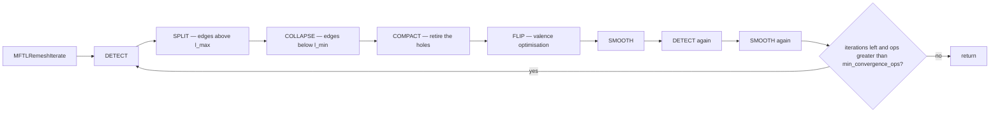
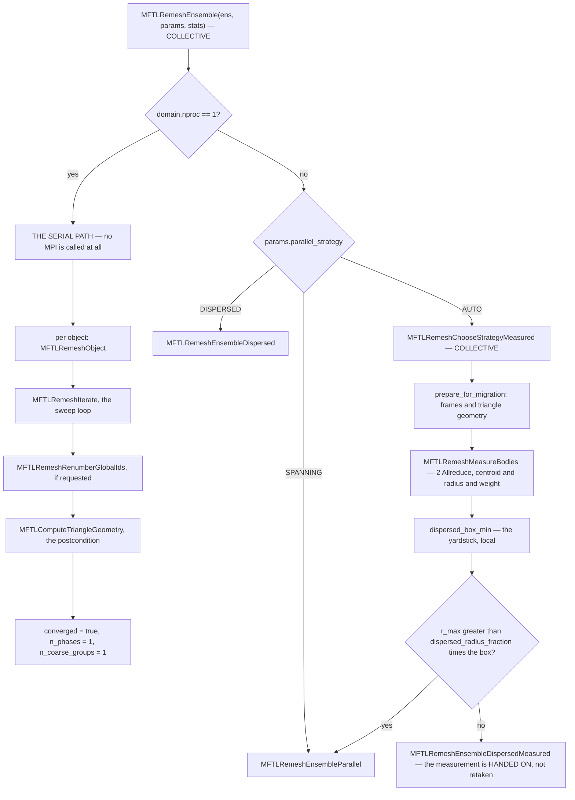
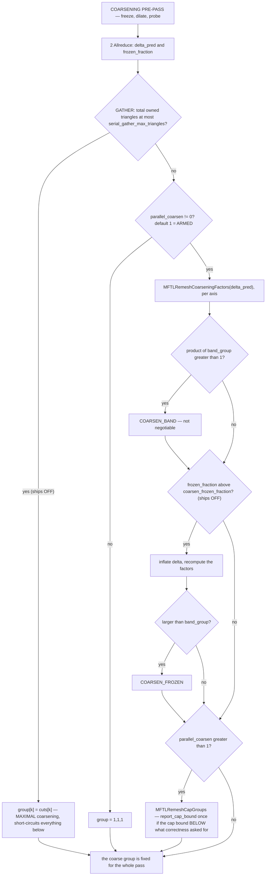
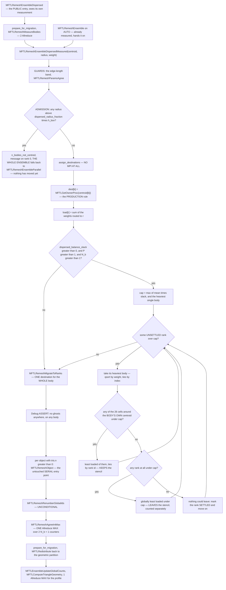

```mermaid
flowchart TD
  A["MFTLRemeshEnsembleParallel — COLLECTIVE"] --> G{"max_edge_length greater than 0 and min at most max?"}
  G -->|no| GE["message on rank 0, return MFTL_ERROR"]
  G -->|yes| CQ{"coarsening armed or gather set, and P greater than 1?"}

  CQ -->|no| DP
  CQ -->|yes| CP["COARSENING PRE-PASS: freeze, dilate, probe the band and the frozen count"]
  CP --> CR["2 Allreduce: delta_pred and frozen_fraction"]
  CR --> CD["choose the coarse group — see the decision graph in the coarsening section"]
  CD --> DP["DISTINCT PLACEMENTS: dedupe the 8-row phase table over the ACTIVE axes"]

  DP --> PL["PHASE LOOP  p = 0 .. parallel_phase_budget-1"]
  PL --> SH["MFTLRemeshPhaseShift — shift is half the COARSE box on each active axis"]
  SH --> PM["prepare_for_migration"]
  PM --> MQ{"did ANY rank move anything? 1 Allreduce LOR"}
  MQ -->|no| SK["SKIP the migration, n_migrations_skipped++"]
  MQ -->|yes| RD["MFTLRedistributeWithOwners — MFTLRemeshCoarseOwnerProc per entity"]
  SK --> FZ
  RD --> FZ["MFTLRemeshMarkFrozen, MFTLDilateFrozenBand, count_hidden_edges"]
  FZ --> IT["MFTLRemeshIterate — THE UNTOUCHED SERIAL KERNEL, gated by MFTL_FLAG_FROZEN"]
  IT --> ID["assign_phase_gids — Exscan and Allreduce, both posted before either is waited on"]

  ID --> CV{"global_ops == 0?"}
  CV -->|no| RS["streak = 0, next phase"]
  RS --> PL
  CV -->|yes| HD{"hidden edges?"}
  HD -->|none| OK["converged = true, BREAK — the EXACT certificate"]
  HD -->|hidden_long| RS
  HD -->|hidden_short only| ST{"++streak at least n_distinct_placements?"}
  ST -->|yes| OK
  ST -->|no| PL
  PL -->|budget exhausted| CL
  OK --> CL["CLOSING SEQUENCE — the order is forced, every constraint is silent"]

  CL --> C1["redensify_global_ids: MFTLRemeshIdReduce"]
  C1 --> C2["MFTLRemeshSyncGhostIds — keyed on the OLD id, so it runs BEFORE the overwrite"]
  C2 --> C3["overwrite by SLOT: gid = base + slot, he_gid = 3 tri_gid + k"]
  C3 --> C4["MFTLRedistribute — back to the CANONICAL planes, the production rule"]
  C4 --> C5["clear_frozen, MFTLEnsembleUpdateGlobalCounts, MFTLComputeTriangleGeometry"]
  C5 --> C6{"n_coarse_groups at most 1?"}
  C6 -->|yes| C7["check_band_fits — warns ONCE if h is at most 4 delta"]
  C6 -->|no| C8["done"]
  C7 --> C8
```

`src/remeshing/` — Isotropic surface remeshing {#mftl_mod_remeshing}
==============================================

**Public header:** `include/mftl_remeshing.h` · **Layer:** 3 ·
**Module group:** @ref mftl_remeshing

The largest module, and the only one whose MPI is confined to a single file by a
**build-time** check.

| File | Job | MPI? |
|---|---|---|
| `remesh_ops.c` | split, collapse, flip — an approval predicate and an execution function each | no |
| `remesh_smooth.c` | feature detection, and the three-subspace tangential smoother | no |
| `remesh_compact.c` | remove dead entities, re-establish the ownership prefix, re-densify global ids | no |
| `remesh_driver.c` | the sweep loop, and the dispatch on rank count | no |
| `remesh_parallel.c` | the shift/freeze phase schedule — move the **planes** | no |
| `remesh_dispersed.c` | body centering — move the **bodies** | no |
| `remesh_comm.c` | **every MPI call the module makes** | **yes** |

`remesh_internal.h` holds the shared helpers; `remesh_comm.h` declares the
communication layer and the shifted ownership rules.

## Notation used throughout {#rem_notation}

| Symbol | Meaning | Where it lives |
|---|---|---|
| $L$ | target edge length | `params.target_length` |
| $\ell_{\min}, \ell_{\max}$ | the acceptance band, $\tfrac45 L$ and $\tfrac43 L$ | `params.min/max_edge_length` |
| $P$ | rank count | `domain.nproc` |
| $h_k$ | rank box width on axis $k$, $=\mathrm{size}_k/\mathrm{cuts}_k$ | derived from #MFTL_Domain |
| $h$ | $\min_k h_k$ over CUT axes | `MFTLDomainGetHMin` |
| $\delta$ | half-width of the frozen band | `stats.band_measured` / `band_bound` |
| $g_k$, $G$ | per-axis coarsening factors and their product | `MFTLRemeshCoarseningFactors`, `stats.n_coarse_groups` |
| $R_b$, $\mathbf{c}_b$, $w_b$ | body $b$'s radius, centroid, triangle count | `MFTLRemeshMeasureBodies` |
| $N_b$ | bodies in the ensemble | `ens->num_objects` |
| $s \in \{0,1\}^3$ | one phase of the shift schedule | `MFTL_REMESH_PHASES` |

---

## The serial algorithm {#rem_algorithm}

Botsch & Kobbelt's incremental isotropic remesher. One iteration is:

```
DETECT → SPLIT → COLLAPSE → COMPACT → FLIP → SMOOTH → DETECT → SMOOTH
```

against a target edge length $L$, with the acceptance band

$$
  \ell_{\min} = \tfrac45 L, \qquad \ell_{\max} = \tfrac43 L,
  \qquad \frac{\ell_{\max}}{\ell_{\min}} = \frac53 .
$$

`MFTLRemeshIterate` repeats that until `params.iterations` is exhausted or an
iteration performs no more than `min_convergence_ops` operations.



**The second `DETECT` is not a redundant call**, and the order is not a
convenience — @ref rem_order and @ref rem_features say why each arrow is where it
is. A split of a rim edge creates a midpoint that IS on the rim, so a
classification taken before the sweeps describes a mesh that no longer exists.

### What the two constants actually buy {#rem_band}

A split is the map $\ell \mapsto \ell/2$ applied to the set $(\ell_{\max},\infty)$.
Its image is $(\tfrac23 L, \infty)$, so the halves of a freshly split edge land
inside the band exactly when

$$
  \ell \in [\,2\ell_{\min},\; 2\ell_{\max}\,] = [\tfrac85 L,\; \tfrac83 L].
$$

That leaves one window where a split is *not* self-consistent: an edge in
$(\tfrac43 L, \tfrac85 L)$ splits into two halves in $(\tfrac23 L, \tfrac45 L)$,
which are below $\ell_{\min}$ and therefore collapsible. **The band alone does
not forbid split/collapse ping-pong.** Three separate mechanisms do, and each is
worth knowing about because each is a place the remesher can be broken:

1. **The split sweep takes a snapshot** of $3 n_{\text{tris}}$ before it runs, so
   the halves it creates are not re-examined until the next iteration — after
   smoothing has had a chance to lengthen them back towards $L$.
2. **`MFTLCollapseApproved` carries an explicit stretch bound.** A collapse is
   refused when any edge of the merged vertex would exceed $\ell_{\max}$
   (@ref rem_approval), which closes the collapse → split direction that no
   choice of constants can close.
3. **Smoothing runs between the sweeps** and is a contraction towards equal edge
   lengths, so the population drifts into the band rather than across it.

Widening $\ell_{\max}$ to $\tfrac85 L$ *would* remove the window entirely — every
splittable edge would then produce two in-band halves — at the price of
tolerating edges 60 % longer than the target. $\tfrac43 L$ is the compromise:
a tight bound on the longest edge, and a narrow window that smoothing absorbs.

@note `MFTL_REMESH_UNIFORM` sets $\ell_{\min} = \ell_{\max} = L$, which is the
      degenerate band. It is meant for tests that want a deterministic
      refinement, not for a deforming interface.

### The sweep order is not arbitrary {#rem_order}

- **SPLIT before COLLAPSE**, because splitting is the operation that *cannot
  fail*: no link condition, no fold test. Doing it first gives the collapse sweep
  a mesh where the short edges are genuinely short rather than merely short
  relative to their over-long neighbours.
- **COMPACT between COLLAPSE and FLIP.** The payoff is not tidiness: the smoother calls
  `MFTLObjectRefreshFrames` and `MFTLComputeVertexNormals`, which **stream the
  whole pool** and would otherwise accumulate dead triangles into live vertices'
  normals.
- **FLIP before SMOOTH**, because the valence criterion is combinatorial — it
  reads the connectivity the previous two sweeps produced, and smoothing does not
  change connectivity. Running it after would delay its effect by an iteration.
- **DETECT at the top of every iteration and again before the smoother**, not
  once per call — see @ref rem_features.

### Every sweep takes a fresh snapshot of the half-edge count

`MFTLSplitEdge` appends triangles, so $3 n_{\text{tris}}$ grows **during** the
split sweep. The bound is captured once, before the loop, **on purpose**: the
half-edges the sweep creates are the two halves of an edge it has just decided was
too long, and re-examining them in the same sweep is how a remesher turns one long
edge into a burst of tiny ones. They are examined on the next iteration, measured
against a mesh that has been smoothed in between.

---

## What implicit indexing does to a topological operator {#rem_operators}

Half-edge $3t+k$ **is** corner $k$ of triangle $t$. An operator therefore cannot
allocate a half-edge, move one between triangles, or patch a `next` pointer —
none of those are representable. What it does instead:

> **Rewrite whole triangles, then re-link the patch's outer twins.**

A triangle is written by storing three *target* vertices, and the patch is closed
by re-pointing the twins of the half-edges on its rim. Three consequences:

| Operator | Allocation | Work |
|---|---|---|
| **FLIP** | none at all | both triangles rewritten in place, four rim twins re-pointed. No `next` cycle to repair. |
| **SPLIT** | one triangle per side (two interior, one at a boundary) | its three half-edges come with it, at the right indices, by construction |
| **COLLAPSE** | **cannot free anything** | a triangle's half-edges *are* its storage, so it marks #MFTL_FLAG_DEAD and compaction removes them later |

A half-edge's global id is $3\,t_{\mathrm{gid}} + k$, a function of the **slot**,
never of the logical edge — so rewriting a triangle leaves the ids alone and the
invariant holds for free.

@warning What does **not** come for free is the **flag word**. When triangle $t$ is
         rewritten, the logical edge that used to sit in slot 1 may end up in slot
         2, and #MFTL_FLAG_FEATURE / #MFTL_FLAG_BOUNDARY have to travel with the
         **edge**, not with the slot. Every operator captures the rim flags before
         it writes anything and replaces them afterwards.

### Approval and execution are separate, on purpose

The predicate is the entire correctness argument; the execution assumes it has
already been made. A distributed driver needs to evaluate predicates on one rank
and replay executions on another, and that is only possible if they share no state.

SPLIT and FLIP are judged **once per undirected edge**, through the half-edge of
smaller index (`he_is_canonical`), because both are symmetric in the edge's two
directions. **COLLAPSE is not**, and it deliberately examines both: $a \to b$
retires $a$ while $b \to a$ retires $b$, and clause 2 below is asymmetric, so one
direction can be refused where the other is approved. A sweep therefore visits
$3 n_{\text{tris}}$ half-edges, and #MFTL_FLAG_VISITED — set on what an operator
touched, tested by `edge_is_operable` on the half-edge *and* both endpoints, and
cleared by `clear_visited` **once per iteration** rather than once per sweep —
is what stops an entity being operated on again before the next
DETECT/SMOOTH round has looked at it.

### Every clause of `MFTLCollapseApproved` is silent when removed {#rem_approval}

Collapsing $h = (a \to b)$ retires $a$, moves $b$ to $p_m$, and rewrites the
corner $a$ of every triangle in $a$'s fan. Write $N(v)$ for the one-ring vertex
set of $v$ and $W = N(a) \cap N(b)$ for the **wing** vertices. The predicate is
one *want* followed by seven refusals, evaluated in this order — cheapest and
most selective first, so that `reject_reason` names the clause a caller can act
on:

| # | Clause | Statement | What its absence produces |
|---|---|---|---|
| 1 | wanted | $\lVert e_h \rVert^2 < \ell_{\min}^2$ | — |
| 2 | feature admissibility | $a \notin$ CORNER; $a$ on a feature ⟹ $b$ on it; $a$ on the mesh boundary ⟹ $b$ on it | the feature curve or the rim is dragged off itself |
| 3 | **feature/boundary link** | not ($h \notin$ FEATURE ∧ $a,b$ both on a feature curve); not ($h$ has a twin ∧ $a,b$ both on the boundary) | two curve points joined by a **chord** merge, pinching the curve inwards |
| 4 | **link condition** | $\lvert W \rvert = 2$, or $1$ when $h$ is a boundary edge | welds two sheets into a non-manifold vertex, after which every one-ring walk from it silently visits half the fan |
| 5 | merged valence | $3 \le \lvert N(a)\rvert + \lvert N(b)\rvert - \lvert W\rvert - 2 \le$ #MFTL_MAX_VALENCE | above the cap the fan walkers truncate and every later query is quietly wrong |
| 6 | **wing valence** | $\deg(w) \ge 4$ for every $w \in W$ | a **tetrahedron passes the neighbour count and still dissolves** |
| 7 | **stretch** | $\lVert p_m - p_w \rVert \le \ell_{\max}$ for every $w \in (N(a) \cup N(b)) \setminus \{a,b\}$ | split and collapse oscillate forever |
| 8 | **fold-over** | every SURVIVING triangle's unit normal satisfies $\hat{\mathbf n}_{\text{new}} \cdot \hat{\mathbf n}_{\text{old}} \ge$ `max_normal_deviation_cos` | an inverted triangle |

**Where the merged vertex goes.** $p_m$ is the periodic midpoint, *unless exactly
one endpoint is pinned* — on a feature curve or on the mesh boundary — in which
case the pinned endpoint's position is kept:

$$
  p_m = \begin{cases}
          p_b & b \text{ is a CORNER, or } b \text{ pinned and } a \text{ free} \\[2pt]
          \tfrac12\big(p_a \oplus p_b\big) & \text{otherwise}
        \end{cases}
$$

where $\oplus$ denotes the minimum-image midpoint. Averaging a pinned endpoint
with a free one pulls the curve off itself; averaging a corner with anything
rounds off the one point on that curve with a definite position. The remaining
case — both endpoints pinned and on the *same* curve — takes the midpoint, which
stays on a straight feature exactly and cuts a curved one by $O(h^2)$, acceptable
precisely because the edge being collapsed is short by construction.

Clauses 3 and 6 are the easy ones to omit, because the obvious form of the link
condition does not imply either. On an open patch the missing clause 3 serrates
the rim; on a cube it merges two sharp edges into the middle of the face between
them. Clause 6 is the one a tetrahedron defeats: its four vertices all have
valence 3, so $\lvert W \rvert = 2$ holds and the collapse dissolves the solid.

Guarded by `test_collapse_refuses_to_dissolve_a_tetrahedron` and
`test_remesh_of_an_open_patch_keeps_its_rim`.

The fold-over guard has a measured second role: **worth nothing on a correct
configuration, but it bounds a runaway once features are spurious** — 16 702
triangles against 101 048.

### Valence optimisation

A flip re-cuts the quad $(a,b,c,d)$ along its other diagonal, so $a$ and $b$ each
lose a neighbour and $c$ and $d$ each gain one. It is accepted on a **strict**
decrease of

$$
  E = \sum_{v \in \{a,b,c,d\}} \big(\deg(v) - \deg^{*}(v)\big)^{2},
  \qquad \deg^{*}(v) = \begin{cases} 6 & v \text{ interior} \\ 4 & v \text{ on the boundary} \end{cases}
$$

i.e. on $E_{\text{after}} < E_{\text{before}}$ where

$$
  E_{\text{after}} = (\deg a - 1 - \deg^{*}a)^2 + (\deg b - 1 - \deg^{*}b)^2
                   + (\deg c + 1 - \deg^{*}c)^2 + (\deg d + 1 - \deg^{*}d)^2 .
$$

$\deg^{*} = 6$ is the valence of a regular triangulation of the plane; 4 is its
half, which is what a boundary vertex sees. **Strictness matters** — an equality
would let two flips alternate forever, and each would report itself as work done,
so the convergence test would never fire either.

Additionally rejected when $c$ and $d$ are **already adjacent** (the flip would
create a second undirected edge with the same endpoints, which no half-edge
traversal can distinguish from the first), when $\deg a$ or $\deg b$ would drop
below 3, when $h$ carries #MFTL_FLAG_FEATURE or #MFTL_FLAG_BOUNDARY, and when the
new diagonal turns a normal past the fold-over threshold — which is what a flip
across a **non-convex** quad does.

---

## Features and smoothing {#rem_features}

`MFTLDetectFeatures` produces two outputs from two linear passes and **no fan
walks at all**:

- **half-edges** — #MFTL_FLAG_FEATURE on both directions of every edge whose
  dihedral angle exceeds `feature_angle_threshold`, and on every mesh-boundary
  half-edge unconditionally. Cleared elsewhere, so a fold that has since been
  smoothed out stops being a feature.
- **vertices** — FEATURE for exactly two incident feature edges continuing roughly
  straight through the vertex (a *ridge point*); CORNER for one, for three or
  more, or for two that turn by more than `feature_corner_angle`; neither for zero.

The dihedral test is on the unit face normals of the two incident triangles,

$$
  \hat{\mathbf n}_1 \cdot \hat{\mathbf n}_2 < \cos\theta_{\text{feature}},
$$

and the ridge/corner test is on the two feature directions
$\mathbf{d}_1, \mathbf{d}_2$ leaving the vertex,

$$
  \text{ridge} \iff
  \frac{-\,\mathbf{d}_1 \cdot \mathbf{d}_2}{\lVert\mathbf{d}_1\rVert\,\lVert\mathbf{d}_2\rVert}
  > \cos\theta_{\text{corner}} .
$$

Doing the vertex classification **here** rather than in the smoother is what keeps
the smoothing sweeps free of fan walks — the smoother runs several times per
iteration and would otherwise re-derive the same counts each time.

The count is over **undirected** edges, visited once through the half-edge of
smaller index, which is also what makes the boundary case come out right: a fan
walk over *outgoing* half-edges misses the closing edge of an open fan entirely,
so a boundary vertex counted that way is short by one and lands in the wrong class.

### Detection must describe the mesh being SMOOTHED

`MFTLRemeshObject` calls `MFTLDetectFeatures` **twice per iteration**.

A split of a rim edge creates a midpoint that *is* on the rim. A vertex the
smoother believes to be free gets the 2D tangent-plane treatment and slides
straight off it — after which the surface has a serrated notch **no structural
check can see**, because the result is a perfectly valid manifold with a perfectly
valid boundary.

Detecting once per call means that from the first split onwards the smoother is
classifying vertices against a feature set describing a mesh that no longer
exists. The alternative — every operator maintaining the classification
incrementally — is the arrangement that leaves a smoother several sweeps out of
date and gives no signal when it does.

### Two feature edges make a ridge point only if the curve runs STRAIGHT

Counting alone makes the four corners of an open patch ridge points, free to slide
along the diagonal between their neighbours — off the patch.

`feature_corner_angle` is a **separate** threshold from `feature_angle_threshold`
because it applies where that one does not: **a mesh boundary is a feature curve
at any dihedral threshold, including a disabled one.**

### Smoothing is a projection {#rem_smoothing}

The feature class chooses the subspace the Laplacian displacement is projected
onto. Stated that way, the three cases are one idea:

| Class | Subspace | Projection |
|---|---|---|
| free | 2D tangent plane | $\mathbf{d} \leftarrow (\mathbf{I} - \hat{\mathbf{n}}\hat{\mathbf{n}}^{\!\top})\,\mathbf{d}$ |
| ridge | 1D curve tangent | $\mathbf{d} \leftarrow (\hat{\mathbf{t}}\hat{\mathbf{t}}^{\!\top})\,\mathbf{d}$ |
| corner | 0D | $\mathbf{d} \leftarrow \mathbf{0}$ |

**Free vertices.** The raw displacement is towards the area-weighted centroid of
the incident triangles (`MFTL_SMOOTH_TRIANGLE_BASED`),

$$
  \mathbf{d} \;=\; \frac{\sum_i A_i\,\mathbf{c}_i}{\sum_i A_i} - \mathbf{p},
  \qquad
  A_i = \tfrac12\lVert \mathbf{d}_{1,i} \times \mathbf{d}_{2,i}\rVert,
  \qquad
  \mathbf{c}_i - \mathbf{p} = \tfrac13(\mathbf{d}_{1,i} + \mathbf{d}_{2,i}),
$$

where $\mathbf{d}_{1,i}, \mathbf{d}_{2,i}$ are the two edge vectors of triangle
$i$ leaving $\mathbf{p}$. Both the area and the centroid offset come out of the
one cross product, so the weight costs nothing beyond it and needs no access to
`tris.area`, which the operators have left stale anyway. The alternative,
`MFTL_SMOOTH_VERTEX_BASED`, is the umbrella operator
$\mathbf{d} = \frac1{\lvert N(v)\rvert}\sum_{u \in N(v)} (\mathbf{p}_u - \mathbf{p})$.

@warning The **area weight is the mechanism, not a refinement**. It is what
         equalises triangle SIZE, by pulling vertices out of densely triangulated
         regions towards sparse ones. An unweighted mean of the same centroids is
         very nearly the umbrella operator again — measured in
         `docs/remeshing-quality-analysis.md`, where dropping it costs volume
         conservation (6.0 % against 3.5 %) rather than triangle quality.

**Ridge vertices.** With $\mathbf{d}_1, \mathbf{d}_2$ the offsets to the two
feature neighbours, the curve tangent and the projected step are

$$
  \boldsymbol{\tau} = \mathbf{d}_2 - \mathbf{d}_1, \qquad
  \boldsymbol{\Delta} = \tfrac12(\mathbf{d}_1 + \mathbf{d}_2), \qquad
  \mathbf{d} = \frac{\boldsymbol{\Delta}\cdot\boldsymbol{\tau}}{\lVert\boldsymbol{\tau}\rVert^2}\,\boldsymbol{\tau}.
$$

The discarded component is the whole point. Moving the vertex **to**
$\boldsymbol{\Delta}$ instead — the full displacement, no projection — is a
**chord cut**: it pulls the vertex off the curve towards the straight line
between its neighbours, so a repeatedly smoothed ridge **shrinks**. A regular
24-gon collapses to $\cos^{20}(\pi/24) = 0.8421$ of its radius in 20 sweeps — a
large systematic error, applied precisely where the geometry was supposed to be
*preserved*. `test_a_regular_ridge_is_a_fixed_point` asserts drift below
$10^{-12}$.

**The step, and its clamp.** The sweep is **Jacobi**, not Gauss–Seidel — every new
position is computed from the old ones and applied afterwards — because sweeping
in place makes the result depend on the pool ordering, which
`MFTLObjectReorderMorton` is free to change. The applied step is

$$
  \mathbf{p} \leftarrow \mathbf{p} + \sigma\,\mathbf{d}, \qquad
  \sigma = \min\!\left(\lambda,\; \frac{\phi\,\ell_{\min}^{\text{fan}}}{\lVert\mathbf{d}\rVert}\right),
$$

with $\lambda$ = `smooth_relaxation`, $\phi$ = `smooth_max_step_fraction` and
$\ell_{\min}^{\text{fan}}$ the shortest incident edge, which the displacement
functions have already computed. The clamp costs one comparison and it is not
belt-and-braces: **the tangential projection makes a fold-over unlikely rather
than impossible**, because it is taken against a vertex normal that is itself
meaningless where the one-ring has already degenerated — which is exactly where a
large step does the most damage. A vertex whose accumulated normal came back
exactly zero is left alone rather than moved by the un-projected displacement.

The free case's normal comes from `MFTLComputeVertexNormals`, refreshed each
sweep, which is both more accurate and **faster** than accumulating a cross
product per vertex over its one-ring: it streams `tris.edge` with no fan walk and
no dependent loads (measured at 3.4×).

Every difference is a minimum-image vector and every result is wrapped, so the
smoother is correct across a periodic seam.

@note The sweep loops to `verts.n` — **ghosts included** — and skips
      #MFTL_FLAG_FROZEN. Reading a frozen or ghost neighbour's position is not
      merely allowed, it is required: it is what makes this pass exact across a
      partition boundary with no communication, because the one-ring of every
      unfrozen vertex is complete and current and its owner was equally forbidden
      to move it.

### Feature detection on a smooth surface is a bug, not a safety net {#rem_features_off}

The LeVeque test's poor final mesh was caused by **feature detection on a smooth
surface**, not by any single operator.

A sphere has no features, so **every flagged edge is a false positive**, and each
removes smoothing degrees of freedom from vertices that needed them. Four spurious
edges are enough: at the step they appear, the worst triangle in the mesh drops
from **0.797 to 0.045** and then **freezes there**, because a constrained vertex is
simultaneously exempt from smoothing, from collapse and from flip.

| `feature_angle_threshold` | final min quality |
|---|---|
| 180 (detection off) | **0.76** |
| 45 | 0.0002 |

Monotone across five thresholds.

@warning **Set `feature_angle_threshold` to 180 for any smooth closed interface.**
         A mesh boundary is still treated as a feature at that setting, because it
         is a feature of the *surface* rather than of its curvature.

---

## Compaction {#rem_compaction}

A collapse cannot free anything, so **compaction is not an optimisation here — it
is the deallocator.**

Two properties of this library make the pass simpler than a general compaction:

- **Half-edges move as triples.** `he[3*t_new + k] = he[3*t_old + k]`, so the
  implicit indexing invariant survives by construction, and so do the implicit
  half-edge global ids. Neither needs a fix-up pass. Compacting half-edges as an
  independent array with a map of their own is what forces `next_idx` and
  `triangle_idx` to be remapped as well.
- **One allocation per pool.** Compacting a pool is a loop over its sub-arrays, and
  a sub-array someone forgot **cannot exist** — it would have to have been
  allocated separately, and nothing outside `src/object/object.c` can do that.

### `out_he_idx` is re-derived, not remapped

Remapping would faithfully preserve whatever each operator left behind —
**including an index the operator failed to repair**. Re-deriving it from the
surviving half-edges is the same single-pass rule `MFTLBuildTopologyFromIndexList`
uses, costs $O(H)$ rather than $O(V)$, and cannot be stale.

It gives up nothing: the fan walkers rewind to the start of an open fan themselves,
so *which* outgoing half-edge a vertex names has never mattered.

### It is where the ownership prefix is re-established

An operator appends, and an append lands at the end of the pool — **past the
ghosts**. So during a parallel sweep the pool is

```
[ owned ...... | ghosts ...... | created this sweep ...... ]
               ^ n_local
```

which violates @ref arch_inv_prefix for exactly as long as the sweep runs. This
function ends that window, and it is the natural place: it is already a full
permutation of both pools with a full index remap behind it, so restoring the
prefix costs one more block move.

That is also why the parallel gate is #MFTL_FLAG_FROZEN rather than
`index >= n_local` — during the sweep the index test is **wrong**.

### Renumbering, and why it has to happen

Splits hand out fresh ids and collapses retire them, so ids stay unique but stop
being **dense**. Density is not cosmetic: `src/communication/` sizes its arrival
lookup tables from `next_*_gid`, so holes accumulated over a few hundred timesteps
become an unboundedly growing table for a mesh of constant size.

The cost is that **pool indices and global ids are both unstable across a remesh**,
so nothing external may hold either.

---

## Distributed: the obstacle, stated exactly {#rem_parallel}

Every operator has a **modified set** — the entities whose records it rewrites:

| Operator on edge $h=(a\to b)$ | Modified set $M$ |
|---|---|
| SPLIT | the two incident triangles, the new midpoint vertex, one or two new triangles, and the four rim twins |
| COLLAPSE | $a$ (retired), $b$ (moved), **every triangle in $a$'s fan**, and both wing triangles |
| FLIP | the two incident triangles and four rim twins |

and an **approval set** — the entities it must *read* to decide. For a collapse
that is $N(a) \cup N(b)$ and the whole of both fans.

A rank may perform an operation iff $M$ lies entirely inside what it owns, and
iff its view of the approval set is **complete**. An edge whose two endpoints are
owned by different ranks satisfies neither: each holds half of the one-ring the
link condition is a statement about, and each would have to rewrite records the
other owns.

The obvious answer is a protocol — lock the edge, ask the neighbour, agree, act —
and it is the **wrong** one. It puts a round trip inside the innermost loop of a
remesher, and it makes the *result* depend on message arrival order, so the same
mesh remeshes differently on the same hardware twice in a row.

Two answers that remove the problem instead of managing it:

| | `remesh_parallel.c` — SPANNING | `remesh_dispersed.c` — DISPERSED |
|---|---|---|
| regime | $R_b \gg h$ | $R_b \ll h$ |
| what moves | the **cut planes** | the **bodies** |
| phases | 4–17 measured ($P = 1..8$) | 1 |
| migrations | one per phase, plus one | exactly **2** |
| frozen | $O(\delta/h)$ of the mesh | **nothing** |
| id cost | one Exscan + Allreduce per phase | one `Allreduce(MAX)`, total |
| ranks used | all of them | $\min(N_b, P)$ |
| weakness | phase count at large $P$ | **unfixable** idleness at $N_b < P$ |

**They share no code past `MFTLRemeshIterate`** — different migrations, different
id schemes, different convergence criteria. That is what makes them each other's
cross-check: `test_the_two_strategies_reach_the_same_mesh` is evidence about the
**answer** rather than about one implementation. Its tolerance is 4 % on the
triangle count and 1 % on the volume and **must not be tightened to equality**:
split and collapse are order-dependent, so the two legitimately land on different
triangulations of the same surface at the same resolution. Measured 0.4–2.5 % and
0.3 % at $P = 1, 2, 4, 8$.

### The call graph: how a call reaches a driver {#rem_dispatch}

`◆` marks a decision; the right-hand column says what it costs and whether it
communicates. **Every branch below the `nproc > 1` test must be taken by every
rank** — the choice is made from reduced data and never from anything local.



The same dispatch as a call tree, with the cost of each step:

```
MFTLRemeshEnsemble(ens, params, stats)                          COLLECTIVE
│
├─◆ ens->domain.nproc == 1 ?
│    └─ yes ─▶ THE SERIAL PATH — no MPI is called at all
│              for each object:  MFTLRemeshObject(obj)
│                                  ├─ MFTLRemeshIterate           the sweep loop
│                                  ├─ MFTLRemeshRenumberGlobalIds  if requested
│                                  └─ MFTLComputeTriangleGeometry  postcondition
│              stats.converged = true, n_phases = 1, n_coarse_groups = 1
│
└─◆ params->parallel_strategy
     ├─ MFTL_REMESH_PARALLEL_SPANNING  ──────────▶ MFTLRemeshEnsembleParallel
     ├─ MFTL_REMESH_PARALLEL_DISPERSED ──────────▶ MFTLRemeshEnsembleDispersed
     └─ MFTL_REMESH_PARALLEL_AUTO
          │
          ├─ MFTLRemeshChooseStrategyMeasured                     COLLECTIVE
          │    ├─ prepare_for_migration        frames + tri geometry     local
          │    ├─ MFTLRemeshMeasureBodies      Allreduce(SUM) 8*N_b doubles
          │    │                               Allreduce(MAX)   N_b doubles
          │    │                               ▸ centroid[3N] radius[N] weight[N]
          │    └─ dispersed_box_min            the yardstick             local
          │
          └─◆ r_max > dispersed_radius_fraction * box ?
               ├─ yes ─▶ MFTLRemeshEnsembleParallel               SPANNING
               └─ no  ─▶ MFTLRemeshEnsembleDispersedMeasured      DISPERSED
                          the measurement is HANDED ON, not retaken
```

`dispersed_radius_fraction` defaults to **0.4, not 0.5**, and the margin is not
arbitrary: object-centering is a 26-neighbour exchange exactly while every
triangle lies within one rank box of the centroid, and at $R = 0.5h$ a body
centred on a corner reaches two boxes away on the diagonal and the redistribution
falls back to the **global** communicator — correct, but an all-to-all where the
design promised a stencil. The gap absorbs one pass's worth of growth.

AUTO measures **once**. Choosing and then calling the public dispersed driver
would take four Allreduces where two do, two of them carrying $8N_b$ doubles the
first caller then discards.

@warning **Both drivers must be reached by every rank.** Two ranks entering
         different drivers is an immediate deadlock with no diagnostic, and
         nothing below this point could detect it. That is why the ratio is taken
         against a radius that came out of an `MPI_Allreduce` and is therefore
         identical on every rank to the bit.

---

## The spanning driver {#rem_spanning}

> **Don't move the mesh to suit the cut planes. Move the cut planes.**

Run the untouched serial kernel on the **interior** of each rank's share, where
the whole modified neighbourhood is exclusively that rank's; refuse every
operation whose footprint reaches the partition boundary; then move the planes by
half a box and run again. What was on the boundary is now in the middle of
somebody's share.

Nothing is negotiated because nothing overlaps, and the answer does not depend on
timing because no two ranks ever touch the same entity.

### The call graph of one pass {#rem_spanning_flow}

Control flow first; the call tree with the per-step cost follows it.



```
MFTLRemeshEnsembleParallel(ens, params, stats)                   COLLECTIVE
│
├─ 0 ── GUARDS ────────────────────────────────────────────────────────────────
│   ◆ max_edge_length > 0 and 0 <= min <= max ?
│   │    no ─▶ message on rank 0, return MFTL_ERROR
│   │          (the usual cause is MFTLMeanEdgeLength on a DISTRIBUTED object;
│   │           the symptom otherwise is unbounded refinement, not an error)
│   ◆ watermarks_agree(ens)                        Debug assert   collective
│   ◆ MFTLRemeshParamsAgree(dom, params)           Debug assert   collective
│
├─ 1 ── COARSENING PRE-PASS ───── only if (parallel_coarsen != 0 ||
│   │                                      serial_gather_max_triangles > 0) && P > 1
│   ├─ prepare_for_migration                                          local
│   ├─ for each object:  MFTLRemeshMarkFrozen                         local
│   │                    MFTLDilateFrozenBand(freeze_dilation_rings)  local
│   │                    local_band_probe   ▸ {delta, longest edge}   local
│   │                    local_frozen_count ▸ {owned tris, frozen}    local
│   ├─ MFTLRemeshAgreeDoubleMax(probe, 2)               1 Allreduce(MAX)
│   ├─ MFTLRemeshAgreeDouble(counts, 2)                 1 Allreduce(SUM)
│   │     ▸ stats.frozen_fraction = frozen / owned
│   │     ▸ delta_pred = max(measured band, max_edge_length)
│   │
│   ├─◆ GATHER   serial_gather_max_triangles > 0 and total owned <= it ?
│   │     yes ─▶ group[k] = cuts[k]     COARSEN_GATHER, short-circuits the rest
│   │
│   └─◆ parallel_coarsen != 0 ?   (default 1 = ARMED)
│         ├─ MFTLRemeshCoarseningFactors(delta_pred) ▸ band_group
│         │   ◆ prod(band_group) > 1 ?    yes ─▶ COARSEN_BAND
│         ├─◆ frozen_fraction > coarsen_frozen_fraction ?    (ships DISABLED)
│         │     yes ─▶ band_for_frozen_target inflates delta, factors recomputed
│         │            ◆ larger than band_group ?  yes ─▶ COARSEN_FROZEN
│         └─◆ parallel_coarsen > 1 ?  ─▶ MFTLRemeshCapGroups(group, cap)
│               ◆ the cap bound BELOW what correctness asked for ?
│                  yes ─▶ report_cap_bound  (once per process)
│
├─ 2 ── DISTINCT PLACEMENTS ───────────────────────────────────────────────────
│   axis k is ACTIVE iff cuts[k] / group[k] > 1.  Two rows of MFTL_REMESH_PHASES
│   that differ only on an inactive axis ARE THE SAME PLACEMENT, so the table is
│   deduplicated in its existing order ▸ distinct[], stats.n_distinct_placements
│
├─ 3 ── PHASE LOOP  p = 0 .. parallel_phase_budget-1 ──────────────────────────
│   │
│   ├─ MFTLRemeshPhaseShift(dom, group, PHASES[distinct[p % n_distinct]], shift)
│   │     shift[k] = phase[k] * 0.5 * group[k]*h_k     (0 on an inactive axis)
│   │
│   ├─ prepare_for_migration                                       t_geometry
│   ├─ MFTLRemeshMigrateShifted(&mig, ens, group, shift, &report)  t_migrate
│   │    ├─ per entity: MFTLRemeshCoarseOwnerProc ▸ MFTL_OwnerMap    local
│   │    ├─◆ did ANY rank move anything ?          1 Allreduce(LOR)
│   │    │     no ─▶ SKIP the migration     stats.n_migrations_skipped++
│   │    └─ MFTLRedistributeWithOwners                            collective
│   │
│   ├─ for each object:  MFTLRemeshMarkFrozen                     t_freeze
│   │                    MFTLDilateFrozenBand
│   │                    count_hidden_edges ▸ hidden_long, hidden_short
│   │                    local_band_probe   ▸ running maxima
│   ├─ record per-body watermarks {next_vertex_gid, next_triangle_gid}
│   │
│   ├─ for each object:  MFTLRemeshIterate(obj, params, &one, params->iterations)
│   │                    ▲ THE UNTOUCHED SERIAL KERNEL, gated by MFTL_FLAG_FROZEN
│   │                    ▲ the FULL iteration count, not one iteration   t_sweep
│   │
│   ├─ assign_phase_gids ─ MFTLRemeshIdReduce                      t_reduce
│   │    1 Exscan + 1 Allreduce over 2*N_b counts + 3 convergence ints,
│   │    both posted before either is waited on (the latencies overlap)
│   │
│   └─◆ CONVERGENCE  (global_ops, hidden_long, hidden_short from that Allreduce)
│        ├─ ops == 0 and hidden == 0 ?      ─▶ converged = true, BREAK    exact
│        ├─ ops == 0 and hidden_long != 0 ? ─▶ streak = 0    work IS hidden
│        ├─ ops == 0 ?                      ─▶ ++streak >= n_distinct
│        │                                     ─▶ converged = true, BREAK
│        └─ else                            ─▶ streak = 0, next phase
│
└─ 4 ── CLOSING SEQUENCE ─── the order is forced; every constraint is silent ───
    ├─ redensify_global_ids                                        t_reduce
    │    1. MFTLRemeshIdReduce over the OWNED counts    Exscan + Allreduce
    │    2. MFTLRemeshSyncGhostIds        request/reply over comm_graph
    │       ▲ keyed on the OLD id, so it must run BEFORE the overwrite
    │    3. overwrite by SLOT:  gid = base + slot,  he_gid = 3*tri_gid + k
    ├─ prepare_for_migration                                       t_geometry
    ├─ MFTLRedistribute(ens)   canonical planes, the PRODUCTION rule  t_migrate
    │    ▲ after the renumbering: it is what replaces the stale ghost triangle ids
    ├─ clear_frozen  +  MFTLEnsembleUpdateGlobalCounts
    ├─ MFTLComputeTriangleGeometry(obj, obj->tris.n)   the postcondition
    └─ MFTLRemeshAgreeDoubleMax(prof, 8)     1 Allreduce(MAX): six timers,
       │                                     band_measured and the longest edge
       └─◆ n_coarse_groups <= 1 ?  ─▶ check_band_fits — warns ONCE if h <= 4*delta
```

Read off the cost model directly: a pass costs

$$
  n_{\text{mig}} = n_{\text{phases}} - n_{\text{skipped}} + 1
  \qquad\text{migrations, and}\qquad
  2\,n_{\text{phases}} + 3
$$

small collectives, of which $2 n_{\text{phases}}$ are the overlapped Exscan and
Allreduce pair. **Everything else in the pass is local**, including the whole
freeze classification and every approval predicate.

### The geometric guarantee {#rem_covering}

Let $\delta$ be the half-width of the frozen band and $h_k$ the box width on axis
$k$. Placement $s \in \{0,1\}^3$ puts the planes of axis $k$ at

$$
  x_k = \min_k + s_k\frac{h_k}{2} + j\,h_k, \qquad j \in \mathbb{Z}.
$$

A point frozen in the canonical placement is at distance $\le \delta$ from a
plane, hence at distance $\ge h_k/2 - \delta$ from the nearest plane of the
half-shifted placement. It is interior there iff

$$
  \frac{h_k}{2} - \delta > \delta
  \quad\Longleftrightarrow\quad \delta < \frac{h_k}{4}
  \quad\Longleftrightarrow\quad \boxed{\,h_k > 4\delta\,}
$$

That is the **per-axis** statement, and the useful corollary is: **under
$h_k > 4\delta$ a point cannot be near the planes of both placements of the same
axis.** So for each axis $k$ there is at most one *bad* shift value
$b_k \in \{0,1\}$, and possibly none if the point is nowhere near a plane of that
axis at all. Write $b \in \{0,1,\varnothing\}^3$ for that per-entity **conflict
vector**. Then

$$
  \text{entity is interior in placement } s
  \iff s_k \neq b_k \ \text{ for every axis } k .
$$

### Why the phase table has eight rows, and why it is in that order {#rem_phase_table}

The question "which placements suffice" is now combinatorial, and it has three
different answers depending on how many axes an entity is in conflict on:

| Case | conflicting axes | measure | placements needed |
|---|---|---|---|
| **slab** | 1 | $O(\delta/h)$ | **2**: $(0,0,0)$ and $(1,1,1)$ |
| **tube** | 2 | $O((\delta/h)^2)$ | **4**: a strength-2 orthogonal array |
| **corner** | 3 | $O((\delta/h)^3)$ | **8**: all of $\{0,h/2\}^3$ |

- **Slab.** Only one $b_k$ is specified. $(0,0,0)$ and $(1,1,1)$ differ on every
  axis, so whatever the bad value is, one of the two avoids it.
- **Tube.** Say axes $x,y$ conflict with values $b_x, b_y$. $(0,0,0)$ and
  $(1,1,1)$ are **not** enough: for $b=(0,1,\varnothing)$, $(0,0,0)$ fails on $x$
  and $(1,1,1)$ fails on $y$. What is needed is a set of placements realising all
  four combinations on **every pair** of axes — a strength-2 orthogonal array
  $\mathrm{OA}(4,3,2,2)$, which for three binary factors is the four even-parity
  rows $\{000, 011, 101, 110\}$.
- **Corner.** All three $b_k$ are specified, so the only placement that works is
  the complement $\bar b$. Since every $b \in \{0,1\}^3$ is realisable, **all
  eight placements are necessary**, and eight is therefore also sufficient.

`MFTL_REMESH_PHASES` is $\{0,1\}^3$ ordered so that the prefixes are useful:

```
  index   phase        covers
  ────────────────────────────────────────────────────────────────────
    0     (0,0,0)  ┐   the canonical placement — free, nothing migrates
    1     (1,1,1)  ┘   with index 0: EVERY slab conflict
    2     (0,1,1)  ┐
    3     (1,0,1)  │   with 0 and 4: the even-parity OA — EVERY tube conflict
    4     (1,1,0)  ┘
    5     (1,0,0)  ┐
    6     (0,1,0)  │   the remaining rows — EVERY corner conflict
    7     (0,0,1)  ┘
```

Two phases handle all but $O((\delta/h)^2)$ of the mesh; the tail rows typically
find a handful of entities each and exit almost immediately, because
`MFTLRemeshIterate` breaks out after an iteration that performs nothing and the
migration in front of it is skipped when the placement is already in force.

That ordering is what makes a **small budget** spend itself on the placements
that matter most, and it is why `parallel_phase_budget = 4` is a sensible
per-timestep setting (@ref rem_budget).

### The frozen share {#rem_frozen_share}

For an entity uniformly distributed in the box, the chance of conflicting on axis
$k$ is $\min(1, 2\delta/h_k)$, so the expected frozen share is

$$
  f \;=\; 1 - \prod_{k \in \text{cut axes}} \left(1 - \frac{2\delta}{h_k}\right).
$$

@note That model **over-predicts by about two**: 71 % predicted against 36.6 %
      measured at $P = 27$, because a sphere in a box does not sample the cut
      planes uniformly — most of the mesh is in the interior of the box the body
      occupies. Read the frozen share from `MFTL_RemeshStats::frozen_fraction`,
      which is measured, and never from the geometry.

It is worth logging in its own right: a frozen entity is migrated with everything
else and then **not touched**, so the frozen share is the share of every
migration that buys nothing. Note how permissive the correctness condition is
about it — at the boundary $h = 4\delta$ the model gives $f = 1 - (1/2)^3 =$
**87.5 %**.

### "Frozen" is derived, not communicated, and it is exact {#rem_frozen}

$$
  \text{an owned entity is frozen} \iff \text{some other rank holds a copy of it}
$$

and this rank can evaluate the right-hand side **alone**, because it is the same
rule the redistribution used when it decided what to send:

$$
  \text{triangle } t \text{ is replicated} \iff
  \big(\exists\,k:\ \texttt{tris.verts}[3t{+}k] \ge n^{V}_{\text{local}}\big)
  \ \lor\
  \big(\exists\,k:\ \texttt{tris.neighbors}[3t{+}k] \ge n^{T}_{\text{local}}\big)
$$

$$
  \text{vertex } v \text{ is frozen} \iff \exists\, t \ni v \ \text{frozen}
$$

With ownership as a prefix, "is a ghost" is one integer compare. **Two streaming
reads of 12 B/triangle, six compares each, no distance test, no tolerance, no
message** — and #MFTL_ERROR is $-1$, below every count, so a triangle at a genuine
mesh boundary is not accidentally frozen by its missing neighbour.

Being exact rather than conservative is what makes a dilation unnecessary, and
the argument is short enough to state in full:

1. A vertex is frozen if **any** incident triangle is. So an unfrozen vertex has
   every incident triangle unfrozen — owned, replicated nowhere.
2. An unfrozen triangle has no ghost corner, so all three of its corners are
   **owned**. With 1: every vertex an operator reads while judging an operation on
   unfrozen entities is owned by this rank.
3. The redistribution halo is **vertex-complete**, so every triangle incident to
   an owned vertex is present locally. With 2, every fan walk an approval predicate
   performs traverses a **complete** fan and gets the same answer it would on the
   whole mesh.

That is what reduces the gates to two flag tests even where the modified set is
an entire fan:

```c
freeze_blocks_pair(obj, h)       // split, flip: this triangle or its twin frozen
freeze_blocks_collapse(obj, h)   // collapse:   either ENDPOINT frozen
```

And a fourth consequence, which is what removes the per-phase ghost sync:

> **Every ghost in a rank's pool is frozen on its owner.** It is here because this
> rank owns a corner or an edge neighbour of it, which from the owner's side *is*
> the definition of replicated. So ghost copies are still exact when the sweeps
> finish, and a phase needs **no ghost position sync** before the next migration.

`test_every_ghost_agrees_with_its_owner` checks that to the bit, and
`frozen_matches_replication` checks the equivalence in **both** directions — the
"replicated but not frozen" direction is the fatal one, and its symptoms appear
one or two migrations after the cause.

`freeze_dilation_rings` exists so the claim can be tested against a conservative
alternative; it defaults to 0 and widening it widens $\delta$, which is a
correctness precondition, not a safety margin.

### The band is measured, not estimated {#rem_band_width}

The reach of the freeze rule bounds $\delta$ from above: one triangle to the
plane, one more to a triangle that reaches it, one more because a vertex is
frozen when any incident triangle is. Hence

$$
  \delta_{\text{bound}} = \big(\texttt{MFTL\_REMESH\_BAND\_EDGES} + \texttt{rings}\big)\cdot \ell_{\max},
  \qquad \texttt{BAND\_EDGES} = 3 .
$$

That bound is loose by about a factor of three. Measured on a partitioned sphere
in $[-1,1]^3$ across a sweep of target lengths, the band that actually occurs is

$$
  \delta_{\text{measured}} \approx 0.84\,\ell_{\max}
$$

— about **one** edge, not three, consistently from target 0.06 to 0.50. The
consequence is not academic: at a target of 0.12 on that fixture the estimate
says $4\delta = 1.92$ against $h = 1.0$, i.e. *"this cannot work"*, and the pass
converges with nothing hidden at every rank count. A precondition that cries wolf
by a factor of three is a precondition nobody reads.

So `local_band_probe` measures it, as a **running maximum over every phase**, and
both numbers are reported (`band_measured`, `band_bound`). Two details of that
measurement are load-bearing:

- The distance is the **minimum over axes**, then the maximum over vertices. A
  vertex frozen because of a $y$ plane sits about $h/2$ from every $x$ plane, so a
  maximum over axes saturates at $h/2$ on the first sample and says nothing.
- It is taken against **the planes of the current phase**, not the canonical ones,
  for the same reason.

Measuring only the first phase is the obvious cheap thing and it is wrong in the
direction that matters: a **coarsening** pass lengthens edges as it runs, so the
band grows. On the same fixture at target 0.40 phase 0 reports 0.216 and the band
reaches 0.375.

### A shifted cut plane needs a FLOOR, not a truncation {#rem_shift_floor}

`MFTLRemeshOwnerProc` computes the fine cell of a wrapped position as

$$
  \sigma = \frac{x_k - \min_k - \text{shift}_k}{h_k},
  \qquad
  i = \begin{cases}
        \big\lfloor \sigma + \texttt{cuts}_k \big\rfloor \bmod \texttt{cuts}_k & \text{periodic} \\[2pt]
        \operatorname{clamp}\big(\lfloor \sigma \rfloor\big) & \text{walled}
      \end{cases}
$$

Without a shift, $\sigma \ge 0$ for any wrapped position, so the C cast `(int)`
**is** $\lfloor\cdot\rfloor$ and no bias is needed. With a shift of up to $h/2$,
$\sigma$ reaches $-0.5$, where `(int)` truncates *towards zero* and attributes the
sliver $[\min_k, \min_k + \text{shift}_k)$ to cell 0 instead of to cell
$\texttt{cuts}_k - 1$ across the seam. The bias by `cuts` makes the truncation a
floor again for one add and one predicated subtract.

@warning What makes that hard to catch is that **the wrong rule is still a rule.**
         Every rank computes the same answer, the partition stays consistent, and
         every structural invariant still holds — cell 0 just grows to $1.5h$ and
         cell $\texttt{cuts}-1$ shrinks to $0.5h$, which is exactly what a
         non-periodic axis does on purpose. The one thing that changes is that
         **the seam plane never moves**, so an entity on it is frozen in every
         phase and ends up in a permanently un-remeshed band.

A body away from the seam never enters the sliver, so both original spanning tests
passed under the broken rule. Found by **mutation testing**, guarded by
`test_a_sphere_on_the_periodic_seam_remeshes_everywhere`, which fails on
convergence *and* reports the sphere as an open surface with 78 boundary
half-edges.

The same reasoning applies one level up, to `MFTLRemeshMeasureBodies`: a periodic
coordinate is averaged as an **angle**,

$$
  \theta_k = \frac{2\pi\,(c_k - \min_k)}{\text{size}_k},
  \qquad
  \bar\theta_k = \operatorname{atan2}\!\left(\sum_t A_t \sin\theta_{k,t},\ \sum_t A_t \cos\theta_{k,t}\right),
$$

whose branch cut sits at $\theta = \pi$ — the middle of the domain, not the seam.
The arithmetic mean of a seam-straddling body's coordinates lands in the middle of
the box and its radius comes out as half the domain. Nothing fails: the body is
simply classified SPANNING forever and takes the phase schedule it does not need.
Guarded by `test_a_seam_straddling_droplet_is_not_measured_as_domain_sized`.

### Global ids: sparse during the pass, dense at the end {#rem_ids}

Splits hand out ids and collapses retire them, and in parallel the ids must also
be unique **across ranks**. The rank-encoded 64-bit id that suggests itself is
the wrong answer here whatever its merits elsewhere: redistribution and the ghost
sync size their arrival lookup tables from `next_*_gid`, so they need ids
**dense**, and a rank-encoded id is sparse by construction.

So ids stay 32-bit and dense, in two levels.

**Per phase.** The operators keep drawing ids from the object's own counter, which
makes them locally unique and globally ambiguous — and that is harmless, because
*nothing communicates between the sweeps and the fix-up*. Entities created this
phase are exactly those with $\texttt{gid} \ge w$, the watermark recorded before
the sweeps, so no operator had to keep a list. With $c_r$ the number this rank
created and $\mathrm{Exscan}$ the exclusive prefix sum,

$$
  \texttt{gid} \leftarrow w + \mathrm{Exscan}(c_r) + (\text{rank-local ordinal}),
  \qquad
  w' = w + \sum_{r} c_r .
$$

The watermark advances by the **global** count on every rank, so it stays a value
all ranks agree on — which is what the next phase's "created this phase" test and
redistribution's table sizing both rest on.

**At the end.** `redensify_global_ids` runs one more Exscan, over the OWNED
counts, and renumbers **by slot**:

$$
  \texttt{gid}(v) = \mathrm{Exscan}(n^V_{\text{local}}) + v,
  \qquad
  \texttt{gid}(t) = \mathrm{Exscan}(n^T_{\text{local}}) + t,
  \qquad
  \texttt{gid}(3t{+}k) = 3\,\texttt{gid}(t) + k,
$$

which is a dense permutation of $[0,N)$ by construction. Its three steps are
ordered and **every ordering constraint is silent when violated**:

1. **Reduce first** — the Exscan is what "base + slot" means.
2. **Exchange before overwriting** — `MFTLRemeshSyncGhostIds` is keyed on the OLD
   id, so the owner must still be holding old ids when it answers. Renumbering
   first makes every request unanswerable, and an unanswerable request is treated
   as a skip, so the ghosts quietly keep stale ids instead of failing.
3. **Overwrite last, by slot** — any other rule would need a second table on the
   owner to answer step 2; numbering by slot makes the answer arithmetic.

Ghost **triangles** are deliberately not exchanged: redistribution keeps only
owned triangles and re-receives every ghost, so a ghost triangle's id is replaced
wholesale by the closing migration — which is also why that migration has to come
*after* this function.

### A rank must not judge work it only holds as a GHOST {#rem_certificate}

The first convergence certificate counted *"approved, then refused by the freeze
gate"*. It reported 3 permanently blocked operations on a $P = 4$ sphere that was
in fact fully converged: a rank examines every half-edge in its pool, ghosts
included, and around a ghost vertex its one-ring is **incomplete**, so it approves
a collapse the owner correctly rejects.

The gate therefore runs **before** the approval (it is cheaper anyway), and the
certificate is `count_hidden_edges`:

$$
  \text{hidden}_{\text{long}} = \#\big\{\,h \;:\; \lVert e_h\rVert > \ell_{\max}
  \ \wedge\ \text{an endpoint of } h \text{ is frozen}\,\big\}
$$

$$
  \text{hidden}_{\text{short}} = \#\big\{\,h \;:\; \lVert e_h\rVert < \ell_{\min}
  \ \wedge\ \text{an endpoint of } h \text{ is frozen}\,\big\}
$$

which needs **no fan walk** and so cannot be given a wrong answer by a partial
view. Each undirected edge is attributed to the owner of the incident triangle of
**smaller global id** (`owns_edge_count`), so it is counted mesh-wide exactly
once; attributing it to "whoever owns a triangle here" double-counts every cut
edge by an amount that *grows with the rank count*, which is the one shape of
error a certificate about partitioning must not have.

Convergence then has two exits, and the second is what makes the first safe to be
fast:

| Exit | Test | Why it is sound |
|---|---|---|
| **fast** | $\text{ops} = 0 \ \wedge\ \text{hidden} = 0$ | every out-of-band edge was OFFERED to a rank allowed to act on it, and that rank declined — declining is the approval predicates doing their job |
| **slow** | $\text{ops} = 0$ for `n_distinct` **consecutive** placements | a covering set by construction: with $h > 4\delta$ every entity is interior in at least one of them, and it was silent there |

The slow exit exists because $\text{hidden}_{\text{short}}$ has a false-alarm
mode: an out-of-band edge that no operator would fix anyway, sitting on a band.
$\text{hidden}_{\text{long}}$ has none — a long edge offered to any rank is split
unconditionally — so a non-zero value **resets** the streak rather than merely
failing to extend it. The covering argument is about *consecutive* placements, so
a streak assembled from phases either side of a blocked one would not cover.

@note The streak length is `n_distinct`, not 8, for the reason given in step 2 of
      the call graph: two table rows differing only on an uncut axis are the same
      placement and prove the same thing twice.

### Coarsening: an armed fallback, rarely active {#rem_coarsen}

Raise the rank count on a fixed domain and $h$ shrinks until $h > 4\delta$ fails.
Past that point the schedule **degrades silently**: a lattice of bands along the
cut planes that no placement ever offers to anyone, every one of them a perfectly
valid piece of mesh.

The fix needs no second communicator, because redistribution already accepts an
arbitrary destination per entity (#MFTL_OwnerMap) — **a coarser decomposition is
just a different owner function**. `MFTLRemeshCoarseOwnerProc` takes the fine
cell, integer-divides by the group size, and maps back to a representative fine
cell:

$$
  c_k = \left\lfloor \frac{i_k}{g_k} \right\rfloor \cdot g_k,
  \qquad
  n_{\text{groups},k} = \left\lfloor \frac{\texttt{cuts}_k}{g_k} \right\rfloor,
$$

with the remainder absorbed into the **last** group rather than forming a short
one of its own — a short group is narrower, so its $H$ is smaller, and if it falls
below $4\delta$ its planes are exactly the ones that never move: the permanently
frozen seam this whole path exists to remove, reintroduced at the far end of every
axis.

The covering argument transfers verbatim with $H_k = g_k h_k$, and since $\delta$
is unchanged and $H$ grows, making it hold IS the point. The correctness factor is

$$
  g_k = \min\!\left(\texttt{cuts}_k,\ \left\lceil \frac{4\delta}{h_k} \right\rceil \right),
$$

**per axis**, because the precondition is per axis: a domain thin in $x$ only
costs $2\times$ parallelism rather than $8\times$.

@warning **Armed is not active, and the distinction is the whole design.** The
         default is 1, so every parallel pass runs the decision — but
         `MFTLRemeshCoarseningFactors` returns $\{1,1,1\}$ on any axis already
         wide enough, and `MFTLRemeshCoarseOwnerProc` at $\{1,1,1\}$ is
         bit-for-bit `MFTLRemeshOwnerProc`. On a healthy partition the armed
         driver produces the **identical mesh**, which
         `test_the_fallback_stays_off_on_a_healthy_partition` checks by
         `mesh_digest` rather than by triangle count — a weaker test would pass
         while the armed path perturbed the mesh, because a remesher's output is a
         valid mesh either way. Cost of arming: one pre-pass, about **+0.5 %** of
         a timestep.

The price when it *is* active is exactly what it sounds like: $1/G$ of the ranks
do **all** the sweep work, $G = g_0g_1g_2$. Two cheaper answers exist and should
be preferred: remesh to a **longer target length**, or use the dispersed strategy
if the bodies fit in a rank box (it has no band and so no precondition).

#### Three triggers, because they call for opposite responses

`stats.coarsen_trigger` is a bitmask, and it exists because the three reasons to
coarsen are not equivalent:

| Trigger | Test | Ships | Character |
|---|---|---|---|
| #MFTL_REMESH_COARSEN_BAND | $h_k \le 4\delta$ on some axis | **on** | not negotiable — the alternative is an un-remeshed lattice |
| #MFTL_REMESH_COARSEN_FROZEN | `frozen_fraction > coarsen_frozen_fraction` | off | a trade with cheaper alternatives |
| #MFTL_REMESH_COARSEN_GATHER | total owned triangles $\le$ `serial_gather_max_triangles` | off | a trade the library cannot take on its own |

How the three combine into one group vector, once per pass:



@note The `group = 1,1,1` branch is the one a healthy partition takes, and it is
      why arming costs a pre-pass rather than a different mesh:
      `MFTLRemeshCoarseOwnerProc` at $\{1,1,1\}$ is **bit-for-bit**
      `MFTLRemeshOwnerProc`, so every path below the decision is identical.

**The frozen trigger** turns an efficiency target into a band, so that both
triggers can go through the one published `MFTLRemeshCoarseningFactors`. Requiring
each cut axis to keep an unfrozen share of at least
$u = (1-f^{*})^{1/n_{\text{cut}}}$ makes the product at least $1 - f^{*}$, and
solving $1 - 2\delta/(g h) \ge u$ for $g$ gives

$$
  g_k = \left\lceil \frac{2\delta}{(1-u)\,h_k} \right\rceil
  = \left\lceil \frac{4\delta'}{h_k} \right\rceil,
  \qquad
  \delta' = \frac{\delta}{2\,(1-u)} .
$$

Check it against the degenerate case: with one cut axis $u = 1 - f^{*}$, so the
band inflates by $1/(2f^{*})$ and at $f^{*} = 1/3$ that is $h \ge 6\delta$ —
which is $f = 2\delta/h \le 1/3$ read straight off, with no model in between.

It **ships disabled** because the measurement said so. At 36.6 % frozen it
converts a pass that did not converge and hid 32 edges into one that converged and
hid none, **for twice the wall clock**: migrations fall from 8 to 2, but one rank
in twenty-seven does all the sweeping. Useful window roughly 30–60 %; above it the
band trigger has already fired, below it the pass's real complaint is
`parallel_phase_budget`.

#### The single-rank gather is the top rung of the same ladder

`serial_gather_max_triangles` sets $g_k = \texttt{cuts}_k$. Everything lands on one
rank, so nothing is replicated, so nothing is frozen; no axis keeps an interior
plane, so `n_distinct_placements` is 1 and **every phase after the first is the
identity and is skipped**. The pass moves exactly **twice** however many phases it
sweeps — the gather out, and the closing `MFTLRedistribute` back.

It is the *safest* coarse map rather than the most extreme one: every rank sends
to exactly one destination, so redistribution's 32-bit destination
de-duplication is never stressed. **Intermediate** coarsening is what can reach
that, and $P \le 27$ cannot produce 32 distinct destinations, so nothing tests it.

The measured crossover is **50–100 triangles per rank**, which an absolute count
cannot express — so it defaults to 0. It is a count and not a ratio because one
rank holds the whole ensemble for the duration of the sweep, and a count is the
only form of the question that bounds that. In every row measured, **a gathered
pass converges and hides nothing**, because there is no band for work to hide
behind.

Full tables in `docs/parallel-remeshing-analysis.md` §7.

@note A coarse destination is $g_k$ cells away, hence outside the 26-neighbourhood,
      so both `MFTLRedistributeWithOwners` and `MFTLRemeshSyncGhostIds` fall back
      to their **global** paths. Both detect that themselves.
      `MFTLUpdateGhostPositions` has no global fallback and drops silently, which
      is why a coarsened partition must never outlive a remeshing call — and it
      never does: both drivers close with a plain `MFTLRedistribute` back to the
      canonical fine partition.

---

## The dispersed driver {#rem_dispersed}

For a body that fits inside a rank box the question never arises: migrate the
whole body onto one rank and there are **no split edges at all**. The dispersed
regime is what a real emulsion, spray or bubbly flow is in, and there the
difference is not marginal — a pass over ten thousand droplets costs **two
migrations instead of thirty-four**.

### The call graph of one pass {#rem_dispersed_flow}

Control flow first; the call tree with the per-step cost follows it.



@warning The balancer decides **who remeshes**, not who holds the mesh
         afterwards — the closing `MFTLRedistribute` restores the geometric
         partition. And every tie-break in it is total (ranks by id, bodies by
         index) because #MFTL_OwnerMap is undefined if two ranks name different
         destinations. `domain->neighbors` must never be used to find the 26
         candidates: it is *this* rank's list and differs on every rank.

```
MFTLRemeshEnsembleDispersed(ens, params, stats)                  COLLECTIVE
│   the PUBLIC entry point owes its own measurement; MFTLRemeshEnsemble does not
│   come through here — it measured once for the strategy choice and hands it on
│   ├─ prepare_for_migration
│   └─ MFTLRemeshMeasureBodies                       2 Allreduce
│   ▼
MFTLRemeshEnsembleDispersedMeasured(ens, params, stats, centroid, radius, weight)
│
├─ 0 ── GUARDS   the same edge-length band check and MFTLRemeshParamsAgree
│                assertion as the spanning driver
│
├─ 1 ── ADMISSION TEST ── taken BEFORE anything has been modified ─────────────
│   ├─ r_max = max_b radius[b]                                       local
│   ├─ h_box = dispersed_box_min(dom, params, r_max, N_b)            local
│   └─◆ any radius[b] > dispersed_radius_fraction * h_box ?
│        └─ yes ─▶ stats.n_bodies_not_centred = count
│                  message on rank 0
│                  ─▶ MFTLRemeshEnsembleParallel(ens, params, st)
│                     THE WHOLE ENSEMBLE falls back; nothing has moved yet
│
├─ 2 ── DESTINATIONS ── assign_destinations — NO MPI AT ALL ───────────────────
│   ├─ dest[b] = MFTLGetOwnerProc(dom, &centroid[3b])   the PRODUCTION rule
│   ├─ load[r] = sum of weights of bodies with dest == r
│   └─◆ dispersed_balance_slack > 0 && P > 1 && N_b > 1 ?
│        cap = max(mean * slack, heaviest single body)
│        while some unsettled rank exceeds cap:
│          ├─ take its heaviest bodies in turn (qsort by weight, ties by index)
│          ├─◆ any of the 26 cells AROUND THE BODY'S OWN CENTROID under cap ?
│          │     yes ─▶ least-loaded of them, ties by rank id  (keeps the stencil)
│          │     no  ─▶ globally least-loaded rank under cap   (leaves the stencil,
│          │                                                    counted separately)
│          └─◆ nothing could leave ? ─▶ mark the rank settled and move on
│        ▸ stats.n_bodies_reassigned / n_ranks_idle / load_imbalance
│
├─ 3 ── MFTLRemeshMigrateToRanks(&mig, ens, dest, &report)          t_migrate
│        one destination for the WHOLE body ─▶ MFTLRedistributeWithOwners
│        ASSERT (Debug): every body now has verts.n_local == verts.n
│                        and tris.n_local == tris.n — no ghosts anywhere
│
├─ 4 ── for each object with tris.n > 0:                            t_sweep
│        ├─ MFTLRemeshObject(obj, params, &one)
│        │    ▲ the untouched SERIAL entry point, down to its no-ghost assertion.
│        │    ▲ a rank holding nothing of a body enters with tris.n == 0 and
│        │      returns immediately, so the loop needs no ownership test
│        └─ MFTLRemeshRenumberGlobalIds(obj)     UNCONDITIONAL — see below
│
├─ 5 ── MFTLRemeshAgreeIntMax(counters, 2*N_b + 1)   ONE Allreduce(MAX)  t_reduce
│        {next_vertex_gid, next_triangle_gid} per body, plus the op count
│        ▸ stats.converged = true, n_phases = 1, n_edges_hidden = 0
│        ▸ stats.n_ops_busiest_rank  (MAX, not SUM — one rank per body)
│
└─ 6 ── prepare_for_migration                                       t_geometry
    ├─ MFTLRedistribute(ens)   back to the geometric partition       t_migrate
    ├─ MFTLEnsembleUpdateGlobalCounts
    ├─ MFTLComputeTriangleGeometry(obj, obj->tris.n)   the postcondition
    └─ MFTLRemeshAgreeDoubleMax(prof, 6)               1 Allreduce(MAX)
```

Total: **2 migrations, 3 small collectives** (2 for the measurement, 1 for the
counters) plus the profile reduction, whatever the mesh looks like.

### Why the admission test is on the RADIUS, not on the outcome

The obvious check — migrate, then see whether every body came out with no ghosts
— is vacuous, and quietly so. An #MFTL_OwnerMap names one destination for every
entity of a body, so redistribution puts the body wholly on that rank **whatever
its size**: a jet spanning the domain would arrive complete on one rank, report
itself perfectly local, and remesh correctly. The check would pass and the run
would have serialised the largest object in the simulation onto one rank's memory.

So the thing tested is the precondition itself, and it is geometric:

$$
  \text{admissible} \iff \max_b R_b \;\le\; \texttt{dispersed\_radius\_fraction}\cdot h_{\text{box}} .
$$

A body wider than a rank box has no rank that can hold it as a matter of design,
not of outcome, and two things go wrong:

| | |
|---|---|
| MEMORY | one rank holds the entire body while the others hold none of it |
| MESSAGES | the centering stops being a 26-neighbour exchange — a triangle further than one box from the centroid has a destination outside the stencil, and redistribution correctly falls back to the **global** communicator |

### The one thing that must not happen

The locality check comes **before** any remeshing. If some body is inadmissible,
this pass must not have modified anything yet — the fallback hands the whole
ensemble to the spanning driver, and a half-remeshed ensemble entering it would
carry per-rank id blocks that no Exscan agreed on.

The ordering costs **nothing**: the radii it tests were already reduced for the
strategy decision, so the check is a loop over replicated data.

### Why the ids need almost nothing

The spanning driver's most delicate machinery is the per-phase `MPI_Exscan` that
makes concurrently-created global ids disjoint. **None of it is needed here**, and
the reason is worth stating because it is easy to add back out of habit:

> After centering, exactly **one** rank holds any entity of a given body, so that
> rank's own counter is already globally unique **for that body**.

Two ranks remeshing two different bodies cannot collide, because ids live in a
per-body space. So the operators run completely untouched,
`MFTLRemeshRenumberGlobalIds` makes the ids dense on the owner, and the only thing
the other ranks need is the resulting **counts** — one `Allreduce(MAX)` over
$2N_b + 1$ ints, because a rank holding nothing contributes zero and the owner's
value wins.

Contributing the *stale pre-pass* value instead would be wrong in the one
direction that matters: a body that shrank would keep the larger old count, and
the arrival tables would then be sized for ids nobody holds. Hence the guard
`counters[2b] = (obj->verts.n > 0) ? obj->next_vertex_gid : 0`.

The renumbering is unconditional here, whatever `renumber_global_ids` says. In
serial that flag is a caller preference; here density is a **requirement** of the
migration that follows, because redistribution sizes its arrival table from
`next_*_gid` and a pass that leaves holes grows that table without bound over a
run.

### Load balance: fixable and unfixable idleness are different problems {#rem_balance}

The dispersed strategy's one weakness is that bodies go where their centroids are,
and **centroids cluster** — an emulsion is not a uniform distribution over a
process grid. That produces two situations which look identical in a profile and
call for opposite responses:

| | $N_b \ge P$ | $N_b < P$ |
|---|---|---|
| cause | the bodies happen to sit in few boxes | there are fewer bodies than ranks |
| fixable? | **yes** — reassign them | **no** — a body is the smallest unit of work |
| what to read | `load_imbalance` | `n_ranks_idle` |

`dispersed_balance_slack` fixes the first and is **on by default** at 1.25. The
policy is locality first, load second:

$$
  \text{cap} = \max\!\left(\texttt{slack}\cdot\frac{\sum_b w_b}{P},\ \max_b w_b\right),
  \qquad
  \texttt{load\_imbalance} = \frac{P\,\max_r \text{load}_r}{\sum_b w_b} .
$$

The second term of the cap is not defensive padding: a body is indivisible here,
so a cap below the heaviest body asks for an assignment that does not exist and
the loop would spin looking for it.

**Termination**, in two guarantees that are both needed. A body is only ever moved
to a rank where it still *fits* under the cap, so a rank under the cap stays under
it and is never processed; and the cap is at least the heaviest single body, so a
rank holding one body is never over it. A body therefore moves at most once, and
the outer loop settles one rank per iteration. A rank from which nothing could
leave is marked settled either way — the loads only rise from there, so without
that the outer loop would pick the same rank forever.

Measured on $4P$ droplets packed into one rank's box: imbalance
$4.00 \to 1.25$, $8.00 \to 1.25$, $27.00 \to 1.25$ at $P = 4, 8, 27$, with
**2.5–5.2× less wall clock** and the idle ranks going to zero. Full table in
`docs/parallel-remeshing-analysis.md` §7.4.

@warning **It costs no collective, and that is a constraint rather than a bonus.**
         The assignment is a pure function of the reduced centroids and the
         per-body triangle counts — which ride the reduction
         `MFTLRemeshMeasureBodies` already takes, its stride having gone 7 → 8 for
         exactly this — so every rank derives the same answer without
         communicating. #MFTL_OwnerMap is *undefined* if two ranks name different
         destinations for one entity, so every tie-break is total: ranks by id,
         bodies by index. In particular `domain->neighbors` must **not** be used
         to find the 26 candidates — it is this rank's list and differs on every
         rank. The cells are re-derived from the body's own centroid instead.

@note The balancer decides who does the **remeshing**, not who holds the mesh
      afterwards. The closing `MFTLRedistribute` restores the canonical geometric
      partition, so a clustered ensemble is clustered again when the pass returns.

### Coarsening reaches this path only as a yardstick {#rem_yardstick}

$R_{\max} > 0.4\,h_{\min}$ sends the whole ensemble to the spanning driver. Raise
the rank count on a fixed domain and $h_{\min}$ shrinks, so droplets that have not
changed at all become "too large" — a strategy decided by the rank count rather
than by the bodies, and for a spray that is two migrations against thirty-four.

With the fallback armed, the test is taken against the **coarsened** box $g_k h_k$.
Two things about that are deliberate:

- **The yardstick moves; the destinations do not.** Routing through coarse group
  representatives would restrict destinations to $P/G$ ranks and undo the
  balancer. The coarse box appears only as the size a rank is deemed able to
  hold, which is a memory statement and not a routing one.
- **The relaxation is bounded, and not geometrically.** The factors clamp at
  $\texttt{cuts}_k$, so on a $2\times1\times1$ grid the coarse box is the *whole
  domain*: every body fits, SPANNING becomes unreachable, and a jet gets
  serialised onto one rank while reporting itself perfectly centred.

`dispersed_box_min` therefore refuses to relax at all unless $N_b \ge P$ **and**
$G < P$. The first because below it the strategy is already leaving ranks idle and
relaxing buys no parallelism; the second because merging the entire grid *is* the
gather, and the gather belongs to the spanning path, where a triangle count bounds
the memory.

Guarded by `test_small_bodies_at_a_fine_grid_stay_dispersed`, which asserts BOTH
directions on a $\{P,1,1\}$ grid — the suite's cubic grids have two cells per axis
up to $P = 8$, where every merge is the whole grid and the refusal is correct.

@note `dispersed_box_min` is called by the chooser **and** by the driver, and they
      must agree. If they did not, the chooser would elect DISPERSED on a body the
      driver then rejects, and the pass would pay a wasted measurement and fall
      back — visible only as `n_bodies_not_centred`.

---

## All the MPI is in one file {#rem_mpi_confined}

Every MPI call the remesher makes is in `remesh_comm.c`:

| Function | Collective | Volume |
|---|---|---|
| `MFTLRemeshMigrateShifted` | LOR + `MFTLRedistributeWithOwners` | the band |
| `MFTLRemeshMigrateToRanks` | `MFTLRedistributeWithOwners` | whole bodies |
| `MFTLRemeshIdReduce` | Exscan + Allreduce, overlapped | $2N_b + 3$ ints |
| `MFTLRemeshAgreeIntMax` / `AgreeDouble` / `AgreeDoubleMax` | Allreduce | $O(N_b)$ |
| `MFTLRemeshMeasureBodies` | Allreduce(SUM) + Allreduce(MAX) | $8N_b + N_b$ doubles |
| `MFTLRemeshSyncGhostIds` | request/reply over `comm_graph` | 4 B per ghost vertex |
| `MFTLRemeshParamsAgree` | Allreduce | Debug only |

`test_remeshing_mpi_is_confined` — a **CMake source check**, not a runtime one —
fails the build if that stops being true, because no runtime test can see it.

The rule exists because it was broken in two places that were individually small,
correct and fully tested, and **collectively the wrong shape**: a feature used a
few times per hundred timesteps paying for itself once per timestep, in the two
loops the library is most careful about.

- `MFTLGetOwnerProc` gained a per-axis cut-plane offset and a periodicity branch.
  That function **is** the body of `compute_owners`, i.e. it runs once per vertex
  and once per triangle on every redistributed timestep. **Measured at 1.70× —
  1.79 → 3.05 ns/entity, 42 → 89 instructions for the same loop** (`-O3`, Apple
  silicon, best of seven, interleaved). The end-to-end redistribute timing on the
  development laptop varies by 2× between sessions and cannot resolve it; the
  isolated number is the honest one.
- The per-timestep ghost exchange gained a third field, *"tell me my new global
  id"*, and with it two `field ==` tests inside the loop that applies replies.

Both are reverted. What replaces them is #MFTL_OwnerMap — **one** seam, a NULL
pointer on the production path, and one predicted branch per body hoisted out of
both loops. It is also what the dispersed strategy needs, and that one is not a
plane test at all — so the seam had to be an ownership **array** rather than a
cleverer ownership function.

`MFTLRemeshWallTime` looks like a pointless wrapper around `MPI_Wtime` and is not:
the confinement check is a source scan for `MPI_*(`, so a bare `MPI_Wtime()` in
`remesh_parallel.c` **fails the build**. The rule is worth more than the
indirection, and the call is not on any hot path.

---

## `parallel_phase_budget` is the one parameter a solver must set {#rem_budget}

The default (32) means **run to a fixed point**: keep placing planes until no rank
anywhere wants to perform an operation. That is right for a **one-shot** remesh —
bringing a mesh to a target length it is far from — and it is measurably **wrong**
inside a per-timestep loop, in both directions at once.

Measured on the LeVeque deformation, 150 remeshed timesteps, sphere in a
time-reversed vortex. The budget is the only thing varied:

| budget | $P{=}1$ phases | $V/V_0$ | min $q$ | ms/step | $P{=}4$ $V/V_0$ | min $q$ | ms/step |
|---|---|---|---|---|---|---|---|
| 1 | 1.0 | 0.751 | 0.876 | 7.1 | — | — | — |
| 2 | 2.0 | 0.769 | 0.856 | 20.4 | 0.745 | 0.897 | 12.9 |
| **4** | 3.7 | 0.733 | 0.836 | 37.8 | **0.771** | **0.879** | **16.7** |
| 8 | 5.7 | 0.683 | 0.459 | 52.7 | 0.670 | 0.796 | 35.4 |
| 32 | 13.3 | 0.682 | 0.278 | 99.0 | 0.639 | 0.621 | 84.7 |

Serial reference (`MFTLRemeshObject`): $V/V_0$ 0.751, min $q$ 0.876, 7.1 ms/step.

Two things to read off it. **Volume conservation and triangle quality are
non-monotone and get worse as the budget grows** — re-converging an already-good
mesh to a fixed point every timestep is not free polish, it is repeated
split/collapse churn that erodes an under-resolved surface. And the cost is linear
in the phase count, because every phase is a migration.

At budget 4 the distributed answer at $P = 4$ **matches or beats the serial one on
every correctness measure**. At the default it is worse on all of them and five
times slower.

| Use | Setting |
|---|---|
| **per-timestep loop** | 2–8. Four covers slab and tube conflicts and was the best measured compromise; eight is a full covering set of the table. `converged` will often be false and that is expected — the mesh is being *maintained*, not converged. |
| **one-shot remesh** | leave it at 32 or raise it, and check `converged`. A mesh far from its target needs several sweeps of the table: 4 phases at $P=1$, 6 at $P=2$, 19 at $P=4$, 17 at $P=8$ going 1280 → 3830 triangles. |

The default stays at 32 because the one-shot case **fails loudly** when the budget
is too small (`converged` comes back false) and the loop case **fails quietly**
when it is too large. A default that is wrong in the loud direction is the safer of
the two.

@note At a fixed budget of 4 the phase count **saturates** with rank count
      (3.83 → 3.96 from $P = 2$ to $P = 8$), overhead on a fixed problem grows
      33 % for 4× the ranks, and the distributed mesh is *better* than the serial
      one on every quality measure at an adequate resolution. Still open above
      $P = 8$ and on real hardware: the development machine has four performance
      cores, so $P = 8$ is oversubscribed and every absolute time above $P = 4$ is
      a lower bound.

---

## Reading the diagnostics {#rem_diagnostics}

`MFTL_RemeshStats` is the whole interface to what a distributed pass did. Symptom
first:

| Symptom | Field to read | Likely cause and knob |
|---|---|---|
| `converged == false` in a one-shot pass | `n_phases`, `n_edges_hidden_long` | budget too small → raise `parallel_phase_budget`; or work genuinely hidden → see the next two rows |
| `n_edges_hidden_long > 0` and stable | `band_measured` vs `h`, `coarsen_trigger` | the band no longer fits: $h \le 4\delta$. Remesh to a longer $L$, use fewer ranks, or let #MFTL_REMESH_COARSEN_BAND fire |
| many phases, few operations | `n_migrations_skipped`, `n_distinct_placements` | placements that cannot discover anything are already skipped; the residue is the budget |
| the pass is migration-bound | `frozen_fraction`, `t_migrate` vs `t_sweep` | 30–60 % frozen is the window where `coarsen_frozen_fraction` can help; below it the complaint is the budget |
| most ranks idle, DISPERSED | `n_ranks_idle` vs `load_imbalance` | idle ranks with balanced load ⟹ $N_b < P$, **unfixable** by this strategy; imbalance ⟹ lower `dispersed_balance_slack` |
| DISPERSED silently became SPANNING | `n_bodies_not_centred`, `strategy` | a body outgrew $0.4\,h$; expected during coalescence |
| quality collapses at one timestep | `n_feature_edges` | feature detection on a smooth surface — set `feature_angle_threshold` to 180 (@ref rem_features_off) |
| unbounded refinement, no error | — | the edge-length band was derived with `MFTLMeanEdgeLength` on a *distributed* object. Use `MFTLEnsembleMeanEdgeLength` |

The six timers (`t_total`, `t_migrate`, `t_geometry`, `t_freeze`, `t_sweep`,
`t_reduce`) are the **maximum over ranks**, not the sum and not the mean. The
phase loop is barrier-synchronised by the id collective, so the wall clock a
caller actually waits is set by the slowest rank in each section; a mean would
report a comfortable number for a pass that spent half its time with seven ranks
idle, which is the failure this measurement exists to expose. They are reduced
**unconditionally**, even when the caller passed no stats struct — gating a
collective on a caller's argument is a deadlock waiting for the one caller who
passes `MFTL_NULL`.
