# LeVeque test of the three remeshing modes

Uniform (Botsch & Kobbelt), curvature-adaptive (Dunyach et al. 2013) and anisotropic
(Jiao et al. 2010) remeshing on the LeVeque/Enright deformation, at refinement levels
3, 4 and 5. At refinement 4, MFTL's sweep order is compared with Jiao's order and with
length-sorted sweeps. Every error is measured against the **exact** surface, at
t = T/4, T/2, 3T/4 and T.

## Findings

1. **Volume: the anisotropic mode reproduces Jiao's result.** At refinement 5 it ends
   at **+0.06 %**, against −0.97 % for curvature sizing and −1.17 % for uniform sizing.
   Under Jiao's own protocol it ends at +0.08 %; the paper reports < 0.1 %. Its area at
   T/2 grows by a factor of 4.12, exactly as in the paper. All modes converge with refinement.
   Uniform and curvature lose 3–6 times less per level; the anisotropic error is
   already below 0.4 % at refinement 3.
2. **Geometric accuracy: the anisotropic mode is best by far.** At refinement 5 its
   vertices sit 4–7 times closer to the exact surface than in the other two modes at
   T/2, and 7–8 times closer at T.
   Its curvature at maximum deformation is also the most accurate (E_H 0.30 against
   0.46 and 0.56).
3. **Smoothness at T: the anisotropic mode is worst.** The discrete mean curvature a
   front tracker would compute is noisy in every mode, but the anisotropic mode's
   noise is 8.5 times the true curvature, against 1.5 for the other two. The noise is
   in the geometry, not in the estimator: with the same triangulations projected onto
   the exact surface, the curvature error drops to 0.2–4 %.
   - It builds up in the last quarter, while the surface contracts back to the sphere.
     Uniform and curvature sizing coarsen as it contracts. The anisotropic mode keeps
     its triangles: 2.9 times the initial density at T, so the bumps sit on ever
     shorter wavelengths.
   - Jiao et al. report the second half as "mildly unstable" and add a denoising
     term; MFTL has none.
   - The area at T shows the same thing: +0.36 %, against the paper's < 0.1 %.
4. **Curvature sizing: modestly better than uniform, at 1.5 (refinement 5) to 2.3
   (refinement 4) times the cost.**
   - At refinement 3 it loses half the volume uniform does (−11.7 % against −23.2 %),
     and at refinement 5 it is about 17 % better.
   - At T/2 it uses 40 % more triangles than uniform and resolves the thin sheet's
     rim. It returns to about 1.1 times the initial count.
5. **Refinement 3 is under-resolved for every mode.** The sheet at T/2 is thinner than
   one edge, and no mode returns a sphere. The surface tears and folds, with 200–540
   faces pointing against the exact normal, and is off the sphere by up to R0 at T.
6. **Jiao's sweep order is worse in every mode.** At refinement 4 it loses
   9.5 % (uniform) and 5.2 % (curvature), against 3.9 % and 3.2 % in MFTL's order,
   and the anisotropic mode gains +0.52 % against +0.33 %.
   - In the uniform mode it also leaves shape defects at T: up to 0.97 R0 off the
     sphere, and up to about 1000 faces against the exact normal.
   - The order itself is the cause for uniform and curvature sizing: with the
     smoothing work made equal, it still loses 10.0 % and 5.3 %.
   - For the anisotropic mode the doubled smoothing explains most of the gap (+0.37 %
     against +0.31 % at equal smoothing).
   - It is 1.8–2.0 times as expensive.
7. **Length-sorted sweeps change little.**
   - The volume moves by at most 0.15 percentage points in MFTL's order, the same size
     as the run-to-run spread for uniform sizing, and is unchanged for anisotropic.
   - Curvature sizing gains 0.15 pp (MFTL order) and 0.6 pp (Jiao order) of volume,
     but its curvature noise at T grows.
   - In MFTL's order the minimum triangle quality is somewhat higher.

   Both alternatives were removed from the library after this study.
8. **This study found a bug in the new Jiao order, now fixed.** In a distributed run
   the split appended entities after the ghosts and nothing compacted before the
   next flip and smoothing, so the ownership prefix was broken. A two-rank
   conservation test (removed with the order) caught it. All Jiao-order data below
   were produced after the fix.
9. **The follow-up (section 7) traces the anisotropic mode's volume to collapsing
   rarely, not to its metric, and finds a better remedy for the other two modes.**
   Projecting the smoothed vertices onto the Phong surface of the remesher's input
   gives curvature sizing at refinement 5 −0.03 % volume and a curvature noise of
   0.02, with a third of the anisotropic mode's triangles. Projecting onto the flat
   input surface instead loses 4–7 times more volume.

## Setup

| | |
|---|---|
| case | sphere R0 = 0.15 at (0.35, 0.35, 0.35) in the LeVeque field, T = 3, dt = 0.015 (200 RK4 steps), one rank |
| remeshing | every step, 3 iterations, 3 smoothing sweeps, feature detection off; target L = initial mean edge |
| curvature | ε = 0.02 L, L_min = L/4, L_max = L (`MFTLRemeshUseCurvatureSizing`) |
| anisotropic | l = L, Jiao's defaults, quadric-error placement (`MFTLRemeshUseAnisotropicSizing`) |
| refinement | 3, 4, 5 → 1280, 5120, 20480 initial triangles (Jiao: 46 472) |
| replicas | each configuration also on the initial sphere rotated by 7°, 13° and 29° about its centre: the same exact solution on a differently aligned mesh; ± is the standard deviation over these 4 runs |
| sweep orders | MFTL: split, collapse, flip, smooth. Jiao (§5.4): smooth, collapse, flip, split, flip, smooth, so it smooths twice. Length-sorted: split longest first, collapse shortest first |

**The exact reference.** The velocity is a fixed field times cos(πt/T), so the flow map
to time t is the autonomous flow over the pseudo-time τ = (T/π)·sin(πt/T). Every vertex
is traced back to t = 0 by RK4 together with its first and second variational equations.
This gives the exact level set φ, its gradient and its Hessian, hence:

- the signed distance d = φ/|∇φ|;
- the exact normal;
- the exact mean curvature at the foot point x − d·n.

The reference is converged to 1e-10 R0. Without remeshing, the advected vertices land
within 3.7e-6 R0 of it, so everything above that is the remesher's doing.

**The metrics.**

- **V, A:** volume and area relative to the initial discrete mesh. The exact flow
  conserves V.
- **d_rms, d_mean:** area-weighted RMS and mean of the vertex distance to the exact
  surface, in % of R0.
- **E_H:** relative L2 error of the cotangent-Laplacian mean curvature (Meyer mixed
  areas), i.e. what a front tracker computes for surface tension, against the exact H.
- **N_H (smoothness):** the same norm of H minus its one-ring average, scaled by the
  exact curvature. It is 0 for a smooth discretisation and needs no reference beyond
  that scale.
- **E_H on the projected mesh:** E_H with every vertex moved onto the exact surface.
  What remains is the triangulation's share of the error; the rest is roughness.
- **normal error:** face normal against the exact normal.
- **faces against the exact normal:** faces whose normal points against it, a gross
  defect.
- **q:** 4√3·A / Σl².

## 1. Volume

| mode | refine | T/4 | T/2 | 3T/4 | **T** | area A/A(0) - 1 at T [%] |
|---|---|---|---|---|---|---|
| uniform | 3 | -4.95 ± 0.05 | -15.87 ± 0.82 | -21.01 ± 1.32 | **-23.16 ± 1.43** | +19.85 ± 1.89 |
| uniform | 4 | -1.46 ± 0.01 | -2.64 ± 0.10 | -3.09 ± 0.17 | **-3.90 ± 0.14** | -1.58 ± 0.22 |
| uniform | 5 | -0.41 ± 0.00 | -0.75 ± 0.00 | -0.89 ± 0.01 | **-1.17 ± 0.01** | -0.65 ± 0.01 |
| curvature | 3 | -2.29 ± 0.05 | -5.60 ± 0.07 | -10.42 ± 0.18 | **-11.66 ± 0.15** | +4.03 ± 0.33 |
| curvature | 4 | -0.94 ± 0.02 | -1.62 ± 0.02 | -2.43 ± 0.02 | **-3.15 ± 0.02** | -1.29 ± 0.02 |
| curvature | 5 | -0.33 ± 0.00 | -0.54 ± 0.00 | -0.72 ± 0.00 | **-0.97 ± 0.01** | -0.55 ± 0.01 |
| anisotropic | 3 | +0.80 ± 0.02 | +0.38 ± 0.09 | +0.51 ± 0.19 | **+0.34 ± 0.33** | +12.61 ± 2.27 |
| anisotropic | 4 | +0.10 ± 0.00 | +0.16 ± 0.01 | +0.26 ± 0.01 | **+0.33 ± 0.01** | +1.65 ± 0.12 |
| anisotropic | 5 | -0.01 ± 0.00 | +0.00 ± 0.00 | +0.03 ± 0.00 | **+0.06 ± 0.00** | +0.36 ± 0.01 |
| no remeshing | 3 | -11.23 | -35.40 | -11.23 | +0.00 | +0.00 |
| no remeshing | 4 | -3.09 | -14.69 | -3.09 | +0.00 | +0.00 |
| no remeshing | 5 | -0.79 | -4.87 | -0.79 | +0.00 | +0.00 |

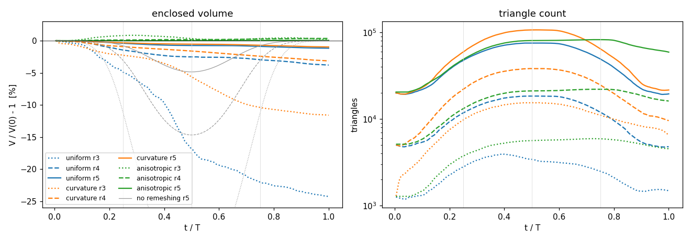

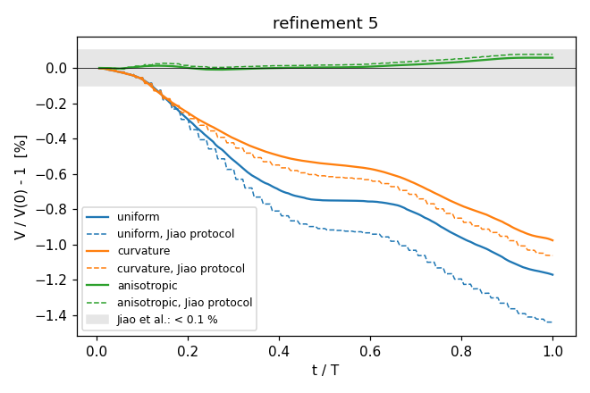

The intermediate values of the no-remeshing run are not losses. They are the chord error
of a mesh whose triangles have been stretched far beyond the curvature, and they vanish
at T. The remeshed runs lose volume steadily, with no recovery.

## 2. Accuracy and smoothness

### At t = T/2

| mode | refine | triangles | d_rms [% R0] | d_mean [% R0] | normal err. RMS [°] | E_H | N_H | E_H on projected mesh |
|---|---|---|---|---|---|---|---|---|
| uniform | 3 | 3495 | 2.940 | -0.169 | 27.50 | 1.61 ± 0.44 | 0.83 ± 0.36 | 1.486 |
| uniform | 4 | 18381 | 0.546 | -0.132 | 7.16 | 0.92 ± 0.03 | 0.62 ± 0.02 | 0.829 |
| uniform | 5 | 75315 | 0.134 | -0.047 | 2.70 | 0.56 ± 0.01 | 0.44 ± 0.01 | 0.460 |
| curvature | 3 | 15422 | 1.380 | -0.476 | 7.18 | 1.10 ± 0.12 | 0.25 ± 0.22 | 1.830 |
| curvature | 4 | 38202 | 0.297 | -0.135 | 2.38 | 0.73 ± 0.01 | 0.54 ± 0.00 | 0.574 |
| curvature | 5 | 106778 | 0.087 | -0.042 | 1.30 | 0.46 ± 0.01 | 0.47 ± 0.01 | 0.208 |
| anisotropic | 3 | 5698 | 1.375 | +0.120 | 11.89 | 0.95 ± 0.03 | 0.63 ± 0.03 | 0.817 |
| anisotropic | 4 | 21138 | 0.114 | +0.024 | 3.18 | 0.53 ± 0.02 | 0.41 ± 0.01 | 0.408 |
| anisotropic | 5 | 80602 | 0.020 | +0.004 | 1.11 | 0.30 ± 0.01 | 0.28 ± 0.00 | 0.216 |

At T/2 the projected-mesh error is close to the full one, so the curvature error at
maximum deformation is resolution: the sheet's rim is curved more tightly than any of the
meshes resolve. The anisotropic and curvature meshes resolve it best.

### At t = T

| mode | refine | triangles | d_rms [% R0] | d_mean [% R0] | normal err. RMS [°] | E_H | N_H | E_H on projected mesh |
|---|---|---|---|---|---|---|---|---|
| uniform | 3 | 1486 | 26.683 | -15.940 | 52.43 | 1.53 ± 0.07 | 1.43 ± 0.10 | 2.669 |
| uniform | 4 | 4818 | 2.167 | -1.314 | 8.51 | 1.61 ± 0.20 | 1.78 ± 0.19 | 0.017 |
| uniform | 5 | 19561 | 0.629 | -0.390 | 3.00 | 1.29 ± 0.06 | 1.51 ± 0.07 | 0.002 |
| curvature | 3 | 6668 | 11.403 | -5.528 | 30.28 | 3.75 ± 0.14 | 3.01 ± 0.12 | 0.725 |
| curvature | 4 | 9610 | 1.967 | -1.076 | 7.70 | 2.72 ± 0.14 | 2.57 ± 0.18 | 0.005 |
| curvature | 5 | 21906 | 0.542 | -0.323 | 2.52 | 1.44 ± 0.14 | 1.58 ± 0.13 | 0.002 |
| anisotropic | 3 | 4562 | 8.141 | +1.054 | 30.39 | 6.81 ± 2.49 | 5.48 ± 0.06 | 0.961 |
| anisotropic | 4 | 16145 | 0.673 | +0.088 | 9.88 | 5.92 ± 0.15 | 6.86 ± 0.14 | 0.134 |
| anisotropic | 5 | 59259 | 0.076 | +0.009 | 4.63 | 7.08 ± 0.12 | 8.48 ± 0.15 | 0.041 |

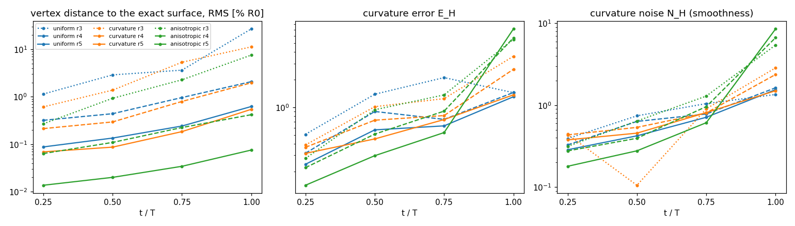

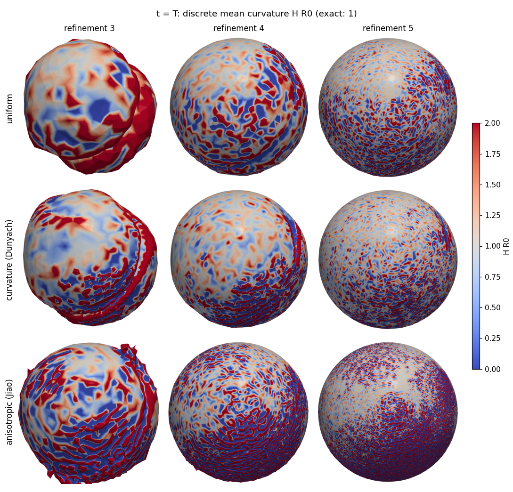

The curvature maps at T make finding 3 visible:

- uniform and curvature sizing return a sphere with fine-grained curvature noise;
- the anisotropic mode returns one that is geometrically closest to the sphere, but
  carries striped noise over the region that contracted most.

On the projected meshes, E_H at T is 0.002 for uniform and curvature sizing at refinement
5 and 0.04 for anisotropic. So the triangulations themselves are fine, and the noise is
vertex-scale roughness.

## 3. The meshes at T/4, T/2, 3T/4 and T

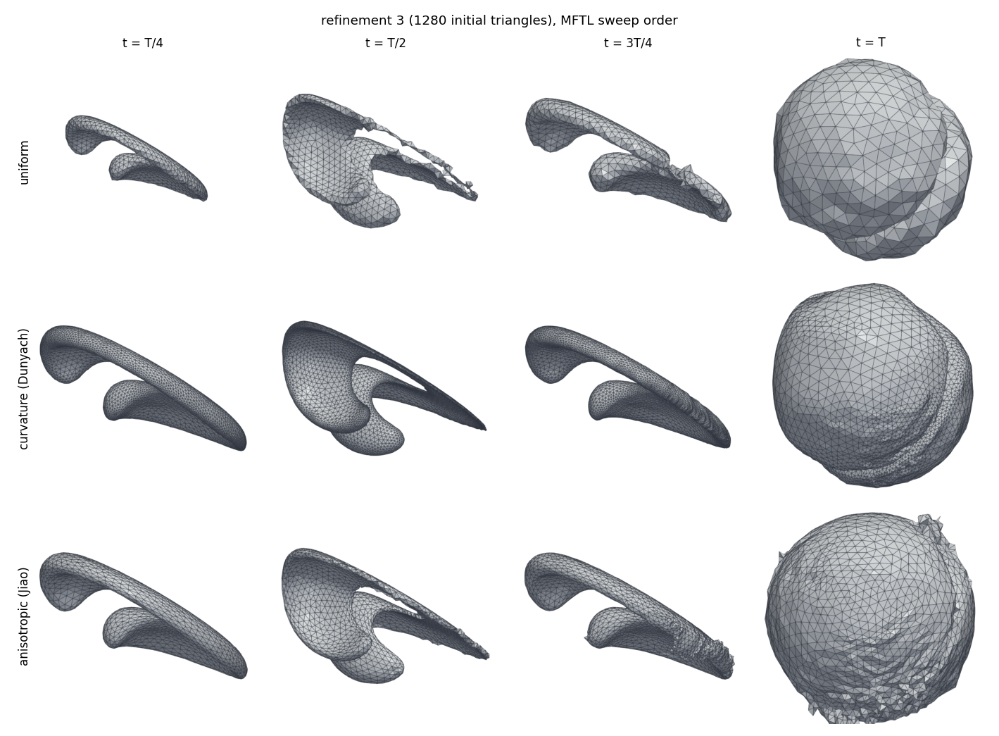

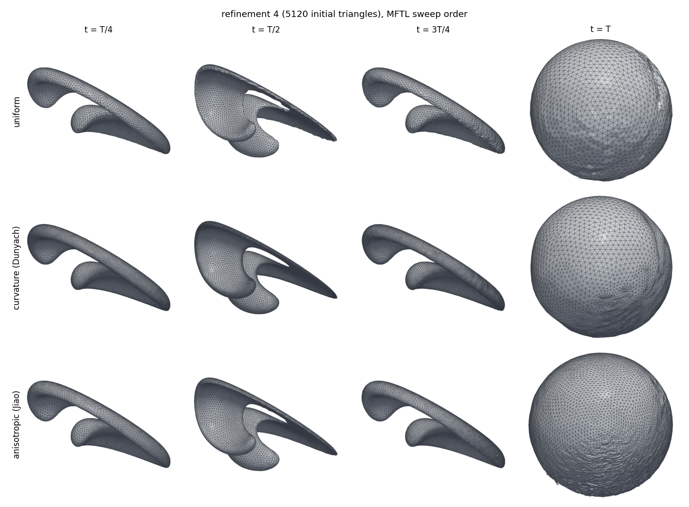

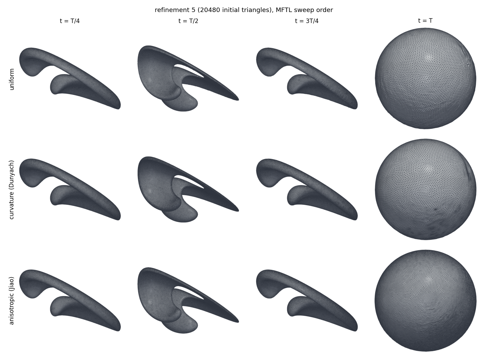

At T/2, where the exact curvature is largest, the three triangulations differ:

- uniform sizing cuts across the sheet's rim with equilateral triangles of the start size;
- curvature sizing refines the rim;
- anisotropic sizing stretches its triangles along it.

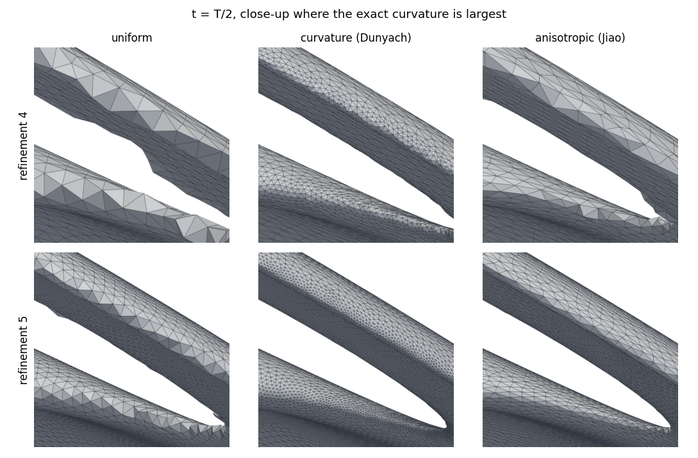

## 4. Mesh quality and cost

| mode | refine | peak triangles | triangles at T | min q (worst of T/4..T) | mean q at T | faces against the exact normal (max over T/4..T) | ms/step |
|---|---|---|---|---|---|---|---|
| uniform | 3 | 3905 | 1486 | 0.083 | 0.980 | 219.2 | 4 |
| uniform | 4 | 18386 | 4818 | 0.639 | 0.977 | 14.5 | 18 |
| uniform | 5 | 75320 | 19561 | 0.653 | 0.975 | 0.0 | 78 |
| curvature | 3 | 15491 | 6668 | 0.517 | 0.969 | 538.2 | 19 |
| curvature | 4 | 38348 | 9610 | 0.528 | 0.973 | 0.0 | 41 |
| curvature | 5 | 106982 | 21906 | 0.544 | 0.974 | 0.0 | 114 |
| anisotropic | 3 | 6112 | 4562 | 0.118 | 0.907 | 208.0 | 25 |
| anisotropic | 4 | 22032 | 16145 | 0.295 | 0.892 | 23.8 | 91 |
| anisotropic | 5 | 82594 | 59259 | 0.313 | 0.911 | 0.0 | 338 |

The ms/step column comes from a separate pass in which each configuration ran alone,
best of 2, without snapshots. At refinements 4 and 5 the anisotropic mode is 4–5 times
as expensive as uniform sizing. Part of that is the 3 times larger mesh it
returns with, part the per-face eigen-decompositions. Its lower mean quality is the
mean-ratio quality of triangles stretched on purpose, not a defect.

## 5. Sweep order and length-sorted sweeps (refinement 4)

Both alternatives were removed from the library after this study (see section 7).

| mode | order | V/V(0) - 1 at T/2 [%] | V/V(0) - 1 at T [%] | d_rms at T [% R0] | E_H at T | N_H at T | min q | triangles at T/2 / T | ms/step |
|---|---|---|---|---|---|---|---|---|---|
| uniform | MFTL (default) | -2.64 ± 0.10 | -3.90 ± 0.14 | 2.17 | 1.61 ± 0.20 | 1.78 ± 0.19 | 0.639 | 18381 / 4818 | 18 |
| uniform | MFTL, length-sorted | -2.57 ± 0.03 | -3.79 ± 0.06 | 2.12 | 1.58 ± 0.09 | 1.75 ± 0.06 | 0.715 | 18400 / 4833 | 18 |
| uniform | Jiao | -4.25 ± 0.51 | -9.46 ± 1.10 | 16.52 | 3.03 ± 0.35 | 2.51 ± 0.14 | 0.295 | 17892 / 5712 | 33 |
| uniform | Jiao, length-sorted | -4.61 ± 0.66 | -10.33 ± 1.47 | 20.83 | 3.17 ± 0.63 | 2.56 ± 0.23 | 0.102 | 17696 / 6055 | 32 |
| uniform | MFTL, 2 smoothing sweeps | -3.01 ± 0.14 | -4.54 ± 0.17 | 2.54 | 1.72 ± 0.12 | 1.86 ± 0.11 | 0.710 | 18344 / 4842 | 17 |
| uniform | Jiao, 2 x 1 smoothing sweeps | -4.88 ± 0.42 | -9.97 ± 0.95 | 12.07 | 2.85 ± 0.13 | 2.46 ± 0.07 | 0.212 | 18092 / 5368 | 27 |
| curvature | MFTL (default) | -1.62 ± 0.02 | -3.15 ± 0.02 | 1.97 | 2.72 ± 0.14 | 2.57 ± 0.18 | 0.528 | 38202 / 9610 | 41 |
| curvature | MFTL, length-sorted | -1.56 ± 0.03 | -3.00 ± 0.04 | 1.86 | 3.07 ± 0.24 | 2.94 ± 0.21 | 0.582 | 38301 / 9880 | 41 |
| curvature | Jiao | -2.19 ± 0.08 | -5.16 ± 0.13 | 3.61 | 3.95 ± 0.14 | 3.35 ± 0.09 | 0.422 | 40529 / 12605 | 79 |
| curvature | Jiao, length-sorted | -2.03 ± 0.03 | -4.52 ± 0.06 | 3.06 | 4.49 ± 0.12 | 4.11 ± 0.09 | 0.531 | 40402 / 13449 | 79 |
| curvature | MFTL, 2 smoothing sweeps | -1.76 ± 0.03 | -3.35 ± 0.05 | 2.04 | 2.85 ± 0.31 | 2.71 ± 0.32 | 0.482 | 38164 / 9831 | 39 |
| curvature | Jiao, 2 x 1 smoothing sweeps | -2.45 ± 0.05 | -5.27 ± 0.08 | 3.27 | 3.69 ± 0.18 | 3.17 ± 0.19 | 0.123 | 39759 / 11724 | 64 |
| anisotropic | MFTL (default) | +0.16 ± 0.01 | +0.33 ± 0.01 | 0.67 | 5.92 ± 0.15 | 6.86 ± 0.14 | 0.295 | 21138 / 16145 | 91 |
| anisotropic | MFTL, length-sorted | +0.16 ± 0.01 | +0.33 ± 0.01 | 0.45 | 5.95 ± 0.11 | 6.91 ± 0.12 | 0.313 | 21089 / 16202 | 90 |
| anisotropic | Jiao | +0.27 ± 0.02 | +0.52 ± 0.03 | 0.69 | 6.42 ± 0.13 | 7.31 ± 0.21 | 0.290 | 21418 / 17858 | 183 |
| anisotropic | Jiao, length-sorted | +0.27 ± 0.01 | +0.52 ± 0.02 | 0.65 | 6.51 ± 0.03 | 7.46 ± 0.11 | 0.321 | 21346 / 17764 | 184 |
| anisotropic | MFTL, 2 smoothing sweeps | +0.15 ± 0.01 | +0.31 ± 0.01 | 0.48 | 5.96 ± 0.11 | 6.97 ± 0.04 | 0.322 | 21452 / 16082 | 79 |
| anisotropic | Jiao, 2 x 1 smoothing sweeps | +0.17 ± 0.01 | +0.37 ± 0.02 | 0.46 | 6.14 ± 0.15 | 7.08 ± 0.16 | 0.301 | 21730 / 17080 | 135 |

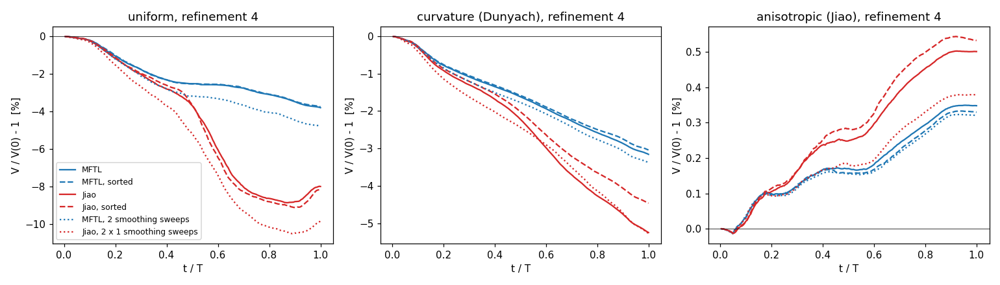

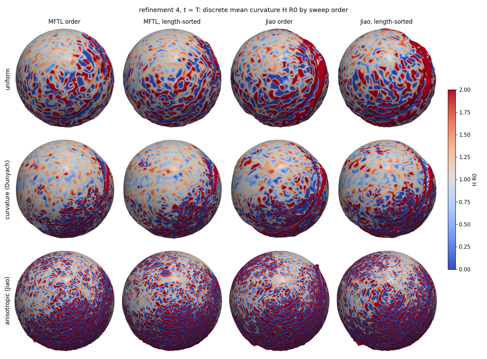

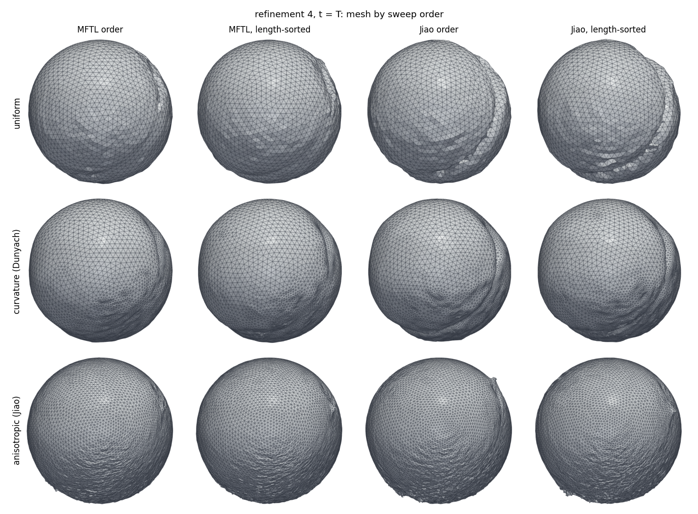

**What Jiao's order does to the volume.** In the uniform mode the extra loss accrues
mostly between t ≈ 0.45 T and 0.7 T, at maximum stretching and the start of
contraction. The obvious difference there is that Jiao's order smooths the freshly
advected mesh before repairing it. This is a likely mechanism, not a measured one.

**What sorting does.** It is significant only for curvature sizing, where it saves a
little volume and costs a little smoothness.

## 6. Jiao et al.'s protocol and their numbers

Jiao et al. adapt fully every 4 steps, in their order with sorted sweeps, smooth every
step and add a denoising term in the second half. These runs use the first three of
those, without the denoising. The protocol rows are single runs; the every-step rows are
means over the four replicas:

| mode | protocol | V/V(0) - 1 at T/2 [%] | V/V(0) - 1 at T [%] | d_rms at T [% R0] | E_H at T | N_H at T | triangles at T | ms/step |
|---|---|---|---|---|---|---|---|---|
| uniform | every step, MFTL order | -0.750 | -1.175 | 0.629 | 1.29 | 1.51 | 19561 | 78 |
| uniform | Jiao's protocol | -0.911 | -1.441 | 0.770 | 1.62 | 1.90 | 20410 | 48 |
| curvature | every step, MFTL order | -0.542 | -0.969 | 0.542 | 1.44 | 1.58 | 21906 | 114 |
| curvature | Jiao's protocol | -0.612 | -1.064 | 0.609 | 3.07 | 3.32 | 28892 | 71 |
| anisotropic | every step, MFTL order | +0.003 | +0.058 | 0.076 | 7.08 | 8.48 | 59259 | 338 |
| anisotropic | Jiao's protocol | +0.016 | +0.077 | 0.090 | 8.19 | 9.92 | 60018 | 211 |

| | Jiao et al. (§6.2.2) | anisotropic, refinement 5 |
|---|---|---|
| initial triangles | 46 472 | 20 480 |
| area at T/2 | ×4.12 | ×4.12 |
| triangles at T/2 | ×4.2 (197 292) | ×3.9 (80 434) |
| volume error at T | < 0.1 % | +0.06 % (every step), +0.08 % (their protocol) |
| area error at T | < 0.1 % | +0.36 % (every step) |

## 7. Follow-up: where the anisotropic mode's accuracy comes from, and back-projection

These runs ask three questions:

- Why does the anisotropic mode hold volume and position so well?
- Is any part of it worth keeping?
- What does projecting the smoothed vertices back onto the surface do, in uniform and curvature sizing?

Every run below also logs the enclosed-volume change of each sweep. The volume budget, the projections and the Delaunay flips are experiments, not library features: they are in `followup_experiment.patch`, driven by `followup.py`. QEM placement was the library's own `qem_placement` (removed since, with the anisotropic mode; see section 8). At refinement 4 each value is the mean ± sd over the run and its three rotated replicas. At refinement 5 it is one run, except the plain modes, which have four.

**Volume budget over the period**, in % of V(0). Advection adds −0.01 to −0.1 in every run and is included in the total.

| variant | r | split | collapse | flip | smooth | total |
|---|---|---|---|---|---|---|
| uniform | 4 | 0.00 | −2.74 | −1.18 | +0.17 | −3.80 |
| curvature | 4 | 0.00 | −1.96 | −1.25 | +0.13 | −3.16 |
| anisotropic | 4 | +0.28 | −0.02 | +0.06 | +0.10 | +0.35 |
| anisotropic, QEM off | 4 | 0.00 | −0.06 | −0.08 | +0.10 | −0.11 |
| uniform + QEM | 4 | +1.44 | −0.29 | −0.41 | +0.17 | +0.86 |
| curvature + QEM | 4 | +1.30 | −0.03 | −0.32 | +0.09 | +0.94 |
| curvature + Delaunay flips | 4 | 0.00 | −1.84 | −0.23 | +0.02 | −2.13 |
| curvature + flat projection | 4 | 0.00 | −2.03 | −1.24 | −9.28 | −12.62 |
| curvature + Phong projection | 4 | 0.00 | −1.75 | −1.12 | +2.83 | −0.09 |
| curvature + Phong midpoints | 4 | +0.61 | −1.07 | −0.83 | +0.12 | −1.23 |
| curvature + local fan projection | 4 | 0.00 | −1.95 | −1.22 | −1.04 | −4.26 |
| curvature + both (local Phong) | 4 | +0.60 | −1.04 | −0.79 | −0.88 | −2.15 |
| uniform + local fan projection | 4 | 0.00 | −2.93 | −1.30 | −2.86 | −7.13 |
| uniform | 5 | 0.00 | −0.83 | −0.38 | +0.04 | −1.17 |
| anisotropic | 5 | +0.06 | 0.00 | −0.02 | +0.03 | +0.06 |

**Accuracy and smoothness at T**

| variant | r | V/V(0) − 1 [%] | d_rms [% R0] | E_H | N_H | E_H at T/2 | triangles |
|---|---|---|---|---|---|---|---|
| uniform | 4 | −3.90 ± 0.14 | 2.17 ± 0.14 | 1.61 ± 0.20 | 1.78 ± 0.19 | 0.92 | 4818 |
| uniform + QEM | 4 | +0.84 ± 0.02 | 0.89 ± 0.04 | 1.99 ± 0.09 | 2.42 ± 0.10 | 0.66 | 4964 |
| uniform + Delaunay flips | 4 | −4.09 ± 0.12 | 2.61 ± 0.11 | 1.51 ± 0.15 | 1.71 ± 0.18 | 0.91 | 4758 |
| uniform + flat projection | 4 | −25.58 ± 0.57 | 13.48 ± 0.71 | 1.63 ± 0.20 | 0.84 ± 0.14 | 1.58 | 4281 |
| uniform + Phong projection | 4 | −1.45 ± 0.02 | 1.39 ± 0.03 | 0.44 ± 0.04 | 0.26 ± 0.04 | 0.80 | 4845 |
| curvature | 4 | −3.15 ± 0.02 | 1.97 ± 0.01 | 2.72 ± 0.14 | 2.57 ± 0.18 | 0.73 | 9610 |
| curvature + QEM | 4 | +0.94 ± 0.00 | 0.66 ± 0.02 | 7.33 ± 0.24 | 7.32 ± 0.19 | 0.44 | 16312 |
| curvature + Delaunay flips | 4 | −2.11 ± 0.02 | 1.35 ± 0.02 | 2.24 ± 0.12 | 2.08 ± 0.10 | 0.60 | 8346 |
| curvature + flat projection | 4 | −12.51 ± 0.09 | 8.20 ± 0.05 | 1.70 ± 0.11 | 0.58 ± 0.05 | 1.01 | 7243 |
| curvature + Phong projection | 4 | **−0.09 ± 0.00** | **0.136 ± 0.001** | **0.15 ± 0.01** | **0.08 ± 0.00** | 0.31 | 5018 |
| curvature + Phong midpoints (no projection) | 4 | −1.23 | 0.830 | 1.08 | 0.96 | 0.45 | 6182 |
| curvature + local fan projection (no stored input) | 4 | −4.26 | 2.395 | 0.82 | 0.27 | 0.67 | 5706 |
| curvature + both (local Phong) | 4 | −2.15 | 1.202 | 0.27 | 0.13 | 0.48 | 5054 |
| uniform + Phong midpoints (no projection) | 4 | −1.70 | 0.996 | 1.07 | 1.24 | 0.73 | 4874 |
| uniform + local fan projection (no stored input) | 4 | −7.13 | 4.016 | 0.77 | 0.42 | 1.17 | 4716 |
| uniform + both (local Phong) | 4 | −4.69 | 2.867 | 0.64 | 0.34 | 1.00 | 4822 |
| anisotropic | 4 | +0.33 ± 0.01 | 0.67 ± 0.48 | 5.92 ± 0.15 | 6.86 ± 0.14 | 0.53 | 16145 |
| anisotropic, QEM off | 4 | −0.12 ± 0.01 | 0.42 ± 0.04 | 5.16 ± 0.18 | 6.00 ± 0.19 | 0.54 | 16306 |
| uniform | 5 | −1.17 ± 0.01 | 0.63 | 1.29 | 1.51 | 0.56 | 19561 |
| uniform + QEM | 5 | +0.36 | 0.24 | 2.05 | 2.53 | 0.45 | 19876 |
| uniform + Delaunay flips | 5 | −0.84 | 0.51 | 1.35 | 1.60 | 0.62 | 19404 |
| uniform + flat projection | 5 | −6.38 | 3.18 | 0.72 | 0.36 | 0.92 | 18974 |
| uniform + Phong projection | 5 | −0.18 | 0.24 | 0.16 | 0.07 | 0.48 | 19730 |
| curvature | 5 | −0.97 ± 0.01 | 0.54 | 1.44 | 1.58 | 0.46 | 21906 |
| curvature + QEM | 5 | +0.30 | 0.19 | 4.90 | 4.85 | 0.43 | 33398 |
| curvature + Delaunay flips | 5 | −0.59 | 0.34 | 1.24 | 1.36 | 0.38 | 21038 |
| curvature + flat projection | 5 | −4.31 | 2.43 | 0.73 | 0.32 | 0.46 | 19872 |
| curvature + Phong projection | 5 | **−0.03** | **0.020** | **0.04** | **0.02** | 0.16 | 19666 |
| curvature + Phong midpoints (no projection) | 5 | −0.42 | 0.238 | 0.52 | 0.60 | 0.24 | 19862 |
| curvature + local fan projection (no stored input) | 5 | −1.30 | 0.691 | 0.32 | 0.21 | 0.34 | 19666 |
| curvature + both (local Phong) | 5 | −0.70 | 0.367 | 0.17 | 0.11 | 0.24 | 19610 |
| uniform + Phong midpoints (no projection) | 5 | −0.53 | 0.291 | 0.72 | 0.86 | 0.45 | 19632 |
| uniform + local fan projection (no stored input) | 5 | −1.74 | 0.959 | 0.36 | 0.23 | 0.64 | 19502 |
| uniform + both (local Phong) | 5 | −1.02 | 0.617 | 0.25 | 0.13 | 0.58 | 19668 |
| anisotropic | 5 | +0.06 ± 0.00 | 0.076 | 7.08 | 8.48 | 0.30 | 59259 |
| anisotropic, QEM off | 5 | −0.04 | 0.092 | 5.93 | 7.02 | 0.29 | 58784 |

1. **The anisotropic mode holds the volume mainly because it hardly collapses.**
   - A stretching flow keeps elongating the triangles, and isotropic sizing undoes that every step: it splits the long edges and collapses the short ones. At refinement 5, uniform sizing makes 93k splits and 94k collapses, 42k of the collapses while the surface is still stretching.
   - On a convex surface, each collapse replaces two surface points by one point on the chord, and each valence flip away from the convex diagonal cuts off a tetrahedron. Those two sweeps are the whole loss; a split at the midpoint changes no volume.
   - The anisotropic mode accepts stretched triangles and makes 12k collapses. Without QEM placement it still ends at −0.11 % (refinement 4) and −0.04 % (refinement 5).
2. **QEM placement is a trade.**
   - In uniform and curvature sizing it lifts new vertices off the chord. That turns the loss into a gain of a few tenths of a percent and halves to thirds the position error.
   - It makes the curvature noise worse, 1.4–3 times, and curvature sizing then refines the noise: 16k triangles at T against 9.6k at refinement 4.
3. **Delaunay flips help curvature sizing on every measure.** These are Jiao's flip under an isotropic metric, or the same test with 3D angles, which measures the same. They need 4.4 times fewer flips. In uniform sizing they are worse at refinement 4 and better at refinement 5.
4. **Projection onto the flat input surface smooths by shrinking.** This is Botsch & Kobbelt's step, with the mesh the remesher was handed as the reference.
   - Every tangential move lands on a chord, and the next step's remesh takes that as its input.
   - The volume error is 4–7 times the unprojected one.
5. **Projection onto the input's Phong surface (α = ½) removes most of both errors.** The Phong surface is built from the input's angle-weighted vertex normals.
   - The smoothing sweep regains what this call's collapses and flips cut off (+2.83 % against −1.75 % and −1.12 %, curvature at refinement 4).
   - Curvature sizing with it beats the anisotropic mode on every measure at a third of its triangles.
   - QEM placement and Delaunay flips add nothing on top of it.
   - Uniform sizing gains less at refinement 4, where the sheet's rim at T/2 is narrower than an edge and the Phong surface is not accurate there.
6. **The reference has to be the call's input; a local patch of the current mesh is not enough.** The local variants are single runs (base orientation). A first version of them was wrong and is superseded: its `MFTL_EXP_PROJECT=3` also built the stored input and projected onto its flat triangles before the local lift (runs kept as `*+localphong-flatpre_r4`).
   - **Phong midpoints alone** (split and collapse place the new vertex on the Phong curve of the edge, from the current vertex normals; no projection) roughly halve the volume loss and lower the noise: curvature −1.23 / −0.42 % and N_H 0.96 / 0.60 at refinement 4 / 5. The split sweep now gains +0.61 % and the collapse loss falls from −1.96 to −1.07 %.
   - **A local projection after smoothing alone** (onto the Phong patch of the vertex's current fan, rebuilt every sweep, no stored input) removes most of the noise, N_H 0.27 / 0.21, and loses MORE volume than no projection: −4.26 / −1.30 %. Its smoothing sweep is a volume sink (−1.04 %; uniform −2.86 %). It reconstructs the surface from the samples it is smoothing, so it acts like a curvature flow and has nothing to restore the call's dents from.
   - **Both together**: −2.15 / −0.70 % and N_H 0.13 / 0.11, against −0.09 / −0.03 % and 0.08 / 0.02 with the stored input.

The experimental projection searches a uniform grid over a copy of the input, and is 20–40 times slower than the plain mode. This says nothing about the cost of a production version. All runs here are the LeVeque flow, with an exact and smooth velocity: noise that enters with an interpolated flow velocity is not addressed by any projection onto the input.

## 8. Reproduction

```bash
python3 build_all.py                          # Release
cd studies/leveque_remeshing
python3 run_campaign.py                       # the base runs (results/leveque_remeshing/runs/), except sections 5-6
python3 run_campaign.py --replicas            # the three rotated replicas of each
python3 evaluate.py                           # exact-reference metrics -> metrics.json
python3 time_runs.py                          # clean timings -> timing.json
python3 make_figures.py                       # figures/ (needs ParaView's pvbatch)
python3 make_tables.py --template REPORT.template.md --report REPORT.md
```

Section 7: on commit `bb3c785`, apply `archive/sizing_with_anisotropic_and_qem.patch` (the
library as it was for this study, with the anisotropic mode and QEM placement), then
`followup_experiment.patch`, build the example in a separate build directory, and run
`python3 followup.py run --exe <that build>/leveque_remeshing_parallel`,
`python3 evaluate.py --out ../../results/leveque_remeshing_followup` and
`python3 followup.py tables`. Without the experiment patch the same tree reproduces the
base runs of sections 1-4 for all three modes.

The scripts and figures are in `studies/leveque_remeshing/`. The raw snapshots, logs and
`metrics.json` are in `results/leveque_remeshing/`, which is not tracked. The example's
options for the study are `-noremesh`, `-snapshots`, `-csv` and `-rotate`.

**Removed after this study.** Because of sections 5 and 6, Jiao's sweep order and the
length-sorted sweeps (`sweep_order`, `sorted_sweeps`, and the example's `-order`,
`-sorted` and `-smoothevery`) were removed from the library; because of section 7, so
were the anisotropic mode and QEM placement (`-sizing anisotropic`, `-qem`). The current
tree runs the uniform and curvature rows only. On commit `bb3c785`,
`archive/sizing_with_anisotropic_and_qem.patch` restores the anisotropic and QEM rows,
and `archive/sweep_orders.patch` on top of it restores `-order`, `-sorted` and
`-smoothevery` for sections 5 and 6 (rebuilt from the session record; three of its runs
were re-run and match the study in every column but the wall clock). See
`archive/README.md`.
